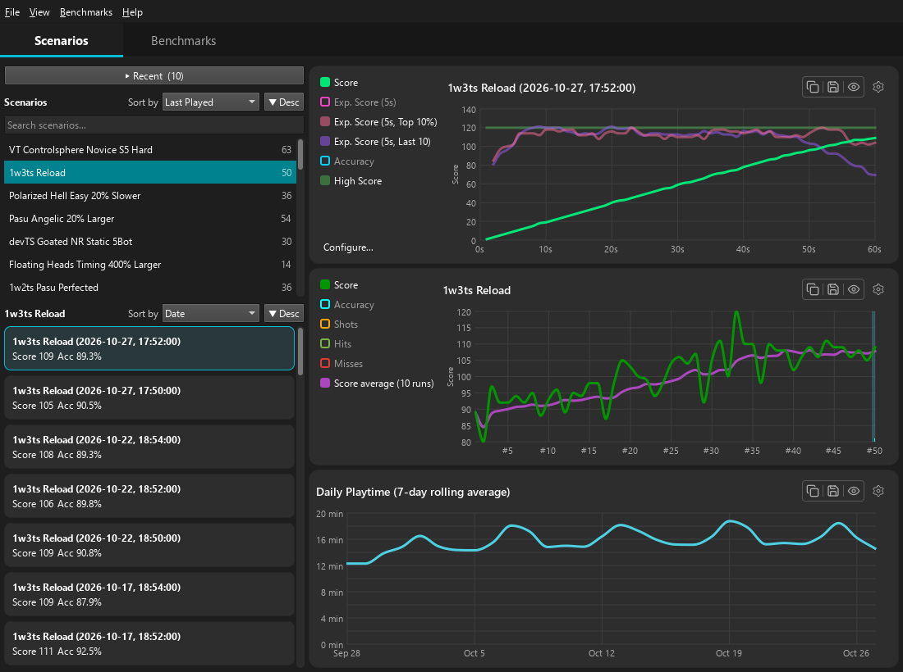
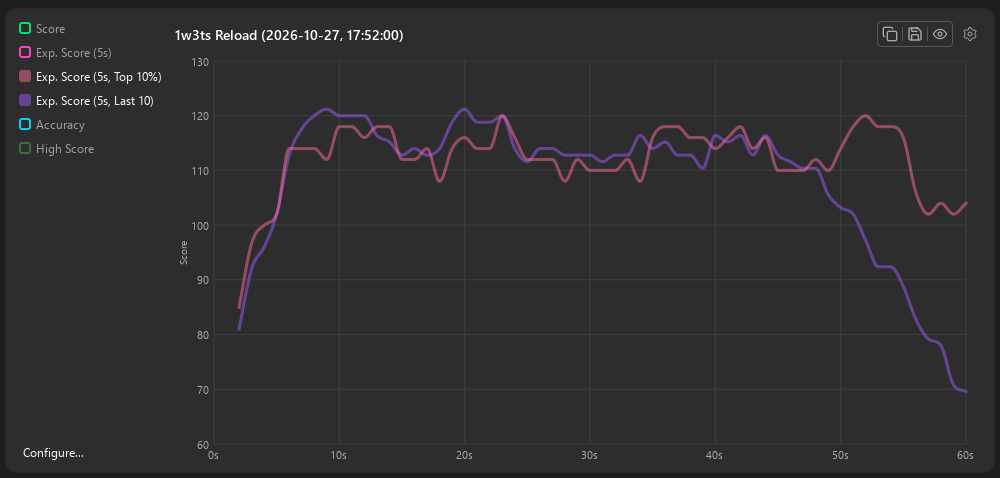
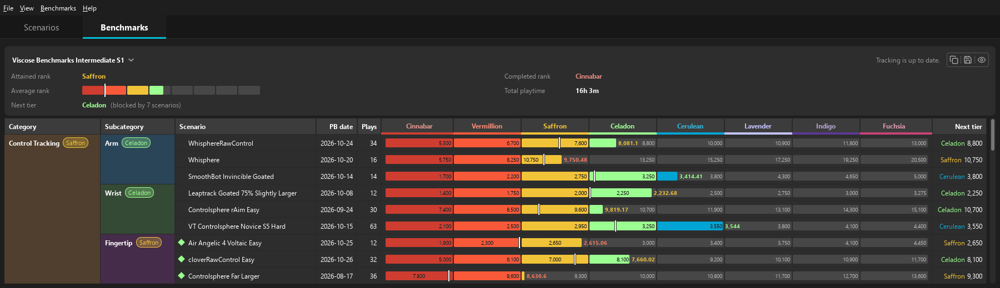

# KovaaK's Statistics Viewer

A data visualisation tool for Kovaaks.

[](https://github.com/Leckatall/KovaaksStatisticsViewer/releases/latest)


[Download for Windows x64](https://github.com/Leckatall/KovaaksStatisticsViewer/releases/latest)



Screenshots use example data.

KovaaK's Statistics Viewer reads your local performance files and stats CSVs, keeps a profile of your imported runs, and turns them into graphs you can configure, export, and share.

## Disclaimer

**This project is not affiliated with or endorsed by KovaaK's or The Meta.**

## Features

### The Run Graph

Similar to what you see in Kovaaks but with additional lines and the option to use arbitrary expressions to create new lines.

It has support for:
- Projections of the final score for scenarios that aren't 1min
- Using the last x seconds to inform the projection.
- Lines that are built on multiple runs (what was my projected final score at time x in my last n [OR top n%] runs?)
- Arbitrary expressions to create new lines. Pretty much anything you could want to plot should be possible. (Please create an issue if you want something that can't currently be represented).

NOTE: Old runs without performance data won't be shown on this graph as only the final data is recorded. 
Old runs are still used for other features in the app.

### Visual customisation

Pretty much every line you see on a graph can be customised. 
Right now there is support on almost every graph for changing a line's:
- Colour (including alpha)
- Width
- Join style

Pretty much every component can be hidden, if desired. Neighbouring components will expand to fill the space.

Benchmark tier, rank, and, category colours are also completely customisable.

### Progression tracking

Within the app you can view:
- Your playtime (calculated only from completed runs) across all scenarios or just those contained in a benchmark. This can also be shown as a rolling average across any window of time you want
- Your score and accuracy history for a scenario (similar to what is already shown in Kovaaks)
- Your average rank[^avg-rank], over time, for a benchmark. This can be shown on either a date or run-based axis and has a graph both for your "personal best" rank and recent average.

[^avg-rank]: This is calculated by assigning each rank a number (e.g. bronze=1, silver=2, gold=3, etc.) 
progress between ranks is then calculated as the progress towards the next tier.
e.g.: if bronze requires a score of 10, and silver requires a score of 20, a score of 15 would be 1.5.

### Image export

Every data visualisation component can be exported at a PNG rendered at a custom resolution.

### Screenshots

Compare the projected scores of your recent runs with your strongest runs to see where they start to fall behind:



See each scenario against your tier thresholds, with markers for the ones holding back your next rank:



## Download

1. Download `KovaaksStatsViewer-<version>-win64.zip` from the [latest release](https://github.com/Leckatall/KovaaksStatisticsViewer/releases/latest).
2. Extract it anywhere.
3. Run `KovaaksStatsViewer.exe`.

The release is not code-signed, so Windows SmartScreen may say *Windows protected your PC*; choose **More info → Run anyway** to launch it.

Using a newer version of the app won't re-write your existing data.

## Getting started

If KovaaK's is in the default Steam location, the app finds it automatically. Otherwise, choose your KovaaK's folder on the welcome screen. This is the `FPSAimTrainer` folder in your Steam library, usually:

```
C:\Program Files (x86)\Steam\steamapps\common\FPSAimTrainer
```

If you use another Steam library, find the folder in Steam: right-click KovaaK's → **Manage → Browse local files**. Choose that install folder, rather than the nested `stats` or `performances` folder. Your existing runs are then imported; a large history can take a moment the first time. You can change the folder later in **Settings → Profile**.

Select a scenario to open its latest run. Click a run in the list or a point on the history graph to inspect an earlier one. In **Benchmarks → Manage Benchmarks**, create a benchmark or import a playlist, then enter or paste the tier thresholds from your benchmark sheet.

Useful shortcuts:

| Shortcut | Action |
|---|---|
| `F5` | Refresh the profile (pick up new runs) |
| `Ctrl+F` | Search scenarios |
| `Ctrl+O` | Open a single `.perf` file |
| `Ctrl+,` | Settings |

## Your data

The app reads your KovaaK's files without changing them. By default, its own data is kept in `%APPDATA%\Lecka\`:

| Path | Contents |
|---|---|
| `KovaaksStatsViewer.ini` | Settings |
| `KovaaksStatsViewer\profile.pb` | Your run history (the location can be changed in Settings → Profile) |
| `KovaaksStatsViewer\benchmarks\` | Your benchmarks |

**Refresh Profile** (`F5`) adds new runs to that history (this should be unnecessary as the profile is refreshed when a new file is added to your performances folder). **Rebuild from Scratch…**, in **Settings → Profile**, replaces it using the files still on disk and drops runs whose source files are gone.

To uninstall, delete the extracted app folder. To remove its data too, delete the paths above and any profile stored in a custom location.

## Building from source

See [BUILDING.md](BUILDING.md) for prerequisites, toolchain setup, tests, packaging, and project structure.

## Help and feedback

[Report a bug or suggest a feature](https://github.com/Leckatall/KovaaksStatisticsViewer/issues).

## Changelog

See [RELEASE_NOTES.md](RELEASE_NOTES.md) for what's new in each version, or [CHANGELOG.md](CHANGELOG.md) for the technical record.

## License

[MIT](LICENSE). Release packages also include Qt 6, licensed under the LGPL v3, and Protocol Buffers, licensed under the BSD 3-Clause License.
