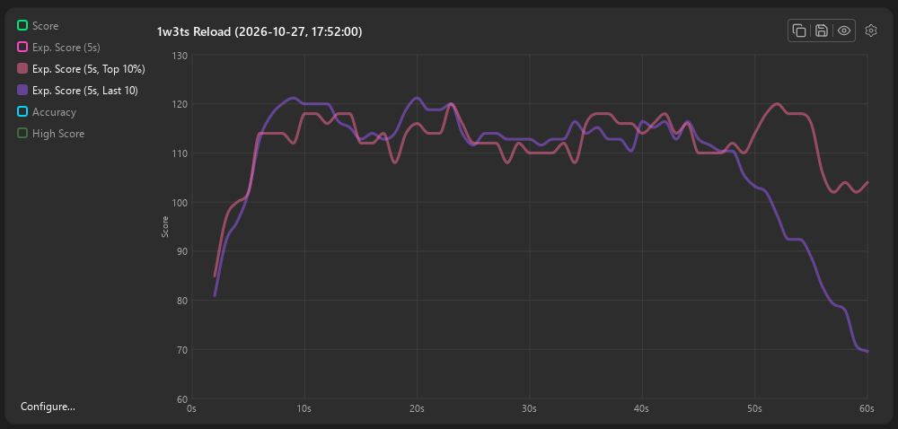
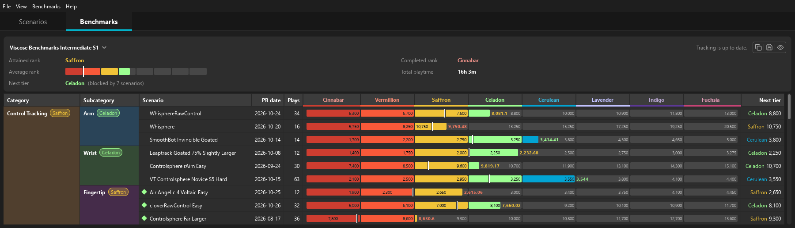

# KovaaK's Statistics Viewer

Inspect your KovaaK's runs second by second, track your progress, and see which scenarios are holding back your benchmark rank.

[](https://github.com/Leckatall/KovaaksStatisticsViewer/releases/latest)


[Download for Windows x64](https://github.com/Leckatall/KovaaksStatisticsViewer/releases/latest)


Screenshots use example data.

KovaaK's Statistics Viewer reads your local performance files and stats CSVs, keeps a profile of your imported runs, and turns them into graphs you can configure, export, and share.

## Disclaimer

This project is not affiliated with or endorsed by KovaaK's or The Meta.

## Features

- **Run graphs**: score and accuracy through a run, with projected final scores compared with your personal best, top runs and recent runs.
- **Scenario history**: every run of a scenario on one graph with a rolling average. Click a point to open that run.
- **Playtime**: how much you're playing over time, averaged over a window you choose.
- **Benchmarks**: create a benchmark or start from a KovaaK's playlist, set its score thresholds, and track your rank, next-tier blockers and rank history.
- **Configurable graph lines**: add, recolour and reorder lines, share axes, and build your own expressions for the comparisons you want.
- **Image export**: copy any graph or benchmark table to the clipboard or save it as a PNG.
- **Automatic import**: new runs appear while the app is open; runs played while it's closed are imported next time you launch it. Older runs with only a stats CSV appear in your history too, without per-second run graphs.

Compare the projected scores of your recent runs with your strongest runs to see where they start to fall behind:



See each scenario against your tier thresholds, with markers for the ones holding back your next rank:



## Download

1. Download `KovaaksStatsViewer-<version>-win64.zip` from the [latest release](https://github.com/Leckatall/KovaaksStatisticsViewer/releases/latest).
2. Extract it anywhere.
3. Run `KovaaksStatsViewer.exe`.

There's no installer and nothing else to install: the zip contains everything the app needs. Requires Windows 10 (1809 or later) or Windows 11, 64-bit.

The release is not code-signed, so Windows SmartScreen may say *Windows protected your PC*; choose **More info → Run anyway** to launch it.

To update, extract the latest zip into a new folder and run it. Your profile, benchmarks and settings are stored separately from the app.

## Getting started

If KovaaK's is in the default Steam location, the app finds it automatically. Otherwise, choose your KovaaK's folder on the welcome screen. This is the `FPSAimTrainer` folder in your Steam library, usually:

```
C:\Program Files (x86)\Steam\steamapps\common\FPSAimTrainer
```

If you use another Steam library, find the folder in Steam: right-click KovaaK's → **Manage → Browse local files**. Choose that install folder, rather than the nested `stats` or `performances` folder. Your existing runs are then imported; a large history can take a moment the first time. You can change the folder later in **Settings → Profile**.

Select a scenario to open its latest run. Click a run in the list or a point on the history graph to inspect an earlier one. In **Benchmarks → Manage Benchmarks**, create a benchmark or import a playlist, then enter or paste the tier thresholds from your benchmark sheet.

Useful shortcuts:

| Shortcut | Action |
|---|---|
| `F5` | Refresh the profile (pick up new runs) |
| `Ctrl+F` | Search scenarios |
| `Ctrl+O` | Open a single `.perf` file |
| `Ctrl+,` | Settings |

## Your data

The app reads your KovaaK's files without changing them. By default, its own data is kept in `%APPDATA%\Lecka\`:

| Path | Contents |
|---|---|
| `KovaaksStatsViewer.ini` | Settings |
| `KovaaksStatsViewer\profile.pb` | Your run history (the location can be changed in Settings → Profile) |
| `KovaaksStatsViewer\benchmarks\` | Your benchmarks |

Back up `profile.pb`: it keeps imported runs even if the original files are later moved or deleted. **Refresh Profile** (`F5`) adds new runs to that history. **Rebuild from Scratch…**, in **Settings → Profile**, replaces it using the files still on disk and drops runs whose source files are gone. Back up your profile before rebuilding, and your benchmarks and settings if you want to keep your setup.

To uninstall, delete the extracted app folder. To remove its data too, delete the paths above and any profile stored in a custom location.

## Building from source

See [BUILDING.md](BUILDING.md) for prerequisites, toolchain setup, tests, packaging, and project structure.

## Help and feedback

[Report a bug or suggest a feature](https://github.com/Leckatall/KovaaksStatisticsViewer/issues).

## Changelog

See [RELEASE_NOTES.md](RELEASE_NOTES.md) for what's new in each version, or [CHANGELOG.md](CHANGELOG.md) for the technical record.

## License

[MIT](LICENSE). Release packages also include Qt 6, licensed under the LGPL v3, and Protocol Buffers, licensed under the BSD 3-Clause License.
