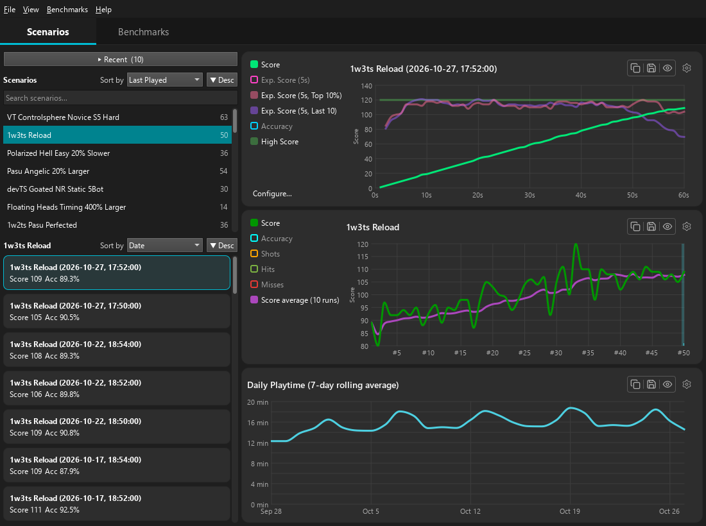

# KovaaK's Statistics Viewer

See every KovaaK's run in detail: how your score built up second by second, how each scenario is trending, how much you're playing, and where you rank in your benchmarks.

[](https://github.com/Leckatall/KovaaksStatisticsViewer/releases/latest)


<!-- TODO: add a screenshot of the Scenarios tab, e.g. docs/images/scenarios.png -->


KovaaK's saves a performance file for every run you play, but only shows you a fraction of it. KovaaK's Statistics Viewer reads those files, keeps a profile of all your runs, and turns them into graphs you can configure, export, and share.

## Disclaimer

This project is not affiliated with or endorsed by KovaaK's or The Meta.

## Features

- **Run graphs**: your score and accuracy second by second through a run (kills, hits, and, damage too, if you add them), with your projected final score compared with your high score and recent runs.
- **Scenario history**: every run of a scenario on one graph with a rolling average. Click a point to open that run.
- **Playtime**: how much you've played each scenario over time, averaged over a window you choose.
- **Benchmarks**: build a benchmark and see your rank, the score needed for each tier, which scenarios are holding you back, and how your rank has changed over time.
- **Configurable graph lines**: add, recolour and reorder lines, share axes, and write your own lines as expressions, such as `Final(SCORE)` or your PB pace with `BestRun(...)`.
- **Image export**: copy any graph or benchmark table to the clipboard or save it as a PNG.
- **Automatic import**: runs you play while the app is open, or while it's closed, are picked up on their own. Older runs that only have a stats CSV are imported too.

<!-- TODO: a screenshot of the Benchmarks tab, e.g. docs/images/benchmarks.png -->

## Download

1. Download `KovaaksStatsViewer-<version>-win64.zip` from the [latest release](https://github.com/Leckatall/KovaaksStatisticsViewer/releases/latest).
2. Extract it anywhere.
3. Run `KovaaksStatsViewer.exe`.

There's no installer and nothing else to install: the zip contains everything the app needs. Requires 64-bit Windows.

## Getting started

On first launch the app asks for your KovaaK's folder. This is the `FPSAimTrainer` folder in your Steam library, usually:

```
C:\Program Files (x86)\Steam\steamapps\common\FPSAimTrainer
```

If KovaaK's is in the default Steam location the app finds it on its own. Your existing runs are then imported, which can take a moment the first time if you've played a lot.

Useful shortcuts:

| Shortcut | Action |
|---|---|
| `F5` | Refresh the profile (pick up new runs) |
| `Ctrl+F` | Search scenarios |
| `Ctrl+O` | Open a single `.perf` file |
| `Ctrl+,` | Settings |

## Your data

The app only reads your KovaaK's folder; it never changes anything in it. What it does save is kept in `%APPDATA%\Lecka\`:

| Path | Contents |
|---|---|
| `KovaaksStatsViewer.ini` | Settings |
| `KovaaksStatsViewer\profile.pb` | Your run history (the location can be changed in Settings → Profile) |
| `KovaaksStatsViewer\benchmarks\` | Your benchmarks |

The profile keeps your runs even if KovaaK's later deletes or moves its own files, so back it up if your history matters to you. To uninstall, delete the extracted folder and, if you want to remove your data too, the paths above.

## Building from source

The app is C++20 with Qt 6 / QML, built with CMake and Ninja on Windows using MinGW or MSVC. See [BUILDING.md](BUILDING.md) for the prerequisites, toolchain setup, tests, and packaging.

## Project structure

```
src/
  domain/    Core model (runs, scenarios, benchmarks). No Qt, no I/O.
  data/      Reading .perf and stats files, the profile store
  qt_data/   Qt-backed services: settings, files, playlists, images
  app/       Use cases, and App, which wires everything together
  ui/        View models and the QML interface
tests/       Tests for each layer, plus integration tests against real .perf files
tools/       Developer tools, e.g. a component gallery with QML hot reload
docs/        Architecture description, decision records and feature designs
```

Each layer only depends on the layers below it, through interfaces. See [docs/architecture/](docs/architecture/README.md) for the full description and the decisions behind it.

## Changelog

See [RELEASE_NOTES.md](RELEASE_NOTES.md) for what's new in each version, or [CHANGELOG.md](CHANGELOG.md) for the technical record.

## License

[MIT](LICENSE). Release packages also include Qt, licensed under the LGPL v3, and Protocol Buffers, licensed under the BSD 3-Clause License.
