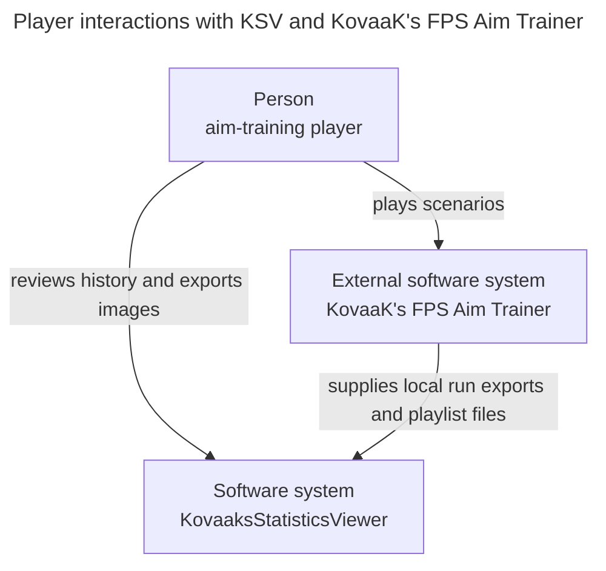
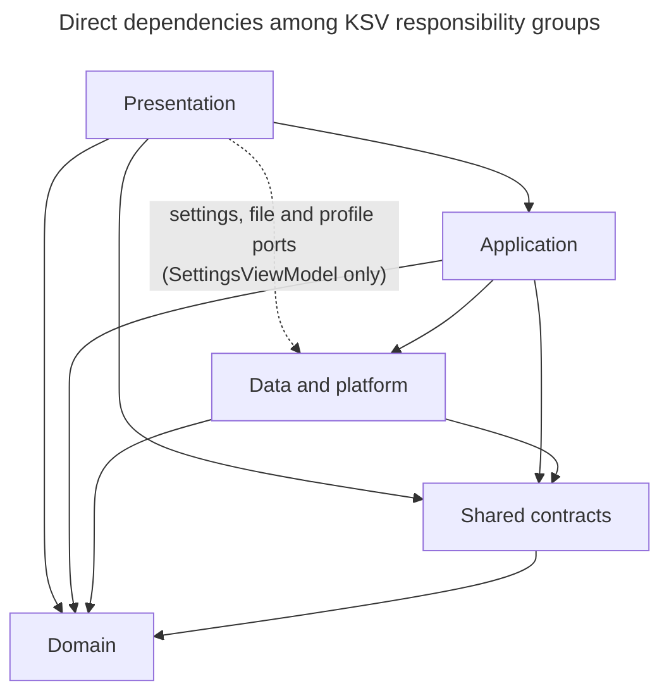

# KovaaksStatisticsViewer Architecture

Documented version: v1.0.0

## Purpose, audience, and scope

KovaaksStatisticsViewer (KSV) is a Windows desktop application that imports local exports from KovaaK's FPS Aim Trainer. It presents scenario history, per-run performance series, playtime, and benchmark progress. Players can configure graphs and export any graph or the benchmark table as an image.

This description is for maintainers and contributors deciding where a change belongs and what it must preserve: layer boundaries, the import and persistence model, data compatibility, the QML/C++ boundary, threading, packaging, and testability.

The scope is the shipped `ksv` process, its local files, and the build that produces it. Development-only tools and tests appear only where they explain a quality control or a build constraint.

## System context

For maintainers orienting to KSV, this system-context diagram shows the aim-training player, KovaaK's FPS Aim Trainer, and KSV. The player uses both applications, and KSV reads the local files KovaaK's writes.

**Type:** system context. **Scope:** the shipped KSV software system as one box, with the person and the external software system that interact with it directly. **Concern:** people and external software-system interactions only.

No key is needed: the boxes identify their types and the labelled arrows name distinct interactions.

KSV reads local exports from the configured KovaaK's installations (`.perf` run files and stats `.csv` files under each install root's `FPSAimTrainer/performances` and `FPSAimTrainer/stats` folders) and a playlist file the player selects when seeding a benchmark. Image export writes to the operating-system clipboard through Qt or to a PNG path the player selects. KSV uses no network service. KovaaK's is the only external software system. Evidence: [`FileService`](../../src/qt_data/file_service.cpp), [`PlaylistReader`](../../src/qt_data/playlist_reader.cpp), [`QtClipboardImageWriter`](../../src/qt_data/qt_clipboard_image_writer.cpp).

KSV owns everything it derives from the exports in local stores; [Owned data](#owned-data) lists them, [Run history data][run-history-data] covers the source-based Rebuild and migration enrichment that still read the exports, and [Benchmark definitions][benchmark-definitions] covers the definition files, which are their own recovery source and accept external edits on refresh. Evidence: [`FileService`](../../src/qt_data/file_service.cpp), [`PlaylistReader`](../../src/qt_data/playlist_reader.cpp), [`QtClipboardImageWriter`](../../src/qt_data/qt_clipboard_image_writer.cpp), [`App::App`](../../src/app/app.cpp).

## Architectural strategy and constraints

QML requests usually pass through presentation view models and application use cases or `SessionController` to data services and Qt adapters. The domain (`src/domain`) provides run identity, the `UserProfile` index and aggregates, and benchmark modelling and evaluation in plain C++. It has no Qt or persistence I/O; `UserProfile::addRun` does write duplicate-run diagnostics to `std::cerr` ([`user_profile.cpp`](../../src/domain/user_profile.cpp)). [Building blocks](#building-blocks) shows the direct dependencies that cross these boundaries. Application rules that several layers share — graph configuration and its validation, the expression domain-specific language (DSL), Graph Lines editing, range resolution — live in the Qt-free `ksv_contracts` library alongside the use-case interfaces ([ADR 0001](decisions/0001-application-interface-and-implementation-placement.md)).

There is no dependency-injection framework. [`App::App()`](../../src/app/app.cpp) is the single production composition root. It assembles services, use cases and view models, primarily through `shared_ptr<I…>` interfaces. Its injected constructor accepts eight dependencies, and it supplies nine view models to QML. [Composition root][composition-root] explains which subscribers must exist before the first profile load.

Change propagation uses two mechanisms, chosen by interface rather than by whether the implementation is a `QObject`. Service and use-case interfaces register `std::function` callbacks (profile, graph configuration, benchmark library, settings, file arrivals, day rollover), even where the implementation, such as `FileService` or `SettingsService`, is a `QObject`; `ISessionController` and the view-model layer use Qt signals. The two channels fire in different orders during a profile import, which is a constraint for anyone adding a subscriber; [Composition root][composition-root] owns the registrations and their order.

Work leaves the GUI thread in exactly three places: profile imports run on the profile import thread (`SessionController`'s `m_build_thread` with a `ProfileBuildWorker`), capture rendering on a one-thread render pool, and PNG writing on a one-thread save pool. Each worker receives an owned value payload and returns its result to the GUI thread through a queued call. The GUI thread decides whether to accept an import candidate or a render result; PNG completion only reports a write that has already been attempted ([`ImageOutputUseCase::savePng`](../../src/app/usecases/image_output_use_case.cpp)). [Profile lifecycle][profile-lifecycle] owns the import hand-off and its acceptance gate; [Image capture][image-capture] owns capture's guarded contexts, cancellation, session and generation matching, and single-flight output; [Composition root][composition-root] owns what the process waits for at exit and the teardown of all three workers, imports included.

The layer rule is a convention enforced at injected interface boundaries, not by the build. Every target sees the whole `src/` tree through a global include path, `ksv_contracts` and `src/data/interfaces` include each other's headers, and the composition root's library links the UI library. [Build and deployment][build-and-deployment] owns the physical picture and what does and does not catch a violation.

## Building blocks

For maintainers deciding where a change belongs, this dependency diagram shows how presentation reaches application behavior and how application and data code use the domain and shared contracts.

**Type:** top-level building-block dependency. **Scope:** the five responsibility groups that together make up the shipped process, each grouping classes and targets by responsibility, and every direct use between them. **Concern:** principal "uses" relationships, not target links, ownership, or individual calls.

**Key**

- Unlabelled solid arrow: uses, from the consumer to the capability it uses
- Dashed arrow: direct use of a data-layer port that bypasses the application group

| Responsibility group | Responsibility |
|---|---|
| Presentation | QML, view models, graph canvas and capture. |
| Application | Composition root, use cases and `SessionController`. |
| Data and platform | Import, persistence, benchmark and graph-configuration services, and Qt adapters. |
| Shared contracts | Use-case interfaces, graph configuration and the expression DSL. |
| Domain | Run identity, profile, benchmark model and evaluation. |

The presentation-to-domain arrow is direct use of value types such as scenario and run identifiers and benchmark rank points. `SettingsViewModel` takes `ISettingsService`, `IFileService`, and `IProfileService` directly, the remaining bypass recorded as debt in [ADR 0004](decisions/0004-route-view-model-interactions-through-use-cases.md). [Composition root][composition-root] compares the direct dependencies of the settings, session and capture view models. Evidence: [`settings_vm.h`](../../src/ui/presentation/app/settings_vm.h), [`App::App`](../../src/app/app.cpp).

The build links the static libraries below into the `ksv` executable. [Build and deployment][build-and-deployment] describes their build dependencies.

| Target | Responsibility |
|---|---|
| `ksv_domain` | Qt-free run, profile, and benchmark model and calculations. |
| `ksv_contracts` | Qt-free use-case interfaces, transport types, and shared application rules (graph configuration, expression DSL, series editing, range projection, raster images). |
| `ksv_data` | Profile import and persistence, benchmark library service, graph-configuration service, `.perf` and CSV decoding; uses Protocol Buffers. |
| `ksv_qt_data` | Qt adapters: file watching and scanning, `QSettings`, graph-configuration persistence, benchmark JSON store, playlist reader, day source, clipboard and PNG writers. |
| `ksv_ui` | Static QML module, view models, graph canvas and painters, capture pipeline. |
| `ksv_app` | Use cases, `SessionController` and its import worker, and the `App` composition root (which is why it links `ksv_ui`). |
| `ksv` | Entry point: process-wide Qt settings, QML type registration, and the event loop. |

## Owned data

| Store | Owner | Authority and form |
|---|---|---|
| `profile.pb` (default under the application-data location; path configurable) | `ProfileService` via `ProfileSerializer` | The authoritative run history and failed-source ledger, as a versioned Protocol Buffers file. Once a run is accepted, `profile.pb` rather than its source exports is authoritative ([Run history data][run-history-data]). |
| `benchmarks/` directory under the application-data location | `BenchmarksService` via `BenchmarkStore` | One versioned JSON definition per benchmark; the accepted library. |
| `QSettings` (INI) | `SettingsService`, `GraphConfigurationPersistence` | Configured KovaaK's source roots, profile path, recent benchmark IDs, and the versioned graph-configuration JSON document with its quarantined copies. |
| QML-owned `Settings` groups in the same production INI file | `VisualSettingsManager.qml`, `SettingsDialog.qml` | Window geometry, panel and graph visibility, per-series visibility, history-graph choices, settings-dialog placement; unversioned, with key groups disjoint from the C++ ones. |

Each C++ store has one data-layer authority that alone decides what is accepted; where it holds state in memory it reaches storage through an injected port, and `SettingsService` is both authority and adapter ([ADR 0010](decisions/0010-one-data-layer-authority-for-each-body-of-persisted-state.md)). The QML-owned groups have no such authority (see [Known risks and debt](#known-risks-and-debt)).

[Run history data][run-history-data], [Benchmark definitions][benchmark-definitions], [Graph configuration][graph-configuration], and [QML boundary][qml-boundary] own the identity, versioning, and recovery rules of these stores. Evidence: [`App::App`](../../src/app/app.cpp), [`main.cpp`](../../src/main.cpp) (INI format), [`SettingsService`](../../src/qt_data/settings_service.cpp).

## Concerns

### Composition and the QML boundary

[Composition root][composition-root] explains how `App::App()` assembles the object graph, which leaves are injectable, and which ordering rules the assembly depends on — most importantly that `SessionController` must exist before the first profile load, and that anything constructed later must read initial state itself rather than wait for a notification. Consult it before adding a service, a subscriber, or a shutdown-sensitive worker.

[QML boundary][qml-boundary] explains how the nine view models reach QML and its panels, what the static QML module requires for a type to register, which QML components are signal-only, and which UI state QML persists for itself. Consult this view before adding a QML type: registration depends on the generated registrar and on the static linker retaining the type.

### Run history

[Profile lifecycle][profile-lifecycle] explains how stored-profile loads and background imports become accepted history. Consult it before changing import or profile switching: a changed import result must be saved before it is published.

[Run history data][run-history-data] explains what makes two runs the same, how a `.perf` and its stats `.csv` pair into one run, what `profile.pb` stores, and what happens to a store that cannot be read. Consult it before changing identity, pairing, or the stored schema: a Rebuild starts from nothing, so runs whose files have been removed are lost.

[Run selection and rendering][run-selection-and-rendering] explains how the current run is chosen from three entry points and fanned out to the graph, scenario browser, and completion history. Consult it before changing selection transport or current-run notifications: `SessionController::setCurrentRun` is the guarded path for explicit selections, and an accepted import publishes through a second path.

### Graphs

[Graph presentation][graph-presentation] explains the graph view-model family, its axis and series model, and the plain-value scene that both the on-screen canvas and image capture paint. Consult it before changing how a graph is modelled or drawn: the scene must stay free of live objects because capture paints it off the GUI thread.

[Graph configuration][graph-configuration] explains the single validated configuration every graph reads, how it is persisted and migrated, and how quick edits and cancellable settings visits change it. Consult it before adding a graph setting: the persisted document is strictly versioned, and dashboard graphs must never see draft edits.

### Benchmarks

[Benchmarks][benchmarks] explains the benchmark subsystem: definitions owned by a data-layer service over a JSON store, joined to run history by an application use case, edited in presentation, and tracked against the profile. Consult it, and its children, before changing anything that crosses those parts; the accepted library and the editor's working copy are deliberately different objects.

### Image capture

[Image capture][image-capture] explains how a graph or the benchmark table becomes a PNG or clipboard image: a snapshot taken on the GUI thread and rendered on the capture render pool, after which the application use case dispatches the rendered image to the clipboard or PNG writer, both Qt adapters. Consult it before touching capture: the render input must be an owned snapshot, and stale renders are dropped by session and generation.

### Build and deployment

[Build and deployment][build-and-deployment] explains target boundaries, toolchain configuration and what ships. Consult it before changing targets, toolchain keys or packaging: toolchain resolution is implemented twice and the two must change together. KSV builds for Windows with C++20, CMake and Ninja against Qt and vcpkg-provided Protocol Buffers, using MinGW (default) or MSVC; GoogleTest is test-only. Release packaging produces a self-contained win64 ZIP.

## Cross-cutting quality responses

- **Responsiveness:** imports run on the profile import thread and capture rendering and PNG writing on their own one-thread pools ([Profile lifecycle][profile-lifecycle], [Image capture][image-capture]). Substantial work remains on the GUI thread: file listing scans on directory change, capture snapshots, accepting and saving import results, loading the stored profile at startup and on a profile-path change (including migrating and rewriting a version-3 file, see [Run history data][run-history-data]), and decoding a file opened directly. No latency target is established.
- **Consistency:** a single gate accepts import results by token and generation, so results computed against replaced state are discarded ([Profile lifecycle][profile-lifecycle]); capture results are matched by session and generation in the same way ([Image capture][image-capture]).
- **Persistence recoverability:** `profile.pb` and benchmark files are written atomically (temporary file then rename, or `QSaveFile`); unreadable profile and graph-configuration stores are quarantined (the profile rename is best effort; see [Run history data][run-history-data] and [Graph configuration][graph-configuration]), and unreadable or newer benchmark files are left untouched and reported ([Benchmark definitions][benchmark-definitions]).
- **Testability:** `App` takes selected I/O dependencies through an injected constructor so integration tests and the gallery can drive the real object graph with deterministic paths. Use cases depend on interfaces, and per-layer tests use fakes from `tests/support`. [Composition root][composition-root] lists what is injected.
- **Local data ownership:** all history, definitions, and configuration live in local files; nothing is sent anywhere.

## Known risks and debt

- The `.perf` schema has fields whose meaning is unknown; a format change by KovaaK's needs decoder investigation. Stats CSV parsing encodes several game-version-specific layouts.
- KovaaK's folder layout and filename conventions constrain discovery, pairing, and migration enrichment. A layout change can silently hide exports or prevent matching files from pairing. [Run history data][run-history-data] describes the assumptions.
- A Rebuild starts from an empty profile and is always treated as a change, so runs whose source files have been moved or deleted are dropped, and a Rebuild while a configured source root is unavailable saves a history that omits that root's runs (empty if no other input contributes) over `profile.pb` ([Run history data][run-history-data]). The UI warns before a manual Rebuild.
- Shutdown waits for an in-flight import and an in-flight PNG save; neither is cancellable ([Composition root][composition-root]).
- The build does not enforce layer rules: global include visibility permits cross-layer includes, and the current dependencies include mutual headers between `ksv_contracts` and `src/data/interfaces` and a header-only `ksv_ui` dependency on `ISessionController`.
- QML type registration depends on include directories for the generated registrar and, for types nothing else references, on the manual list; omissions fail silently at runtime.
- QML-owned UI settings are unversioned, and the set of graph keys is duplicated between C++ and `GraphCatalog.js`.
- Graph-configuration persistence reports no failure, so the in-memory configuration can move ahead of the stored one, contrary to ADR 0010.
- QML-owned `Settings` groups are persisted state with no data-layer authority, a departure from ADR 0010 ([QML boundary][qml-boundary]).
- Tools are not provisioned and dependency versions are machine-provided and unpinned (there is no vcpkg manifest); [Build and deployment][build-and-deployment] states what the Debug build fingerprint covers.

## Decision and design context

[Decision records](decisions/) hold the rationale for architecturally significant choices; this description states the as-built structure and links them where relevant. Where the implementation and a record disagree, the views say so.

- [Application interface and implementation placement](decisions/0001-application-interface-and-implementation-placement.md): contracts versus use cases.
- [Embedded stable identity for benchmark elements](decisions/0002-embedded-stable-identity-for-benchmark-elements.md): benchmark element identity.
- [Route view-model interactions through use cases](decisions/0004-route-view-model-interactions-through-use-cases.md): view models through use cases.
- [Presentation-owned capture snapshots and application-owned output](decisions/0007-presentation-owned-capture-snapshots-and-application-owned-output.md): captures.
- [No background writes to an entity under edit](decisions/0008-no-background-writes-to-an-entity-under-edit.md): background writes while the benchmark editor is open.
- [Graph configuration is one snapshot](decisions/0009-graph-configuration-is-one-snapshot.md): the unit of graph configuration.
- [One data-layer authority for each body of persisted state](decisions/0010-one-data-layer-authority-for-each-body-of-persisted-state.md): ownership of persisted state, superseding [ADR 0005](decisions/0005-data-owned-benchmark-service-and-presentation-drafts.md) and [ADR 0006](decisions/0006-unified-graph-configuration-and-presentation-drafts.md) (ADR 0005 had superseded [ADR 0003](decisions/0003-profile-independent-benchmark-repository-and-application-owned-state.md)).

## Evidence and limitations

The views were rebuilt on 2026-11-10 from a survey of `src/`, the build files and the scripts, not from earlier versions of this description. Each view's Evidence and limitations section identifies the files inspected and any gaps in its coverage. Claims cite source paths and symbols; thread affinity and destruction order on shutdown are partly inferred from C++ and Qt rules rather than observed at runtime. Test source was used mainly to establish topology, and in some views to confirm behavioural contracts or the substitute-object mechanics of QML tests; it was not run. Several ADRs link files that no longer exist, and ADR 0004's statement of current state is out of date; the views note this where it matters.

<!-- arch-doc:references:start -->
[benchmark-definitions]: views/benchmark-definitions.md
[benchmarks]: views/benchmarks.md
[build-and-deployment]: views/build-and-deployment.md
[composition-root]: views/composition-root.md
[graph-configuration]: views/graph-configuration.md
[graph-presentation]: views/graph-presentation.md
[image-capture]: views/image-capture.md
[profile-lifecycle]: views/profile-lifecycle.md
[qml-boundary]: views/qml-boundary.md
[run-history-data]: views/run-history-data.md
[run-selection-and-rendering]: views/run-selection-and-rendering.md
<!-- arch-doc:references:end -->
