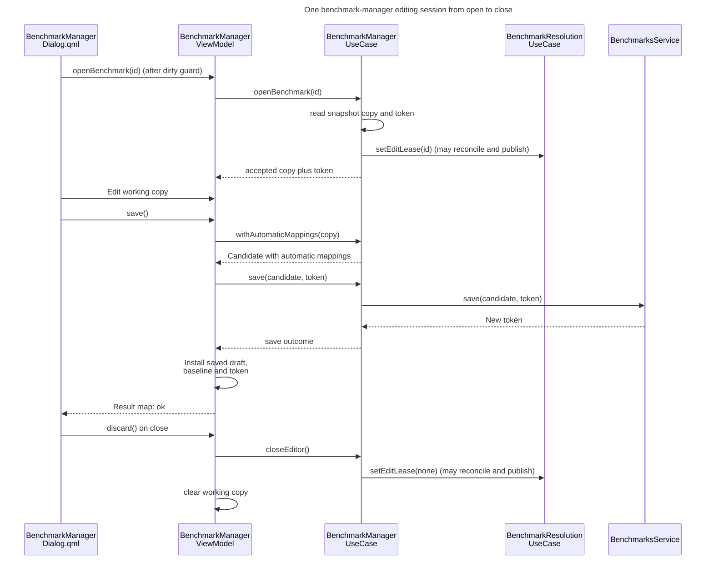

# Benchmark editing

## Concern and scope

How does a manager session preserve unsaved edits and selection through local commands, background writes and external file changes? A maintainer needs it before changing save, close, undo, refresh or the table model.

A session lasts from adopting a new, opened or imported working copy until that copy is discarded, replaced or closed. The component structure is in [Benchmarks][benchmarks]; ID, token and digest semantics are in [Benchmark definitions][benchmark-definitions]; the reconciliation and publication rules, including lease-aware write-back, are in [Benchmark tracking][benchmark-tracking]. Tracking's selector and graphs are not part of this view.

## Architectural account

### Who owns what during a session

| State | Owner | Notes |
|---|---|---|
| Working copy (`m_draft`), accepted baseline (`m_baseline`), admitted token (`m_token`), retained invalid cell text (`m_cellInputs`), undo history (`m_history`), selection anchors | `BenchmarkManagerViewModel` ([`benchmark_manager_vm.h`](../../../src/ui/presentation/benchmarks/manager/benchmark_manager_vm.h)) | Presentation owns every unsaved edit; no application component retains a working copy. A baseline of `nullopt` means a never-saved copy, which is always dirty. |
| Manager's read state: library, revision, resolutions and write failures | `BenchmarkManagerUseCase`, combining service and resolution snapshots ([`benchmark_manager_use_case.cpp`](../../../src/app/usecases/benchmark_manager_use_case.cpp)) | The session reads this state. On each service or resolution notification the use case rebuilds it and publishes only when `sameState` finds a difference; `sameState` compares the rebuilt state's fields, including resolutions. |
| Edit lease | `BenchmarkResolutionUseCase`, set by the manager use case | One optional `BenchmarkId`; `beginNewBenchmark`, `openBenchmark` and `importPlaylistSeed` set it, `closeEditor` clears it. Saving does not clear it. |
| Window, prompts, pending action, status text | `BenchmarkManagerDialog.qml` | Owns the window and prompts and decides when commands run; every change to the draft is a view-model call. |

Commands are `Q_INVOKABLE` methods. Structural edits, import, save and delete return `{ok, error}` maps. `openBenchmark` returns a bool; `beginNewBenchmark`, `discard` and `refresh` return nothing. The dirty guard runs its pending action only after a save reports `ok` ([`benchmark_manager_vm.h`](../../../src/ui/presentation/benchmarks/manager/benchmark_manager_vm.h)). Structural edits run through `domain::BenchmarkEditor` over a copy. All session commands run on the GUI thread.

**Type:** sequence. **Scope:** one session on an existing library entry, from open through an edit, one successful save, and close; edit commands are collapsed into one step and failure outcomes are omitted. **Concern:** the lease brackets the session and only a successful save moves the baseline and token.

**Key**

- Solid arrow, filled head: direct synchronous call
- Dashed arrow, filled head: returned result
- Self-arrow: work inside one component

Commands and persistence are synchronous on the GUI thread. Taking, changing or clearing the lease can reconcile and publish before the command returns, so callbacks can re-enter the view model while the previous draft is still installed (`open` takes its copy and token from the snapshot read before the lease changes; `discard` clears the working copy only after the lease is released).

The continuations that follow native-dialog results (the file and colour dialogs) run later from the event loop.

#### Seeding, edits and save

- **Seeding.** `openBenchmark` copies the accepted benchmark and token. For an unknown ID or a problem entry, the use case returns no seed and the view model reports `false`. `adoptSeed` sets the baseline to the copy (clean). New and imported seeds have no token and no baseline, so they start dirty. Seeding clears undo history, retained input and selection.
- **Edits.** `applySessionEdit` runs the operation on copies of the draft and retained inputs; only a successful edit that changes either is committed as one undo step ([`BenchmarkManagerViewModel::applySessionEdit`](../../../src/ui/presentation/benchmarks/manager/benchmark_manager_vm.cpp)). A rejected multi-step edit leaves the session unchanged. After a commit, `recomputeAfterLocalEdit` repairs the selection anchors and drops retained input for removed cells, revalidates, recomputes dirty and resolves the draft against the current profile through the use case. A draft is dirty if it has no baseline, differs from its baseline or still has retained input.
- **Save.** `save()` works on a candidate in which each cell with retained input stores a missing threshold (the live session keeps the text until the save succeeds), then `withAutomaticMappings` links unique name matches, because the lease suppresses background linking for this benchmark. The use case forwards to `BenchmarksService::save`; a create (no token) additionally calls `RecentBenchmarks::markCreated` on success. On failure the session, retained input and undo history are untouched and the error is mapped to text (`Conflict` and `StaleToken` both ask the user to refresh). On success the view model installs the newly issued token and uses the saved candidate as both draft and baseline, then clears retained input and undo history. The comment in `save()` notes that a publication may re-enter during the call; the saved draft, baseline and token are installed, and retained input and undo history cleared, only after success.

#### Local session behavior

- **Retained input.** Non-blank threshold text that is not a finite number is retained verbatim by (entry, tier) key. The cell displays that text and an error; the typed threshold is missing. Before saving, the dialog lists the values it will normalise ([`BenchmarkManagerDialog.qml`](../../../src/ui/qml/benchmark/BenchmarkManagerDialog.qml)). Blank or whitespace-only text is not retained: it clears the threshold and any retained text for that cell.
- **Undo.** Each step snapshots the draft, retained input, selection and current cell. Undo restores those and deliberately does not rewind baseline, token or library state. When a step recorded no focused cell, undo keeps the present focus and repairs it against the restored definition instead of restoring a cell.

#### Interactions with accepted state

- **Publications during a session.** The view model subscribes to the use case; on a notification it re-resolves the unchanged draft and republishes state. Edits, history and retained input are untouched. `baselineStale` is recomputed from the token against the accepted snapshot: the baseline is stale if the accepted snapshot no longer contains the filename, lists it as a problem entry or records a different digest. A stale session stays fully editable.
- **Refresh.** The library pane's refresh rescans the directory. An open copy is never rebased, and refresh does not update the token: if the accepted file's digest differs from the token's, `baselineStale` is true. Save failures distinguish three conditions:

  | Condition | Save result |
  |---|---|
  | The accepted entry's digest differs from the token's, or the entry is no longer loaded | `StaleToken` |
  | The accepted snapshot no longer lists the filename | `UnknownTarget` |
  | The accepted entry still matches the token, but store preflight finds a differing on-disk digest, including a file deleted since refresh | `Conflict` |

  Staleness is a current comparison: a later refresh that restores the original loaded bytes makes the old token usable again, and reopening takes a new token but discards unsaved edits. Background automatic-mapping failures and scan failures have their own banners in the dialog and library pane.
- **Delete.** The view model deletes using the open token when the ID matches, otherwise the accepted entry's token; problem entries are not deletable. `deleteBenchmark` does not clear the working copy, so deleting the benchmark under edit leaves the draft open and stale when the dialog deletes immediately from a clean session or after a successful Save. The guard's Discard branch clears the draft and releases the lease before invoking delete, so delete then selects the current library token rather than the old session token.
- **Background write-back.** For the leased benchmark, the resolution use case continues deriving resolutions and skips background write-back. Closing the session clears the lease, which reconciles against the latest accepted definition and token and may write automatic mappings then ([Benchmark tracking][benchmark-tracking]).

### The dialog as a window

`BenchmarkManagerDialog` is an `ApplicationWindow` with `Qt.Dialog` flags and `Qt.WindowModal`, instantiated once in `Main.qml` (hidden) and shown by `open()`, which resets status text and pending action ([`BenchmarkManagerDialog.qml`](../../../src/ui/qml/benchmark/BenchmarkManagerDialog.qml), [`Main.qml`](../../../src/ui/qml/Main.qml)). The menu and the workspace Manage action open the dialog; the workspace Edit action calls `openOnEntry`. `openOnEntry` selects the library entry and keeps an already-open draft of the same benchmark instead of reopening it.

Three rules keep unsaved work safe:

- **Commit before command.** `commitActiveEdits()` flushes the table cell editor and the toolbar name field (when focused and different from the draft) into the session without waiting for `editingFinished`. It is called first by `runWhenClean`, `runTableCommand`, `requestSave`, `requestMappingEdit`, the Undo and Paste handlers and `onClosing`. A command that skipped it would act on a draft missing what the user just typed.
- **Dirty guard.** Draft-replacing transitions (New, Open, Import, close, and deleting the benchmark under edit) go through `runWhenClean`: with a clean draft the action runs; otherwise the dialog stores the action in `pendingAction` and the Save/Discard/Cancel prompt opens. Save runs the pending action only if the save succeeded and drops it otherwise; Discard calls `discard()` then runs it; Cancel drops it. A failed save therefore cannot leave a stale action that fires on a later save.
- **Discard on close.** `onClosing` commits edits. If the draft is dirty, the handler vetoes the close and puts `closeWindow` through the dirty guard. Otherwise `closeDraft()` discards any open draft: `discard()` releases the lease and clears the working copy. This close path discards the draft and releases the lease before the dialog is hidden.

### Table model and stable anchors

The view model builds a flat projection of the draft for `BenchmarkTableModel`; the model owns no session state ([`benchmark_table_model.cpp`](../../../src/ui/presentation/benchmarks/manager/benchmark_table_model.cpp)). `setProjection` compares only the identity sequence of rows (entry or empty-group ID) and tiers (tier ID). When the row and tier ID sequences are unchanged, the model emits `dataChanged` for rows whose values differ and `headerDataChanged` when tier values differ, so delegates and focus survive value edits. A model reset occurs whenever that identity sequence changes, which covers adds, removes, moves and reorders; a regroup that preserves the flattened sequence only updates row data.

Selection survives resets because it is addressed by stable IDs, not row numbers: the view model holds `selectedEntryIds`, a list of entry IDs, and a separate `currentCell` map with `entryId`, `tierId` and `columnKind` (plus `emptyGroupId`). On a local edit the view model repairs the anchors before the projection is replaced:

- **Scenario entry.** The selection list keeps only surviving IDs. If the current cell's scenario entry is removed, the cell moves to the scenario now at the old row position, clamped to the last row and keeping its column. It is cleared when no scenario remains.
- **Tier.** A removed tier falls back to the Scenario column.
- **Empty group.** Its anchor is cleared only when the group itself no longer exists. If the group is merely populated, the anchor survives its vanished empty row and the table resolves it to the group's first row.

These rules are implemented by [`restoreSelection`](../../../src/ui/presentation/benchmarks/manager/benchmark_manager_vm.cpp) and [`anchorIndex`](../../../src/ui/qml/benchmark/BenchmarkEditorTable.qml). The view model announces the result in one `selectionChanged`, emitted only when an anchor actually differs.

The table ([`BenchmarkEditorTable.qml`](../../../src/ui/qml/benchmark/BenchmarkEditorTable.qml)) marks `restoringSelection` on `modelAboutToBeReset`, ends any range drag, records rank-header focus, and defers `restoreSessionSelection` with `Qt.callLater` on reset because the selection model clears itself from the same signal in no guaranteed order. The restore rebuilds the visual selection from the manager's anchors without publishing back; `publishSelection` is suppressed while restoring. The view model's anchors are authoritative during reset.

### QML test-double constraint

New dialog code must reach the view model through `vm()`, and a binding over non-observable state must read `sessionRevision`, with a bump on the command path that changes it.

The QML tests substitute a plain JavaScript object for the view model, which QML copies when assigned to a property. `vm()` therefore returns `editorTable.manager`, the same instance the table holds, rather than the dialog's own `benchmarkManagerVm` property ([`BenchmarkManagerDialog.qml`](../../../src/ui/qml/benchmark/BenchmarkManagerDialog.qml), [`tst_BenchmarkManagerDialog.qml`](../../../tests/ui/qml/tst_BenchmarkManagerDialog.qml)). A plain object has no notify signals: selected dialog commands explicitly bump `sessionRevision`, and bindings such as `normalizationIssues` and toolbar undo enablement read it. Real `draftChanged` signals also bump the counter when present. Other paths (refresh, toolbar rename) call the view model directly, and some bindings (current tier, baseline staleness) read without the counter. The table connects to `selectionChanged` only when that signal exists and otherwise relies on model reset.

`BenchmarkMappingPanel` and `BenchmarkGroupCommand` hold no manager reference at all (they emit commands as signals and receive data through a provider function); the toolbar and library pane receive the manager for reading and signal commands back to the dialog; the table reads and edits through its own manager reference.

## Consequences and invariants

- **Unsaved edits are never rebased.** Refresh and background publications change what the draft resolves to and whether it is stale, never the draft. Rebasing onto a new digest would silently merge or overwrite an external edit; the mechanism is the token-versus-snapshot comparison plus the service's digest precondition ([ADR 0010](../decisions/0010-one-data-layer-authority-for-each-body-of-persisted-state.md) records that the authority never rebases a working copy; the code agrees).
- **The lease and the save-time link are a pair.** Because leasing suppresses background linking, `save()` must link (`withAutomaticMappings`); dropping that call would leave a saved entry unlinked until the lease ended.
- **Selection is addressed by ID.** Persisting selection by row number would let a regroup retarget it. The invariant is that a retained-input key never survives its cell (`pruneCellInputs`) and anchors are repaired before the model resets.
- **Every transition that replaces the draft passes the dirty guard, and closing discards.** A new entry point that called `beginNewBenchmark`, `openBenchmark` or `importPlaylist` directly would drop unsaved work, and a close path that skipped `discard()` would leave the lease held.
- **Test doubles shape the QML.** Preserve the access and notification rules under [QML test-double constraint](#qml-test-double-constraint) so the suite's plain-object double remains usable.
- **Deleting a benchmark and closing its draft are separate operations.** `deleteBenchmark` does not touch the session, so deleting the benchmark under edit leaves a stale draft except on the Discard branch, which avoids it only because the dialog discards first. A change that made delete discard the draft would need to do so in the view model, not only the dialog.
- **Relationship to ADRs.** [ADR 0004](../decisions/0004-route-view-model-interactions-through-use-cases.md) lists `BenchmarkManagerViewModel` among the view models that bypass use cases; the code now routes it through `IBenchmarkManagerUseCase`. `adaptState` follows ADR 0010's rule that a working copy is never rebased. The edit lease implements [ADR 0008](../decisions/0008-no-background-writes-to-an-entity-under-edit.md): the resolution use case, which performs the background write, enforces it; derived resolutions continue; `save()` links mappings itself; and closing can write and publish, as the ADR's consequences state.

## Evidence and limitations

Verified by reading `BenchmarkManagerUseCase`, the resolution use case's lease handling, `BenchmarkManagerViewModel` (header; session, seed, save, delete, undo, restoreSelection, projection building and the edit wrappers through the group commands), `BenchmarkTableModel::setProjection` and its header, `BenchmarkManagerDialog.qml` in full, the model-reset, selection and undo parts of `BenchmarkEditorTable.qml`, and the manager-related wiring in `Main.qml`.

Not read in full: most of `BenchmarkEditorTable.qml` (drag, keyboard, paste, cell editing), the toolbar, library pane, mapping panel and group-command QML beyond their manager coupling, the clipboard and cell-input helpers, and the QML test file beyond its introductory comment.

Verification was source-based. Main-window shutdown while the dialog is open or dirty was not examined, and no runtime session was exercised. The diagram was rendered and inspected.

<!-- arch-doc:references:start -->
[benchmark-definitions]: benchmark-definitions.md
[benchmark-tracking]: benchmark-tracking.md
[benchmarks]: benchmarks.md
<!-- arch-doc:references:end -->
