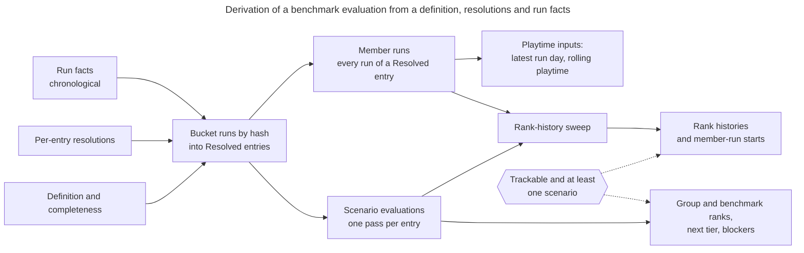

# Benchmark evaluation

## Concern and scope

What does the application derive from a benchmark definition and the profile's runs, and which rules and contracts must hold for those derived values to be correct? The view covers the evaluated value `domain::Benchmark` and the values it owns: per-scenario statistics, group and benchmark ranks, next-tier blockers, the per-run rank histories, the run-start list that indexes them, and the playtime inputs. A maintainer needs it before changing a rank rule, a history, the run facts the evaluation consumes, or anything that reads those results.

The view stops at the domain boundary. When the evaluation is built, how it is cached and which part of it is published are in [Benchmark tracking][benchmark-tracking]. The definition value, its identity and its stored form are in [Benchmark definitions][benchmark-definitions]. The run facts' producer, `UserProfile`, is in [Run history data][run-history-data]. How the histories are windowed and drawn is in [Graph presentation][graph-presentation]. The component structure is in [Benchmarks][benchmarks].

## Architectural account

### What is derived from what

**Type:** data flow. **Scope:** the inputs and outputs of one `domain::Benchmark` construction, shown at the granularity of its derivation stages; accessors and view-model consumers are omitted. **Concern:** the stored outputs are derived by coordinated passes over one ordered run sequence, so the outputs agree with each other.

**Key**

- Solid arrow: supplies input to, from input to output
- Dashed arrow from the hexagon: the stage runs only when the condition holds
- Rectangle: a derivation stage or a value; none is a store
- Hexagon: a condition

The constructor computes the stored evaluation through several passes over the same ordered input: bucketing the runs, evaluating each entry's sequence, visiting the retained member scores, and sweeping for the rank histories ([`Benchmark::Benchmark`](../../../src/domain/benchmarks/benchmark.cpp), `Benchmark::Builder::evaluate`). The stored evaluation is immutable afterwards. The normalised scenario histories and `rollingPlaytime(windowDays)` are computed on demand rather than stored.

`Benchmark` owns its scenario and group evaluation trees. Accessors such as `scenarios()` and `categories()` return pointers into the object, valid until it is destroyed, assigned to or moved from ([`benchmark.h`](../../../src/domain/benchmarks/benchmark.h)).

Run facts with hashes absent from the definition are ignored. An entry with no resolution is treated as `Unresolved`.

### Inputs and what counts as a run

| Input | Role | Contract |
|---|---|---|
| `BenchmarkDefinition` and `CompletenessResult` | Tiers, groups and entries; the entries' `hashes` and thresholds | Completeness gates every overall result (below). |
| `ScenarioResolution` per entry | Match state of each entry | Only `Resolved` entries contribute runs. |
| `RunFact` list | One run's identity, score and length | Must be chronological; the type cannot check it. |

`indexRuns` buckets each run fact into every `Resolved` entry that holds its hash, in input order, producing one run sequence per entry and one list of member runs for the benchmark. A `MappedUnavailable`, `Unresolved`, `Ambiguous` or `AutoMappable` entry therefore has no runs, no statistics and no attained tier, even when its hash appears in the facts. The profile side produces the ordering: [`UserProfile::getRunFacts`](../../../src/domain/user_profile.cpp) de-duplicates the requested scenarios, merges their run lists and sorts by start time with the run index as the tie-break, so the order is total and does not depend on hash-set traversal or on sort stability ([Run history data][run-history-data]).

### Scenario statistics

[`ScenarioEvaluation::fromRuns`](../../../src/domain/scenario_evaluation.cpp) is the single derivation of one scenario's statistics from one chronological run sequence: run count, personal best and the time of the earliest run that set it, the mean of the latest five runs, playtime, the personal-best history and the recent-average history. The current personal best and recent average are read off the last entries of those histories, so the series and the current values agree by construction. Each window mean is re-summed oldest first rather than kept as a running total. It returns nothing for an empty sequence, so `ScenarioBenchmarkEvaluation::stats()` is optional, and `attains` requires that stats exist: an entry that was never played is distinct from one that scored zero even when its first threshold is zero.

A later run replaces the personal best only by strictly beating it, so the earliest run wins a tie. That rule depends on the sequence being oldest first.

`ScenarioBenchmarkEvaluation` adds the ladder and the tier results. [`BenchmarkDefinition::ladderFor`](../../../src/domain/benchmarks/benchmark_definition.cpp) yields one threshold per tier only when every tier has one and they strictly increase; otherwise the entry has no ladder, no attained tier, and a normalised rank of zero. The normalised rank is the number of thresholds reached plus fractional progress toward the next, with a maximum equal to the tier count. Below the first threshold, it is the score divided by that threshold, clamped at zero. Both the personal best and the recent average have a normalised form, as do the two per-run series.

### Completeness gating

Overall results are produced only when `completeness == Trackable` and the definition has at least one scenario. For any other benchmark these stay at their defaults: attained rank, completed rank, average rank, next tier and blockers, group satisfied tiers, both rank histories and the member-run starts. The scenario-level data (match state, statistics, attained tier and normalised rank for entries with a valid ladder), the total playtime and the playtime inputs are still produced. The guard keeps partial thresholds from yielding a plausible-looking rank, and keeps an empty scenario tree from making the mean undefined (`Benchmark::Builder::evaluate`).

### Rank semantics

The rules operate on `Requirement`s ([`benchmark.cpp`](../../../src/domain/benchmarks/benchmark.cpp), `TierRules`): one per subcategory, one for a category with no subcategories, and each Uncategorized scenario on its own. A requirement is met at a tier when any one of its scenarios attains it. A category is satisfied when all its requirements are met.

- **Attained rank:** the highest tier at which every Uncategorized scenario attains it and every category is satisfied.
- **Completed rank:** the highest tier that every entry attains.
- **Average rank:** the mean of every entry's normalised personal-best rank in tree order, unplayed entries included, so the value is zero for a Trackable benchmark with no runs.
- **Group tier:** the same requirement test applied to one category, or to one subcategory alone.
- **Next tier:** the tier above the attained rank, when one exists. `scenariosAtNextTier` counts the scenarios that already attain it.

A category that holds both direct scenarios and subcategories is a `MixedCategoryContent` issue and so Incomplete; the rank logic never sees it.

### Blockers

`RankBlocker` models one unmet requirement, not one scenario below the tier: `{optional<GroupId> group, scenarios}` where each scenario carries the threshold it needs for the next tier and its current best. A group requirement is cleared by any one of its scenarios, so counting scenarios would over-count; an Uncategorized scenario is a requirement with no group and exactly one scenario. Blockers exist only for a Trackable benchmark whose attained rank is below the top tier.

### Histories, member runs and the rank anchor

`averageRankHistory` (personal-best rank) and `recentAverageRankHistory` (recent rank) are indexed by member run rather than day. One sweep builds both histories from the same run facts and hash buckets used to build the entry sequences. An entry's k-th run in the sweep therefore matches its k-th run in the sequence used for its statistics ([`sweepRankHistory`](../../../src/domain/benchmarks/benchmark.cpp)).

Every member run appends a recent-history point. It appends a personal-best-history point only when at least one entry sets a new raw personal best, including a best above the top tier that leaves the mean unchanged.

Each point recomputes the mean over every entry in tree order, starting the sum at zero, just as `averageRank()` does. The last personal-best point therefore equals `averageRank()` bit for bit, and the last recent point equals `recentAverageRank()`. With no member runs, neither history has a point.

`memberRunStarts` holds the start of benchmark run `n` at index `n - 1` and is filled alongside the histories. [`rank_history.h`](../../../src/domain/benchmarks/rank_history.h) is the windowing vocabulary over them:

- `RankHistoryWindow<Point>` pairs the points inside a window with `established`, the last point before it, which is the rank already held when the window opens.
- Windows exist by UTC day (`AverageRankOfDay`, from `rankHistoryByDay`, the last point of each day) and by benchmark run number (`RunSpan`).
- `runSpanOfDays` turns an inclusive day range into a `RunSpan` with two binary searches over `memberRunStarts`.

Because every point was computed from the whole history, a window changes only which points are shown, never a value. The shared rank anchor for both rank graphs is the UTC day of `memberRunStarts().back()`; the personal-best history is sparse, so its own last point would end a range at the last improvement rather than the last play.

### Playtime

The benchmark's total playtime is the sum of each entry's playtime. `Benchmark::rollingPlaytime(windowDays)` computes the rolling series on call from the retained member runs through the free function [`domain::rollingPlaytime`](../../../src/domain/rolling_playtime.cpp), which `UserProfile::rollingTimeAverageFor` also uses. That function requires chronological input, because day totals merge only adjacent equal days. It skips start times at or below zero, emits one sample per day that has play inside its window, jumps over idle stretches, and divides by the smaller of the days since the first day plus one and the window length, so early samples use a shorter window. `latestRunDay()` is the latest start day among member runs with a positive start time and anchors the playtime range. It is produced for Incomplete benchmarks too, unlike the rank anchor.

Each run is counted once per `Resolved` entry that holds its hash. Validation reports a hash held by two entries as `DuplicateResolvedHash`, which makes the benchmark Incomplete, so a Trackable benchmark counts each run once; an Incomplete one with two entries on one hash counts that scenario's runs and playtime twice ([`benchmark_validation.cpp`](../../../src/domain/benchmarks/benchmark_validation.cpp)).

## Consequences and invariants

- **Run facts must be chronological, and ties must be ordered deterministically.** The sequences, the sweep, `memberRunStarts` and the playtime all assume nondecreasing start times, and nothing checks it. An unsorted fact list would silently break two assumptions: `memberRunStarts` would no longer be suitable for the binary searches in `runSpanOfDays`, and rolling playtime would merge day totals incorrectly. Separately, the evaluation retains the supplied order of equal start times in both passes, so a producer that ordered only by start time would still leave timestamps sorted but make run numbers, intermediate rank points and the order in which simultaneous runs are pooled depend on traversal order or sort stability. In the wired application `UserProfile::getRunFacts` is the only producer ([Run history data][run-history-data] notes a source comment questioning the tie-break).
- **Entry sequences and the sweep share one bucketing.** `indexRuns` and `sweepRankHistory` both walk the facts through `entriesByHash`. Changing the bucketing in one without the other would desynchronise run numbers between an entry's statistics and the histories.
- **The histories must end on the current means.** A change to summation order, or a switch to running sums, would break the bit-for-bit equality between the last history point and `averageRank()` or `recentAverageRank()`, so a graph's last point and the summary would disagree.
- **Requirements drive every tier rule together.** Attained rank, group tiers, next tier and blockers all read the same `Requirement` list. Changing how one of them treats a group would make a group appear satisfied in one place and blocking in another.
- **Only `Resolved` entries contribute, and completeness gates the overall results.** Relaxing either would show a rank from entries that are not yet linked or whose thresholds are partial.
- **Windows never alter values.** A range change can therefore be served from the evaluated value without re-evaluating it, which [Benchmark tracking][benchmark-tracking] relies on. Computing any history value from only the visible window would break that.
- **`Benchmark` is a value with internal pointers handed out.** Pointers from its accessors point into the owning object's vectors and stay valid only while that object is neither destroyed, assigned to nor moved from. A copy does not carry them over: pointers into the original remain pointers into the original, so a holder that switches to the copy must fetch new ones.

## Evidence and limitations

Verified by reading `benchmark.h`, `benchmark.cpp`, `rank_history.{h,cpp}`, `scenario_evaluation.{h,cpp}`, `rolling_playtime.cpp`, the ladder and `scenarioHashes` code in `benchmark_definition.cpp`, the validation completeness result and its duplicate-hash check, and `UserProfile::getRunFacts` with its merge helper. The consumers named in the account, `BenchmarkTrackingUseCase` and `BenchmarkTrackingViewModel`, were read for the anchor and windowing claims, not for how they draw. No test was run or read, and no runtime trace was taken. The claim that a Trackable benchmark never has two entries on one hash follows from the validation code, not from a test. Not read: `benchmark_editor.cpp`, `run.h` beyond `TimedScore` and `RunFact` use, and the progress-grid model that consumes the blockers.

<!-- arch-doc:references:start -->
[benchmark-definitions]: benchmark-definitions.md
[benchmark-tracking]: benchmark-tracking.md
[benchmarks]: benchmarks.md
[graph-presentation]: graph-presentation.md
[run-history-data]: run-history-data.md
<!-- arch-doc:references:end -->
