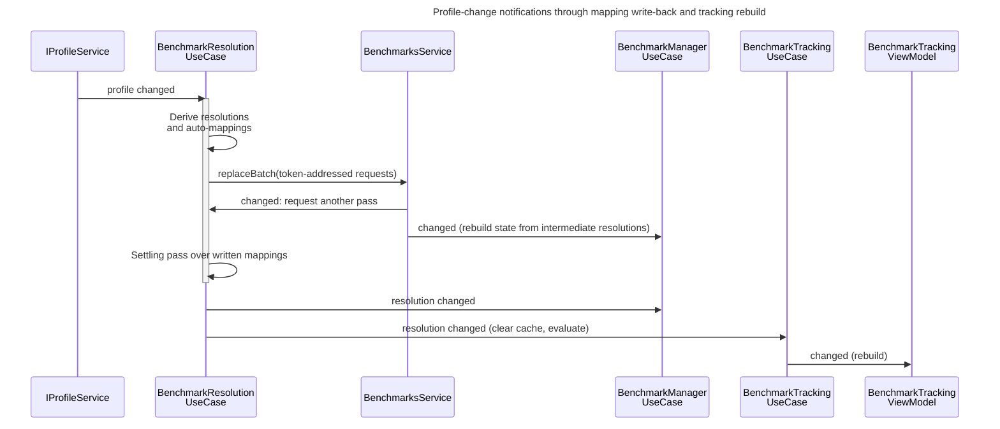

# Benchmark tracking

## Concern and scope

How do profile, library, graph-setting and day changes update the benchmark workspace? The view explains how a change becomes a published workspace snapshot and then a rebuilt presentation, which changes avoid the full evaluation, what an evaluation cache entry holds, and why a consumer can still see more than one publication for one user action. A maintainer needs it before touching subscriptions, caching, publication or the view model's axis handling.

It begins when `BenchmarkResolutionUseCase`, `RecentBenchmarks`, `IGraphConfigurationUseCase` or the day source notifies `BenchmarkTrackingUseCase`, and ends when `BenchmarkTrackingViewModel` has applied the result: a full rebuild that ends in `changed`, or a scoped rank, playtime or presentation update. The component structure is in [Benchmarks][benchmarks]. What the evaluation computes, and the rules that make its outputs agree, are in [Benchmark evaluation][benchmark-evaluation]. Identity and stored form are in [Benchmark definitions][benchmark-definitions]; the editing session that sets the lease is in [Benchmark editing][benchmark-editing]. How the profile itself changes is in [Profile lifecycle][profile-lifecycle], and its stored representation and run identity are in [Run history data][run-history-data].

The application observer callbacks described here are synchronous `std::function` calls on the notifying thread, and nothing in this subsystem runs a worker; deferred QML work is noted where it occurs. In the wired application that thread is the GUI thread: `SessionController` accepts a finished profile build on its owning (GUI) thread before profile observers run, so write-back and evaluation after acceptance happen there, and the day source fires from a GUI-thread timer or the application-activation callback ([`SessionController::onBuildFinished`](../../../src/app/session_controller.cpp), [`SystemDaySource`](../../../src/qt_data/system_day_source.cpp)).

## Architectural account

### Resolution coordinates library and profile updates

[`BenchmarkTrackingUseCase`](../../../src/app/usecases/benchmark_tracking_use_case.cpp) registers on four sources only: `IRecentBenchmarks::onChanged`, `IBenchmarkResolutionUseCase::onChanged`, `IGraphConfigurationUseCase::onChanged` and `IDaySource::onDayChanged`. It holds `IBenchmarksService` and `IProfileService` only to read: the library `revision()` and `snapshot()`, and `getRunFacts` inside an evaluation. It never subscribes to either.

[`BenchmarkResolutionUseCase`](../../../src/app/usecases/benchmark_resolution_use_case.cpp) subscribes to both the library service and the profile, and its contract says it fires "after every benchmark-library or profile change, once `snapshot()` reflects that change" ([`IBenchmarkResolutionUseCase`](../../../src/app/contracts/i_benchmark_resolution_use_case.h)). Its `reconcile()` runs passes in a loop while its re-entrancy flag requests another, then calls `publish()` once. Notifications that arrive while a reconcile is running are coalesced into it, so a library change, a profile change or a lease change, with any automatic write-back it causes, ends in one resolution publication. Tracking answers each publication with one cache clear, one refresh and one `changed` on the view model; the refresh evaluates only when a selected benchmark has a loaded entry, and does nothing more than rebuild the choices when nothing is selected.

**Type:** sequence. **Scope:** one profile change that makes an entry eligible for automatic mapping, through successful write-back, to the tracking view model's rebuild; the store's file write and subscribers other than the manager and tracking use cases are omitted. **Concern:** the manager use case sees an intermediate publication, and tracking does not.

**Key**

- Solid arrow, filled head: direct synchronous call, either a registered callback or a service method
- Self-arrow: work inside one component
- Activation bar on the resolution use case: the period in which its re-entrancy guard is set

The manager sees an intermediate snapshot because `runReconcilePass` assigns the new resolution snapshot before calling `replaceBatch`. The service notifies its subscribers synchronously inside that call, so the manager's service callback reads the new resolutions before write failures are recorded or the settling pass runs.

The manager also publishes the final update. It compares state by value using the local `sameState` helper in [`benchmark_manager_use_case.cpp`](../../../src/app/usecases/benchmark_manager_use_case.cpp), and the mapping's change from `AutoMappable` to `Resolved` changes the compared fields ([Benchmark editing][benchmark-editing]).

Tracking sees only the settled state. While `m_reconciling` is set, a notification only sets `m_reconcileAgain`. The write-back's library notification therefore requests another loop pass. The guard ends before the single resolution publication.

This ordering is derived from callback registration and invocation order, rather than a runtime observation: [`App::App()`](../../../src/app/app.cpp) constructs resolution, then manager, then tracking.

When the write-back is skipped or every write fails, there is no nested service notification and no intermediate state; the loop ends after one pass.

### Opening or closing an editor also publishes

`setEditLease` reconciles whenever the lease value changes, and every reconcile ends in `publish()`, so beginning or ending an edit session re-evaluates the selected benchmark even when the lease change produces no definition or profile change.

`runReconcilePass` derives resolutions for every loaded benchmark, including a leased one, but skips the automatic-mapping request for the leased benchmark (eligibility and the digest guard are in [Benchmark definitions][benchmark-definitions]). The lease is a single optional `BenchmarkId`. Requests carry the digest-bearing token of the accepted entry, so a write whose file digest differs at the store's preflight is rejected as `Conflict`. Any other rejection is recorded as `WriteFailed`. The replacement is addressed by token and does not pass through the manager's name validation. The resolution snapshot records the failure under the benchmark's ID in `BenchmarkResolutionSnapshot::automaticWriteFailures`, and the entry remains `AutoMappable`. Nothing retries on a timer: the next reconcile pass tries again. That pass can be the settling pass when other writes in the same batch succeeded, or a later profile, library or lease change. The manager state exposes this as `resolutionWriteFailed`; [Benchmark editing][benchmark-editing] shows how the editor reacts.

### What the cache holds

Two caches exist in [`BenchmarkTrackingUseCase`](../../../src/app/usecases/benchmark_tracking_use_case.h).

`m_cache` maps a `BenchmarkId` to an `Evaluation`: the evaluated `domain::Benchmark`, and a full rolling-playtime series with the window it was built for. Only a `Ready` evaluation is cached, so a benchmark that reappears is evaluated rather than served a remembered absence. `evaluate` reads the resolution snapshot for that benchmark, asks `IProfileService::getRunFacts` once for the unique hashes of the loaded definition (`scenarioHashes()`, with empty scenario names because `ScenarioId` identity is the hash), and constructs the `Benchmark` ([Benchmark evaluation][benchmark-evaluation]). The playtime series is kept beside the benchmark so a window or range change needs no re-evaluation: `applyPlaytimeView` recomputes the full series only when the committed window differs from the cached one.

`m_librarySnapshot` caches a deep copy of the service snapshot because `snapshot()` returns by value. Tracking fetches it again only when `IBenchmarksService::revision()` changes. A refresh failure leaves the revision unchanged, so tracking retains the last accepted library.

The published `BenchmarkWorkspaceSnapshot` carries a copy of the cached `Benchmark` (`m_snapshot.benchmark`), the choices, and the resolved rank and playtime views. `BenchmarkTrackingUseCase::benchmark()` points into that copy, so it is valid only until the next `refresh()`.

### Scoped refreshes

Resolution publications clear the whole cache, whether or not any value changed. Everything else uses the cached evaluation. The meaning of range, window and style settings is in [Graph configuration][graph-configuration].

| Trigger | Handler | Work | Notification |
|---|---|---|---|
| Resolution publication (library, profile or lease change) | `reevaluate` | Clear all cached evaluations; `refresh()` rebuilds choices and evaluates only the selected benchmark | `onChanged` |
| Recent-list notification | recent handler | `refresh()` (choices carry recency); the cache is not cleared | `onChanged`; no refresh or publication while `m_markingViewed` is set, which `select` does while it records its own view |
| Range of the `benchmarkRank` or `benchmarkRecentRank` graph | `refreshRankOnly` | Re-resolve the named graph's `RankRangeView` from the cached `Benchmark` | `onRankChanged(graph)` |
| Range or window of the playtime graph | `refreshPlaytimeOnly` | Re-derive the visible rolling-playtime series; the full series is recomputed only when the window differs from the cached one | `onPlaytimeChanged` |
| Style of any benchmark graph | in the configuration handler | None | One `onPresentationChanged` for the whole configuration change, however many graphs restyled |
| Day rollover (`IDaySource::onDayChanged`) | day handler | Re-resolve only graphs whose effective range `followsToday` | `onRankChanged` / `onPlaytimeChanged` per affected graph |

Both rank graphs share one anchor: the UTC day of the benchmark's last member run (`memberRunStarts().back()`), which `applyRankRange` computes for either graph. With the anchor setting on, a recent-days preset ends at the anchor and a missing anchor can yield no relevant history. All-history is capped at the anchored end by the view model. An explicit interval is shortened to the anchor only when it straddles it; one wholly before or wholly after the anchor keeps its entered dates. Playtime anchors at `latestRunDay()`. The domain meaning of both anchors is in [Benchmark evaluation][benchmark-evaluation]. Range changes leave the computed rank histories intact; they change the resolved display range.

The rank, playtime and day handlers act only while the state is `Ready` with a cached evaluation; otherwise they do nothing and publish nothing. The style notification has no `Ready` gate and publishes whenever a benchmark graph's style changed. A playtime refresh rewrites the visible playtime and the cached full series; it leaves the cached `Benchmark` intact.

### Selection and state

`select` of the already selected ID is a no-op; otherwise it records the choice, calls `RecentBenchmarks::markViewed` with the chosen file's name, refreshes and notifies once. Every choice, problem entries included, carries its entry's key and its name from the filename, and the last known display name is taken from the current choices.

The selected ID is kept even when the benchmark disappears: the state becomes `Unavailable` and the last known display name is carried so the UI can name the unavailable benchmark. IDs are keys the service mints per filename for the session ([Benchmark definitions][benchmark-definitions]), so a file that comes back after vanishing, or one renamed outside the application, is a new benchmark and the selection stays `Unavailable` until the user picks it again. A selected incomplete benchmark is `Ready` with an evaluated `Benchmark` whose overall results are absent; its scenario results are still produced.

`selectDefault` acts only while nothing is selected: it selects the choice whose filename comes first in the recent list and is still selectable (see [Benchmark definitions][benchmark-definitions]). If no recent file is selectable, it selects a benchmark only when exactly one benchmark is selectable.

`BenchmarkWorkspace.qml` triggers that default: when the tab becomes visible, or the body reverts to the no-selection state while visible, it calls `selectDefaultBenchmark()`. Creation-time checks are deferred with `Qt.callLater` because the item reports visible inside its `StackLayout` before the layout hides it; an immediate check would evaluate a benchmark at startup before the tab is ever opened. The side effect is that merely viewing the tab can select a benchmark and rewrite the persisted recent list.

### A rename can publish twice

Saving an existing benchmark under a new name through the manager use case updates the library before the recent list. Tracking can therefore publish once for the library update and again for the recent-list update.

[`BenchmarkManagerUseCase::save`](../../../src/app/usecases/benchmark_manager_use_case.cpp) calls `IBenchmarksService::save`. On a successful rename, the service moves the in-session key to the new filename (`drop` then `admit` with the token's ID) and publishes once ([`BenchmarksService::save`](../../../src/data/benchmarks_service.cpp)). Resolution processes that publication and notifies tracking. Tracking's first publication shows the renamed choice while the recent list still holds the old filename. The choice has recency at this point only if a stale recent entry for the new filename already exists.

After the service's `save` returns, the manager calls `RecentBenchmarks::rename(old, new)` (or `markCreated` for a save with no token). If the old name is present, `rename` replaces it in place, removes any other occurrence of the new name, commits to settings and fires the recent callbacks. Tracking's recent handler then runs `refresh()` and `notifyChanged()` without clearing the cache, producing the second publication with corrected recency and order. `m_markingViewed` is not set, so it does not suppress this notification.

If the old name is absent, `rename` does nothing. A benchmark never selected in tracking has no recent entry and therefore produces only the first publication. If the file rename fails, `save` reports `RenameFailed`; the content and the recent-list entry retain the old filename.

The selection is a `BenchmarkId`, which survives the rename because the service moved the key. Selection, the edit lease, `automaticWriteFailures` and the cache are all keyed by that ID, so a rename path that minted a new ID for the file would break selection and let the resolution use case resume write-back for the benchmark under edit.

### Presentation rebuild

`BenchmarkTrackingViewModel` subscribes to the four notifications and pulls the snapshot ([`benchmark_tracking_vm.cpp`](../../../src/ui/presentation/benchmarks/tracking/benchmark_tracking_vm.cpp)). It reads `snapshot.benchmark` and `snapshot.visiblePlaytime`.

- **Staged rebuild.** `rebuild()` recomputes selector entries, state string and message, summary strings and colours, rank bar fills, the contents of the three history graphs and the progress grid from one snapshot, and the parent emits `changed` once at the end. The parent's fields change in place first, and the child history view models and the progress-grid model emit their own notifications before that `changed`, so a synchronous listener on a child can observe a mix of old and new fields; the parent's `changed` signal marks the point at which all child updates are complete. [Graph presentation][graph-presentation] describes the history graph models populated by this view model. The state string is derived from the snapshot's availability and completeness; the view model emits one `emptyLibrary` token both for an empty library and for a library of only problem files, and the workspace separates the two using the selector contents.
- **Summary.** The average-rank bar marks the recent average rank (`recentAverageRankPosition`, `-1` without one). The next-tier text counts blockers as requirements: "blocked by N groups and M scenarios", from `RankBlocker::group` ([Benchmark evaluation][benchmark-evaluation]).
- **Axes and content agree after `update()` returns.** Each `BenchmarkHistoryViewModel` owns a `DateTimeAxis` and a `RunDateAxis`. `update()` takes both the X values and the axis choice (`onRunAxis`) from the same `Content`; `xAxis()` returns the axis used by the last update. The parent sets that axis's range before calling `update()`. Once the call returns, a canvas or capture reads matching axes and content. During the call, however, `runAxisShownChanged` is emitted after the axis flag changes but before the new observations are installed. A synchronous listener can therefore read the new axis with the previous points. As with the staged rebuild, GUI-thread execution does not protect a reentrant observer.
- **Calendar mode: one shared extent.** The rank graphs may be laid out on dates. For those, and for the playtime graph, the view model computes the union of the rank, recent-rank and playtime extents (`m_appliedUnionMs`) and applies it to every calendar axis whose range resolved to no explicit dates, so the date graphs align on one horizontal span. A rank graph with no interval but an anchored end caps the union at that end ([`applyRankAxis`](../../../src/ui/presentation/benchmarks/tracking/benchmark_tracking_vm.cpp)). With no interval and no union, the fallback is the current UTC date-time. A playtime-only update that changes the union falls back to a full `rebuild()` because the rank axes and their held-flat lines depend on it. The union applies to calendar axes only.
- **Run mode: no shared extent.** The default X axis of both rank graphs is the run axis (the `xAxis` preference, [Graph configuration][graph-configuration]). `updateRankHistoryOnRuns` converts the snapshot's `RankRangeView` into a `RunSpan` by `domain::runSpanOfDays` over `memberRunStarts()`, windows the per-run history with `rankHistoryWindow`, and sets the run axis to the visible runs. A range with no member run spans nothing on this axis. The calendar path instead uses `rankHistoryByDay` results kept as `m_rankByDay` and `m_recentRankByDay`, so a date-axis redraw does not re-derive them.
- **Carried levels.** Because a personal best is never lost and a recent average moves only on play, a rank line is extended flat to the axis's right edge, and a level reached before a range opens is carried in from its left edge. `leadingCarry` and `trailingCarry` extend the displayed line while preserving the observed points.
- **Scoped signals.** `onRankChanged` runs only `rebuildRank` for the named graph; `onPlaytimeChanged` runs only `rebuildPlaytime`, which falls back to the full `rebuild()` as described above; `onPresentationChanged` runs `applyPresentation`.

### The style flow for `xAxis` and `tierRounding`

Both fields are in the `style` section of a graph configuration change, never `range` or `window` ([Graph configuration][graph-configuration]). The use case's configuration handler therefore announces them through `onPresentationChanged`, with no snapshot read and no cache clear. `applyPresentation` calls `setPresentation` on the three history models. A rank model handles `tierRounding` itself: a changed rounding or Y-axis policy refreshes only the Y axis, from the tiers and full-history peak it retained from its last update. After the first `rebuild()` (`m_built`), `applyPresentation` also re-runs `rebuildRank(graph)` for a rank graph whose committed `xAxis` differs from the axis it currently shows (`showsRunAxis(...) != history.runAxisShown()`), which switches axis and content together.

The same view model is one of the four graph sources handed to `CaptureViewModel` ([`App::App()`](../../../src/app/app.cpp)); capture reads it on the GUI thread ([Image capture][image-capture]).

## Consequences and invariants

- **Resolution must stay the only trigger for library and profile changes.** Tracking reads the resolution snapshot inside `evaluate` and has no other hook for those two streams. A new path that changes the library or profile without ending in `BenchmarkResolutionUseCase::publish()`, or a resolution pass that skips publishing when nothing changed, would leave tracking serving cached evaluations for stale data. If tracking subscribed directly to the profile or library, it would evaluate before `reconcile` produced the corresponding resolution snapshot and would publish intermediate state.
- **A resolution publication is a full replacement.** `m_cache` is cleared there, wholesale, so a hit needs no freshness check. A subscription that updated one entry in place would leave stale evaluations for the others.
- **A recent-list notification can publish a previous cached evaluation.** The recent handler refreshes without clearing the cache. During a manager save, the library publication triggers resolution before the manager updates the recent list, so the cache has already been cleared. The use case also allows the reverse order, as recorded in `refresh()`: a recent-list notification can arrive before resolution processes a library change. In that case, tracking publishes the accepted library choices with the previous cached evaluation as `Ready`. The later resolution publication clears the cache and settles the state, for example to `Unavailable` if the selected file is gone. Consumers must allow for this intermediate snapshot.
- **Scoped refreshes must not invalidate evaluation.** Range, window and style changes leave `m_cache` alone; the evaluated `Benchmark` is independent of them because windows never change values ([Benchmark evaluation][benchmark-evaluation]). Adding a dependency of evaluation on those settings would require moving that setting into the invalidating path.
- **`xAxis` and `tierRounding` stay in `style`.** Moving either into `range` would take the `refreshRankOnly` path and publish `onRankChanged` for no reason. Leaving a new field out of the configuration diff makes the edit neither persisted nor published.
- **Axis and content switch together, by the end of `update()`.** Showing an axis from presentation alone, rather than from the `update()` that installs the content, would pair run numbers with a date axis for longer than that call. Within the call the pairing is not atomic for synchronous observers.
- **The lease suppresses automatic write-back for one benchmark.** It excludes only application-initiated write-back; resolution and tracking for it continue.
- **Recents, selection and the file are separate records of one benchmark.** They agree only because a rename goes through `BenchmarkManagerUseCase::save`. Another writer of a benchmark's filename would leave the recent list, which never prunes, pointing at a name that no longer exists.
- **Ordering relies on construction order.** The manager receives resolution publications before tracking because `App::App()` constructs it first ([Composition root][composition-root]); nothing else enforces it, and nothing in tracking depends on it.

## Evidence and limitations

Verified by reading `BenchmarkTrackingUseCase` (header and implementation), `BenchmarkResolutionUseCase` (constructor, `reconcile`, `runReconcilePass`), the construction and `save` path of `BenchmarkManagerUseCase`, `RecentBenchmarks`, `BenchmarksService`, `i_benchmark_resolution_use_case.h`, `benchmark_workspace_snapshot.h`, the benchmark construction in `App::App()`, `BenchmarkTrackingViewModel` (full `.cpp`), the axis and presentation code of `BenchmarkHistoryViewModel`, and the `Qt.callLater` section of `BenchmarkWorkspace.qml`. The notification order in the sequence diagram, including the intermediate manager publication and the rename's two publications, is derived from callback registration and invocation order, not from a runtime trace or a test. The diagram was not rendered in this pass. The `style` classification of `xAxis` and `tierRounding` rests on the consumer side and on the discovery findings; the configuration diff body was not re-read here. Not read: `RunDateAxis` internals, `BenchmarkProgressGridModel` and most QML children of the trackable body, so graph drawing and grid layout are outside this view.

<!-- arch-doc:references:start -->
[benchmark-definitions]: benchmark-definitions.md
[benchmark-editing]: benchmark-editing.md
[benchmark-evaluation]: benchmark-evaluation.md
[benchmarks]: benchmarks.md
[composition-root]: composition-root.md
[graph-configuration]: graph-configuration.md
[graph-presentation]: graph-presentation.md
[image-capture]: image-capture.md
[profile-lifecycle]: profile-lifecycle.md
[run-history-data]: run-history-data.md
<!-- arch-doc:references:end -->
