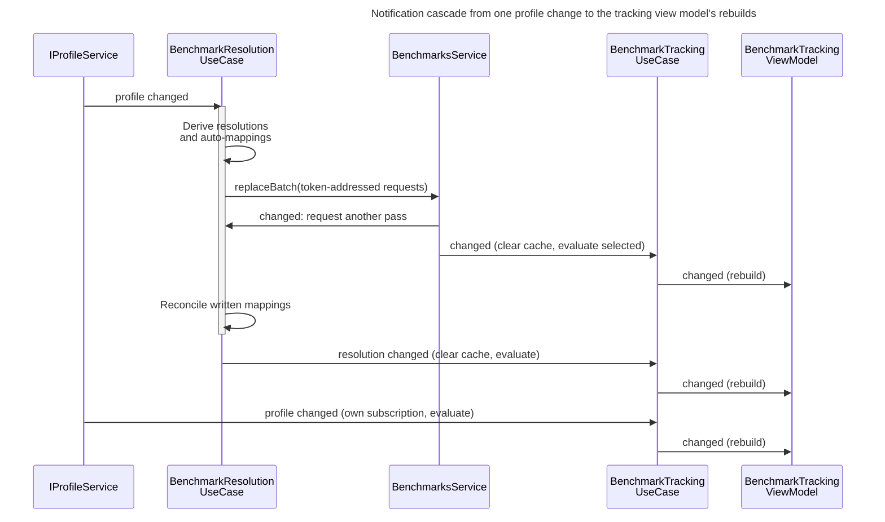

# Benchmark tracking

## Concern and scope

How do profile, library, graph-setting and day changes update the benchmark workspace? The view explains how a change becomes a published workspace snapshot and then a rebuilt presentation, which changes avoid the full evaluation, what the evaluation computes, and why a consumer can see more than one publication for one change. A maintainer needs it before touching subscriptions, caching, publication or the evaluation rules.

It begins when `BenchmarkResolutionUseCase`, `BenchmarkTrackingUseCase` or the day source is notified and ends when `BenchmarkTrackingViewModel` has applied the result: a full rebuild that ends in `changed`, or a scoped rank, playtime or presentation update. The component structure is in [Benchmarks][benchmarks]; identity and stored form are in [Benchmark definitions][benchmark-definitions]; the editing session that sets the lease is in [Benchmark editing][benchmark-editing]. How the profile itself changes is in [Profile lifecycle][profile-lifecycle], and its stored representation and run identity are in [Run history data][run-history-data].

The application observer callbacks described here are synchronous `std::function` calls on the notifying thread, and nothing in this subsystem runs a worker; deferred QML work is noted where it occurs. In the wired application that thread is the GUI thread: `SessionController` accepts a finished profile build on its owning (GUI) thread before profile observers run, so write-back and evaluation after acceptance happen there, and the day source fires from a GUI-thread timer or the application-activation callback ([`SessionController::onBuildFinished`](../../../src/app/session_controller.cpp), [`SystemDaySource`](../../../src/qt_data/system_day_source.cpp)).

## Architectural account

### Reconcile, evaluate, publish

**Type:** sequence. **Scope:** a profile update that makes an entry eligible for automatic mapping, through successful write-back and the tracking view model's updates for a selected loaded benchmark; other subscribers and the store's file write are omitted (see [Benchmark definitions][benchmark-definitions]). **Concern:** one change reaches the tracking use case more than once, and the resolution use case's re-entrancy guard defers, rather than prevents, its own second pass.

**Key**

- Solid arrow, filled head: direct synchronous call, either a registered callback or a service method
- Self-arrow: work inside one component
- Activation bar on the resolution use case: the period in which its re-entrancy guard is set

One profile change produces three tracking rebuilds. The first can combine written definitions with the first pass's resolutions; the final resolution publication settles that intermediate state. This is inferred from callback registration and invocation order in [`BenchmarkResolutionUseCase::reconcile`](../../../src/app/usecases/benchmark_resolution_use_case.cpp) and the constructor of [`BenchmarkTrackingUseCase`](../../../src/app/usecases/benchmark_tracking_use_case.cpp), not observed at runtime. In the intermediate publication, newly mapped entries are still `AutoMappable` rather than `Resolved`, so they have no history.

There are no queued handoffs in this diagram. A notification arriving while `m_reconciling` is set requests another pass through `m_reconcileAgain` and returns immediately. The loop repeats until the flag stays clear; the guard ends before the single resolution publication. Thus the successful write-back in pass 1 leads to a settling pass over the written mappings.

Tracking's resolution, profile and service callbacks each clear the whole evaluation cache, call `refresh()` and publish through `notifyChanged()`. The nested service notification, final resolution publication and tracking's own profile callback therefore each trigger an evaluation and rebuild in this scenario.

### Subscription order

**Among benchmark subscribers, the resolution use case registers first on both streams.** (`SessionController` subscribes to the profile stream earlier, before the initial load.) Its constructor subscribes to `IBenchmarksService::onChanged` and `IProfileService::onProfileChanged` and then reconciles once. The manager and tracking use cases are constructed after it ([`App::App()`](../../../src/app/app.cpp)), so for each stream the callback order among benchmark subscribers is resolution, then manager (service stream only), then tracking. For a service-triggered change (for example a manager save) resolution can therefore publish before tracking receives the outer service callback, and a reconcile that writes adds a nested service notification; a batch in which every write fails emits no nested notification.

**The manager deduplicates by value.** The manager use case compares state values, so whether its own publication is absorbed depends on the compared fields (see [Benchmark editing][benchmark-editing] and `BenchmarkManagerUseCase::sameState`); in the illustrated write-back case a mapping's transition from `AutoMappable` to `Resolved` changes the compared state fields, so the final manager update is not absorbed.

### Edit lease and write-back

**Opening or closing an editor also publishes.** `setEditLease` reconciles whenever the lease value changes, and every reconcile ends in `publish()`, so beginning or ending an edit session re-evaluates the selected benchmark even when the lease change produces no definition or profile change.

`runReconcilePass` derives resolutions for every loaded benchmark, including a leased one, but skips the automatic-mapping request for the leased benchmark (eligibility and the digest guard are in [Benchmark definitions][benchmark-definitions]). The lease is a single optional `BenchmarkId` ([`IBenchmarkResolutionUseCase::setEditLease`](../../../src/app/contracts/i_benchmark_resolution_use_case.h)). Requests carry the digest-bearing token of the accepted entry, so a write whose file digest differs at the store's preflight is rejected as `Conflict` (the precondition's limits are in [Benchmark definitions][benchmark-definitions]). Any other rejection, including a blank name, is recorded as `WriteFailed`. The resolution snapshot records the failure under the benchmark's ID in `BenchmarkResolutionSnapshot::automaticWriteFailures`, and the entry remains `AutoMappable`. Nothing retries on a timer: the next reconcile pass tries again. That pass can be the immediate second pass when other writes in the same batch succeeded, or a later profile, library or lease change. A conflict persists while the accepted digest differs from the file's. A manager refresh can load the new digest; if the expected bytes return first, a later reconcile can pass the digest check without a refresh. The manager state exposes this as `resolutionWriteFailed`; [Benchmark editing][benchmark-editing] shows how the editor reacts.

### Scoped refreshes

Library, resolution and profile notifications each clear the evaluation cache, whether or not the values changed. Everything else uses the cached evaluation. The meaning of range, window and style settings is in [Graph configuration][graph-configuration].

| Trigger | Handler | Work | Notification |
|---|---|---|---|
| Library, resolution or profile change | `reevaluate` | Clear all cached evaluations; `refresh()` rebuilds choices and evaluates only the selected benchmark | `onChanged` |
| Recent-list notification | recent handler | `refresh()` (choices carry recency) | `onChanged`; no refresh or publication while `m_markingViewed` is set, which `select` does while it records its own view |
| Range of the `benchmarkRank` or `benchmarkRecentRank` graph | `refreshRankOnly` | Re-resolve the named graph's `RankRangeView` from the cached projection (anchoring rules below) | `onRankChanged(graph)` |
| Range or window of the playtime graph | `refreshPlaytimeOnly` | Re-derive the visible rolling-playtime series; the full series is recomputed only when the window differs from the cached one | `onPlaytimeChanged` |
| Style of any benchmark graph | in the configuration handler | None | One `onPresentationChanged` for the whole configuration change, however many graphs restyled |
| Day rollover (`IDaySource::onDayChanged`) | day handler | Re-resolve only graphs whose effective range `followsToday` | `onRankChanged` / `onPlaytimeChanged` per affected graph |

A rank refresh anchors the range at the last point of that rank series (playtime anchors at the latest contributing run after the epoch); an explicit interval straddling the anchor is shortened to it, and a missing anchor can yield no relevant history. Range changes leave the computed rank-history series intact; they change the resolved display range.

The rank, playtime and day handlers act only while the state is `Ready` with a cached evaluation; otherwise they do nothing and publish nothing. The style notification has no `Ready` gate and publishes whenever a benchmark graph's style changed. Playtime refresh updates the cached full playtime series when the window differs and writes the visible rolling playtime into both the live and the published projection; it leaves the cached evaluator result and rank data intact.

Two caches exist in [`BenchmarkTrackingUseCase`](../../../src/app/usecases/benchmark_tracking_use_case.cpp).

`m_cache` holds per-`BenchmarkId` `Ready` results and is cleared wholesale on any definition, resolution or profile change, so a hit needs no freshness check.

`m_librarySnapshot` is a deep copy of the service snapshot, refetched only when `IBenchmarksService::revision()` moves because `snapshot()` returns by value. A refresh failure does not move the revision, so tracking keeps its copy of the last accepted library.

### Selection and state

`select` of the already selected ID is a no-op; otherwise it records the choice, calls `RecentBenchmarks::markViewed`, refreshes and notifies once. The last known display name is taken from the current choices, so a problem entry carrying the selected ID can supply it.

The selected ID is kept even when the benchmark disappears: the state becomes `Unavailable` and the last known display name is carried so the UI can name the unavailable benchmark. If a later publication contains it again, selection resumes without user action. A benchmark is also `Unavailable` when more than one loaded file embeds its ID (only loaded entries are counted; a problem entry carrying the same ID does not count), even though each duplicate loaded choice remains selectable ([Benchmark definitions][benchmark-definitions] owns the filename/ID ambiguity). A selected incomplete benchmark is `Ready` with a projection whose official ranks are absent; its scenario results, including attained tiers and normalised ranks for entries with valid ladders, are still produced.

`selectDefault` acts only while nothing is selected: it selects the first ID in the recent list that is still selectable (see [Benchmark definitions][benchmark-definitions]). If no recent ID is selectable, it selects a benchmark only when exactly one benchmark is selectable.

`BenchmarkWorkspace.qml` triggers that default: when the tab becomes visible, or the body reverts to the no-selection state while visible, it calls `selectDefaultBenchmark()`. Creation-time checks are deferred with `Qt.callLater` because the item reports visible inside its `StackLayout` before the layout hides it; an immediate check would evaluate a benchmark at startup before the tab is ever opened. The side effect is that merely viewing the tab can select a benchmark and rewrite the persisted recent list.

### Evaluation rules

`evaluateBenchmark` ([`benchmark_evaluator.cpp`](../../../src/domain/benchmarks/benchmark_evaluator.cpp)) is a pure function of the definition, its completeness, the per-entry resolutions and a chronological run-fact list. `BenchmarkTrackingUseCase::evaluate` requests the facts from `IProfileService::getRunFacts` for the unique mapped hashes of all the benchmark's resolution records (including `MappedUnavailable` ones), with empty scenario names because `ScenarioId` identity is the hash; the evaluator then lets only `Resolved` entries contribute.

#### Contributing runs

- **Which runs count.** Only entries whose state is `Resolved` contribute history. For an entry with several hashes the histories are merged and re-sorted by start time (ties by hash), while the history sweep consumes the profile's chronological sequence (ties by run index), so when tied start times straddle the recent-window cutoff, the per-entry calculation and the history sweep can include different runs. The benchmark's total playtime counts each unique resolved hash once, so two entries mapped to one scenario do not double it.

#### Entry and aggregate ranks

- **Per scenario.** Personal best is the highest score; the earliest run wins a tie; recent average is the mean of up to five of the most recent runs. Normalised rank is the number of thresholds reached plus fractional progress toward the next (below the first threshold it is the score divided by that threshold, clamped at zero), so its maximum is the tier count. An entry with no runs attains nothing even when its first threshold is zero, which keeps "never played" and "scored zero" distinguishable. An entry whose thresholds do not form a valid ladder (`thresholdLadder`) has no attained tier and rank zero.
- **Trackable only.** Overall (benchmark and group) attained rank, completed rank, average rank, next tier, blockers and both rank histories stay at their defaults for an `Incomplete` definition, so partial thresholds cannot yield a plausible benchmark rank. Scenario-level data (match state, personal best, recent average, playtime, and attained tier and normalised rank for entries with a valid ladder) is still produced.
- **Rank semantics.** The attained rank is the highest tier at which every uncategorized entry attains it and every category is satisfied; a category without subcategories is satisfied when any of its entries attains the tier, and one with subcategories when every subcategory has an attaining entry. The completed rank is the highest tier every entry attains. Average rank is the mean of the entries' normalised ranks at their personal-best scores, including unplayed entries.

#### History and playtime series

- **Histories.** Two series feed the two rank graphs, and neither tracks the attained or completed rank above. `averageRankHistory`, plotted by the `benchmarkRank` graph (personal-best rank), has a point on each day some entry set a new personal best; it never falls and is used only for display. `recentAverageRankHistory`, plotted by the `benchmarkRecentRank` graph (recent rank), has a point on each day a benchmark scenario was played and can fall. Both are computed in one linear sweep that relies on `runFacts` being chronological, so each day is a contiguous block. If that contract broke, a day would be visited twice and emit duplicate points ([`UserProfile::getRunFacts`](../../../src/domain/user_profile.cpp) supplies the ordering).
- **Playtime series is separate.** `BenchmarkProjection::rollingPlaytime` is passed to the evaluator empty and filled from the committed window and range by the tracking use case, so a window or range change cannot alter any summary.

### Presentation rebuild

`BenchmarkTrackingViewModel` subscribes to the four notifications and pulls the snapshot ([`benchmark_tracking_vm.cpp`](../../../src/ui/presentation/benchmarks/tracking/benchmark_tracking_vm.cpp)).

- **Staged rebuild.** `rebuild()` recomputes selector entries, state string and message, summary strings and colours, rank bar fills, the contents of the three history graphs and the progress grid from one snapshot, and the parent emits `changed` once at the end. The parent's fields change in place first, and the child history view models and the progress-grid model emit their own notifications before that `changed`, so a synchronous listener on a child can observe a mix of old and new fields; the parent's `changed` signal marks the point at which all child updates are complete. [Graph presentation][graph-presentation] describes the history graph models populated by this view model. The state string is derived from the snapshot's availability and completeness; the view model emits one `emptyLibrary` token both for an empty library and for a library of only problem files, and the workspace separates the two using the selector contents.
- **Shared date axes.** Three `DateTimeAxis` members (rank, recent rank, playtime) are constructed before the history view models that reference them. When a graph's range resolves to explicit dates, its axis uses them; otherwise the default extent is the union of the rank, recent-rank and playtime extents (`m_appliedUnionMs`), so the three graphs align on one horizontal span. The exception is a rank graph with no interval but an anchored end, which caps the union at that end ([`applyRankAxis`](../../../src/ui/presentation/benchmarks/tracking/benchmark_tracking_vm.cpp)). With no interval and no union, the fallback is the current UTC date-time. A playtime-only update that changes the union falls back to a full `rebuild()` because the rank axes and their held-flat lines depend on it.
- **Carried levels.** Because a personal best is never lost and a recent average moves only on play, a rank line is extended flat to the axis's right edge, and a level reached before a range opens is carried in from its left edge. `leadingCarry` and `trailingCarry` extend the displayed line while preserving the observed points.
- **Scoped signals.** `onRankChanged` runs only `rebuildRank` for the named graph; `onPlaytimeChanged` runs only `rebuildPlaytime`, which falls back to the full `rebuild()` as described above; `onPresentationChanged` re-applies presentation to the three history view models.

The same view model is one of the four graph sources handed to `CaptureViewModel` ([`App::App()`](../../../src/app/app.cpp)); capture reads it on the GUI thread ([Image capture][image-capture]).

## Consequences and invariants

- **Each main `onChanged` publication is a full replacement.** In the illustrated profile update with successful write-back the main notification fires three times, the first with an intermediate resolution snapshot; the rank, playtime and presentation notifications deliberately update narrower parts. A consumer must replace its state on each full publication; skipping the settling publication can leave it displaying the intermediate state. Deduplicating means comparing a value, as the manager use case does, not skipping the callback.
- **Cache clearing is wholesale.** The cache stays correct only because every definition, resolution or profile change clears all of it. A subscription that updated one entry in place would leave stale projections for the others.
- **Scoped refreshes must not invalidate evaluation.** Range, window and style changes leave `m_cache` (the evaluator result and rank data) alone; playtime refresh only rewrites the visible rolling playtime and the cached full series. Adding a dependency of evaluation on those settings would require moving that setting into the invalidating path.
- **The lease suppresses automatic write-back for one benchmark.** Leasing excludes only application-initiated write-back for one benchmark; resolution and tracking for it continue.
- **Chronological facts are a contract.** Changing `getRunFacts` ordering breaks the history sweep, and the per-entry multi-hash sort is a separate ordering path with its own tie rule.
- **Ordering relies on construction order.** Resolution registers first among benchmark subscribers because `App::App()` constructs it first ([Composition root][composition-root]); nothing else enforces it. In the illustrated profile-triggered write-back, the nested service notification reaches the manager and tracking before the final resolution publication, whereas for a service-triggered change resolution can publish before tracking receives the outer service callback.

## Evidence and limitations

Verified by reading `BenchmarkResolutionUseCase`, `BenchmarkTrackingUseCase`, `BenchmarkManagerUseCase`, `RecentBenchmarks`, `benchmark_evaluator.cpp`, `benchmark_projection.h`, `rank_history.cpp`, the benchmark contract headers, `BenchmarkTrackingViewModel` (full `.cpp`), `BenchmarkWorkspace.qml`, and the benchmark construction in `App::App()`. The call order within the sequence diagram, in particular the intermediate publication, is derived from reading callback registration and invocation order, not from a runtime trace or a test. The chronological ordering of `getRunFacts` is documented in the evaluator's comment and inferred from `UserProfile`'s use of the merged index, but the merge function was not read. Not read: `BenchmarkHistoryViewModel`, `BenchmarkProgressGridModel` and most QML children of the trackable body, so graph drawing and grid layout are outside this view. The diagram was rendered and inspected; notification order remains a source-based inference, not a runtime trace.

<!-- arch-doc:references:start -->
[benchmark-definitions]: benchmark-definitions.md
[benchmark-editing]: benchmark-editing.md
[benchmarks]: benchmarks.md
[composition-root]: composition-root.md
[graph-configuration]: graph-configuration.md
[graph-presentation]: graph-presentation.md
[image-capture]: image-capture.md
[profile-lifecycle]: profile-lifecycle.md
[run-history-data]: run-history-data.md
<!-- arch-doc:references:end -->
