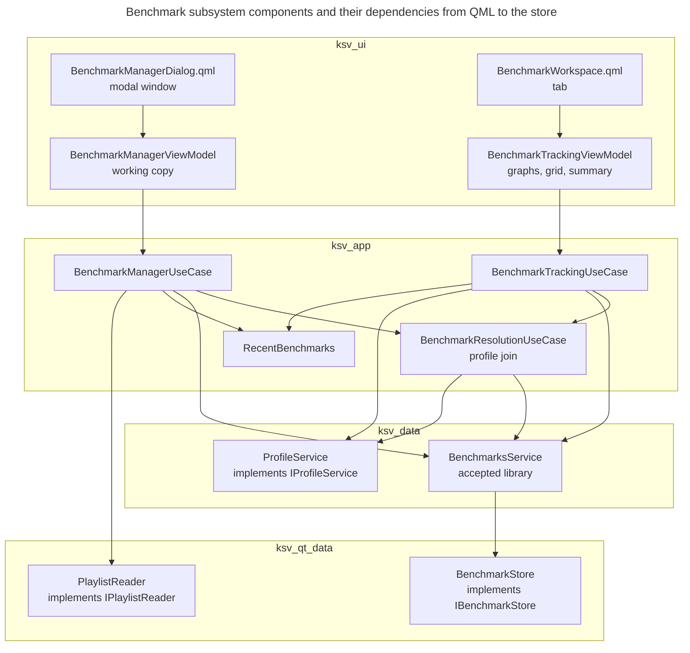

# Benchmarks

## Concern and scope

A benchmark is a user-authored ladder of tiers with per-scenario score thresholds. The subsystem stores those definitions, joins them to the scenarios in the run profile, evaluates the player's runs against them, and lets the player edit the definitions. This view answers: which components accept definitions, match entries to profile scenarios, hold working copies and evaluate runs, and how do they depend on one another?

It covers the benchmark-specific building blocks from the domain model to the two QML surfaces. It does not cover the generic composition of `App` ([Composition root][composition-root]), the run profile itself ([Run history data][run-history-data]), graph rendering ([Graph presentation][graph-presentation]) or the graph settings the benchmark graphs read ([Graph configuration][graph-configuration]).

## Architectural account

### Building blocks

**Type:** building-block and dependency view. **Scope:** the two benchmark QML surfaces and the constructor-injected benchmark dependencies connecting them to profile access and definition/playlist I/O. Presentation children, domain-wide dependencies and generic settings services are omitted. **Concern:** who depends on whom, and where the profile join and the working copy live.

**Key**

- Unlabelled solid arrow: depends on, from the dependent to the dependency, through an interface where the dependency lives in a lower layer
- Enclosing labelled rectangle: implementation layer

The two QML surfaces read benchmark state through their respective view models. Cross-layer dependency arrows target interfaces; the `BenchmarkStore` and `PlaylistReader` boxes name the adapters implementing the file ports in `ksv_qt_data`, and `ProfileService` implements profile access in `ksv_data` ([`benchmark_store.h`](../../../src/qt_data/benchmark_store.h), [`playlist_reader.h`](../../../src/qt_data/playlist_reader.h), [`profile_service.h`](../../../src/data/profile_service.h)).

Only `BenchmarksService` changes the accepted library. `BenchmarkResolutionUseCase` joins accepted definitions to the profile, and `BenchmarkManagerViewModel` holds the editable copy. With respect to accepted benchmark and profile state, the tracking side is a pure reader.

`ksv_domain` supplies benchmark types and operations to the use cases, service, store and view models that work with definitions; it is omitted because nearly every element depends on it. Tracking also writes the recent-ID list through `RecentBenchmarks` and reads graph configuration and the day source. The exact omitted dependencies are listed under Layering notes.

### Responsibilities

| Element | Responsibility |
|---|---|
| Domain `benchmarks` ([`benchmark.h`](../../../src/domain/benchmarks/benchmark.h), [`benchmark_validation.h`](../../../src/domain/benchmarks/benchmark_validation.h), [`benchmark_evaluator.h`](../../../src/domain/benchmarks/benchmark_evaluator.h), [`benchmark_editor.h`](../../../src/domain/benchmarks/benchmark_editor.h)) | Defines benchmark values and opaque IDs, validates trackability, evaluates resolutions and run facts, and applies structural edits to a caller-owned value. |
| `BenchmarksService` ([`benchmarks_service.cpp`](../../../src/data/benchmarks_service.cpp)) | Owns the accepted snapshot, a monotonic revision, refresh diagnostics and publication; issues edit tokens; alone changes accepted memory after a store-confirmed save, batch replacement or removal, or a successful directory scan that replaces the snapshot wholesale |
| `IBenchmarkStore` / `BenchmarkStore` ([`i_benchmark_store.h`](../../../src/data/interfaces/i_benchmark_store.h), [`benchmark_store.cpp`](../../../src/qt_data/benchmark_store.cpp)) | Stateless directory scan, JSON decode and classification, digest-conditional atomic write and delete; performs the application's definition-file I/O (external edits enter through refresh) |
| `BenchmarkResolutionUseCase` ([`benchmark_resolution_use_case.cpp`](../../../src/app/usecases/benchmark_resolution_use_case.cpp)) | Joins accepted definitions to profile scenarios; republishes `BenchmarkResolutionSnapshot`; writes back unique automatic mappings; honours the edit lease |
| `BenchmarkManagerUseCase` ([`benchmark_manager_use_case.cpp`](../../../src/app/usecases/benchmark_manager_use_case.cpp)) | Composes library and resolution into `BenchmarkManagerState`; issues editor seeds; starts and ends the lease; delegates whole-benchmark save and delete; imports playlists |
| `BenchmarkTrackingUseCase` ([`benchmark_tracking_use_case.cpp`](../../../src/app/usecases/benchmark_tracking_use_case.cpp)) | Orchestrates evaluation against profile run facts through the pure domain evaluator; owns selection and the per-benchmark evaluation cache, applies graph range, window and day changes, and publishes `BenchmarkWorkspaceSnapshot` |
| `RecentBenchmarks` ([`recent_benchmarks.cpp`](../../../src/app/usecases/recent_benchmarks.cpp)) | Ordered list of recently viewed or created IDs, persisted through `ISettingsService` |
| `BenchmarkManagerViewModel` ([`benchmark_manager_vm.h`](../../../src/ui/presentation/benchmarks/manager/benchmark_manager_vm.h)) | Working copy, baseline, token, undo, table projection |
| `BenchmarkTrackingViewModel` ([`benchmark_tracking_vm.h`](../../../src/ui/presentation/benchmarks/tracking/benchmark_tracking_vm.h)) | Turns a workspace snapshot into selector, summary, three history graphs and the progress grid |
| `BenchmarkManagerDialog.qml`, `BenchmarkWorkspace.qml` ([`src/ui/qml/benchmark/`](../../../src/ui/qml/benchmark/)) | The modal editing window and the tracking tab |

The two QML surfaces are separate: the dialog is its own `ApplicationWindow` declared in `Main.qml` and takes only `benchmarkManagerVm`; the workspace is a tab in the main window's `StackLayout` and takes the tracking, settings and capture view models. `Main.qml` relays the workspace's `manageBenchmarksRequested` signal to the dialog's `open()` and `editBenchmarkRequested` to `openOnEntry` ([`Main.qml`](../../../src/ui/qml/Main.qml)). Both view models reach QML as initial properties ([QML boundary][qml-boundary]).

### Layering notes

- **Shared header vocabulary crosses layers.** Implementation calls follow the layers, but shared header vocabulary crosses between data and application contracts. `BenchmarkEditToken`, save/remove outcomes and `BenchmarkLibrarySnapshot` are data-owned values read by application and presentation, which never construct snapshots; [`i_benchmark_manager_use_case.h`](../../../src/app/contracts/i_benchmark_manager_use_case.h) and [`benchmark_editor_seed.h`](../../../src/app/contracts/benchmark_editor_seed.h) include the data-owned service interface, and [`benchmark_manager_state.h`](../../../src/app/contracts/benchmark_manager_state.h) and [`benchmark_workspace_snapshot.h`](../../../src/app/contracts/benchmark_workspace_snapshot.h) include snapshot vocabulary. Callers do assemble tokens from snapshot entries (see [Benchmark definitions][benchmark-definitions]). A data-layer port also includes application-contract vocabulary: [`i_playlist_reader.h`](../../../src/data/interfaces/i_playlist_reader.h) includes `playlist_seed.h` from `ksv_contracts`. This header coupling is a known property of the link graph ([Build and deployment][build-and-deployment]).
- **The store is profile-independent.** `IBenchmarkStore` and `BenchmarksService` have no dependency on `IProfileService`; the service header states this. The join happens only in the resolution use case, so benchmark files can be scanned, written and migrated without a profile, and a profile rebuild never touches a benchmark file directly.
- **The resolution snapshot carries identifiers, not definitions.** `BenchmarkResolutionSnapshot` holds the scenario catalogue and per-entry resolutions keyed by `BenchmarkId`; it never copies an accepted `domain::Benchmark` ([`benchmark_resolution_snapshot.h`](../../../src/app/contracts/benchmark_resolution_snapshot.h)). A consumer that needs a definition together with its resolution makes two independent pulls, one from the service snapshot and one from the resolution snapshot, and the two snapshots are not guaranteed to describe the same library state ([Benchmark tracking][benchmark-tracking] owns the reconciliation ordering).
- **Application state is read by pull after a notification.** Each benchmark use case exposes an `onChanged` callback and a `state()` or `snapshot()` accessor, and publication is separate from command returns. The manager and tracking snapshot accessors return a const reference to the use case's current value, so a caller must not hold it across a later publication; the resolution `snapshot()` returns by value ([`i_benchmark_manager_use_case.h`](../../../src/app/contracts/i_benchmark_manager_use_case.h), [`i_benchmark_resolution_use_case.h`](../../../src/app/contracts/i_benchmark_resolution_use_case.h), [`i_benchmark_tracking_use_case.h`](../../../src/app/contracts/i_benchmark_tracking_use_case.h)). Tracking adds scoped notifications beside the main one; event ordering and the scoped notifications are in [Benchmark tracking][benchmark-tracking].
- **Some dependencies are not drawn.** Presentation children (history view models, progress-grid and table models, and the clipboard adapter), domain dependencies and recent-ID persistence through `ISettingsService` are omitted. `BenchmarkTrackingUseCase` also consumes the committed graph configuration (`IGraphConfigurationUseCase`) and the day source (`IDaySource`); `BenchmarkWorkspace.qml` also takes the settings and capture view models and visual settings; the QML surfaces depend on presentation APIs, not on domain types.
- **Playlist import is a port plus a seed.** The comment in `playlist_seed.h` explains that its contract-owned vocabulary lets the manager contract name `PlaylistSeed` without including the data-layer port. `PlaylistReader` returns a `PlaylistSeed` or a failure, and the manager use case turns it into a new, unsaved `Benchmark` ([`playlist_reader.cpp`](../../../src/qt_data/playlist_reader.cpp), `BenchmarkManagerUseCase::importPlaylistSeed`); the seed and lease sequence belongs to the manager session in [Benchmark editing][benchmark-editing].

### Child views

- [Benchmark definitions][benchmark-definitions] establishes what a benchmark definition is across its life: opaque IDs, the filename-keyed snapshot, the digest precondition, the two stored schema versions, validation and what counts as authoritative. A maintainer follows it before changing identity, the stored format or any write path. Automatic mapping can rewrite a stored definition.
- [Benchmark tracking][benchmark-tracking] establishes how a profile, library, configuration or day change becomes a published workspace snapshot, and the rules `evaluateBenchmark` applies. A maintainer follows it before touching subscriptions, caching or evaluation. One change can trigger several full workspace publications.
- [Benchmark editing][benchmark-editing] establishes the manager session: who owns the draft, how the edit lease, token and baseline interact with background writes, and how the modal window and the table model keep a stable selection. A maintainer follows it before changing save, close or undo behaviour. A refresh can flag a draft as stale while its unsaved edits are preserved, never rebased.

## Consequences and invariants

- **Single writer.** `BenchmarksService` is the only application element that mutates the accepted library ([`BenchmarksService::writeAccepted`](../../../src/data/benchmarks_service.cpp), `BenchmarksService::remove`, `BenchmarksService::refresh`). A use case that kept and published its own edited copy as accepted state, or any path that updated memory without going through the service, would let accepted memory and disk diverge. Write ordering, scan replacement and revision behaviour are in [Benchmark definitions][benchmark-definitions].
- **Single join.** Scenario resolution and automatic mapping exist only in `BenchmarkResolutionUseCase`; `BenchmarkManagerUseCase::resolve` and `withAutomaticMappings` forward to it. A second implementation of name matching in presentation would give the editor and the tracker different answers for the same entry.
- **Presentation never writes accepted state directly.** The manager view model submits whole benchmarks through `IBenchmarkManagerUseCase::save`. The manager view model's use of `IBenchmarkManagerUseCase` means the bypass listed for it in [ADR 0004](../decisions/0004-route-view-model-interactions-through-use-cases.md) no longer exists in the code.
- **Implementation dependencies follow the layers; header vocabulary does not.** No data-layer implementation calls a use case, view model or QML. Headers cross in both directions only through the shared contract vocabulary described under Layering notes: `ksv_ui` and the application contracts include data-layer value headers (tokens, outcomes, snapshots), and `ksv_data` includes `playlist_seed.h`. Which of these the CMake target links enforce is in [Build and deployment][build-and-deployment].

## Relationship to ADRs

[ADR 0005](../decisions/0005-data-owned-benchmark-service-and-presentation-drafts.md) records the split between data service, store, resolution, manager use case and presentation draft, and supersedes [ADR 0003](../decisions/0003-profile-independent-benchmark-repository-and-application-owned-state.md). The code follows its responsibility split for accepted state, drafts and reconciliation. [ADR 0002](../decisions/0002-embedded-stable-identity-for-benchmark-elements.md) records opaque element IDs. The implementation differs from ADR 0005 in startup order, lease ownership and prompt ownership:

- **Startup order.** `App::App()` builds the benchmark chain after the initial `loadProfile()`, rather than before ([Composition root][composition-root]).
- **Lease ownership.** The ADR assigns the lease to the manager use case. The implementation splits that responsibility: the manager use case sets and clears the lease through the resolution port; `BenchmarkResolutionUseCase` stores it and uses it to suppress write-back ([`setEditLease`](../../../src/app/usecases/benchmark_resolution_use_case.cpp)).
- **Prompt ownership.** The ADR gives Save/Discard prompts to `BenchmarkManagerViewModel`; pending-action and Save/Discard/Cancel coordination lives in [`BenchmarkManagerDialog.qml`](../../../src/ui/qml/benchmark/BenchmarkManagerDialog.qml).

## Evidence and limitations

Verified by reading the full domain `benchmarks` headers and the validation and evaluator sources, `BenchmarksService`, `IBenchmarksService`, `IBenchmarkStore`, `BenchmarkStore`, `PlaylistReader`, the benchmark contract headers, the three benchmark use cases and `RecentBenchmarks`, the benchmark section of `App::App()`, both benchmark view models (tracking in full; manager's header and the save, delete, undo, session and seed paths), `BenchmarkManagerDialog.qml`, `BenchmarkWorkspace.qml`, and the relevant parts of `Main.qml` and `BenchmarkEditorTable.qml`. Not read in full: the manager view model's per-command wrappers, the clipboard and cell-input helpers, the progress-grid model, `BenchmarkHistoryViewModel`, and most QML children of the two surfaces; their internals are outside this view's claims. The application dependencies in the diagram were read from the constructor-injected `shared_ptr` members of the use cases, `BenchmarksService` and the two view models, and the QML-to-view-model edges from the properties of the two QML surfaces; this is not an automated include analysis. The diagram was rendered and inspected; no runtime behavior was exercised.

<!-- arch-doc:references:start -->
[benchmark-definitions]: benchmark-definitions.md
[benchmark-editing]: benchmark-editing.md
[benchmark-tracking]: benchmark-tracking.md
[build-and-deployment]: build-and-deployment.md
[composition-root]: composition-root.md
[graph-configuration]: graph-configuration.md
[graph-presentation]: graph-presentation.md
[qml-boundary]: qml-boundary.md
[run-history-data]: run-history-data.md
<!-- arch-doc:references:end -->
