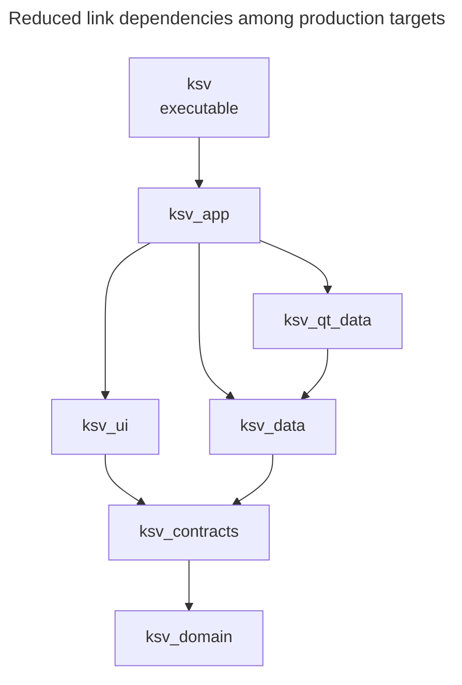
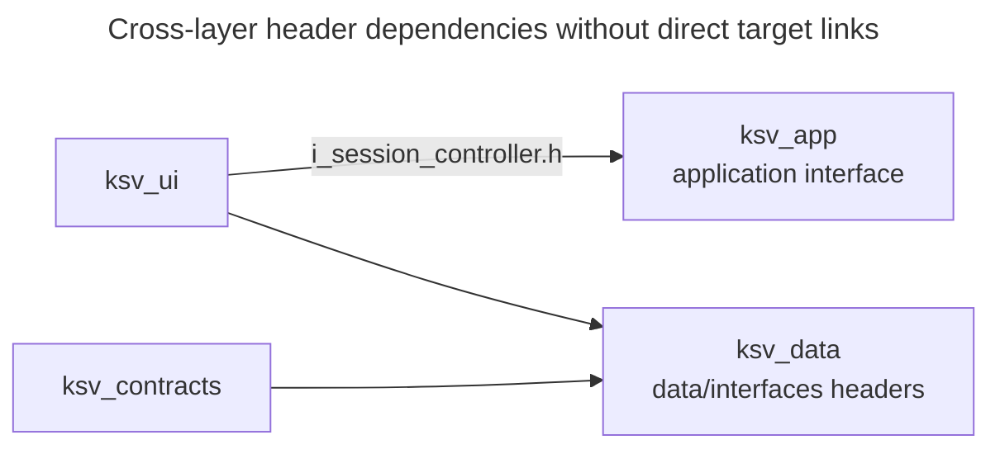

# Build and deployment

Which target boundaries does CMake enforce, and which rules must maintainers preserve across the build runner and release packager? Use this view when changing target dependencies, toolchain settings, test registration or the Windows package. The view covers target dependencies and the Debug-runner and release-packager workflows: admission, phase ordering, command environments and failure boundaries.

It does not restate [`BUILDING.md`](../../../BUILDING.md), which is the how-to, nor the QML registration rules, which belong to [QML boundary][qml-boundary].

## Target link graph

**Type:** build dependency diagram. **Scope:** the production static libraries and executable, showing a direct link only when no path through displayed targets already implies it; Qt and protobuf package targets are excluded. **Concern:** the target-link paths a maintainer must preserve.

**Key**

- Box: CMake target, `STATIC` except the executable `ksv`
- Unlabelled solid arrow: links to, from the linking target to its dependency

The executable reaches the lower libraries through `ksv_app`; the displayed paths omit redundant direct links rather than declaring those links absent.

The library edges are `PUBLIC`, while every link of the `ksv` executable, drawn or omitted, is `PRIVATE` ([`CMakeLists.txt`](../../../CMakeLists.txt) `target_link_libraries(ksv PRIVATE ...)`). Some direct links are omitted where the diagram already shows a transitive path: `ksv` also links `ksv_ui`, `ksv_data`, `ksv_qt_data` and `ksv_domain` directly; `ksv_app` also links `ksv_contracts` and `ksv_domain`; `ksv_qt_data` also links `ksv_contracts` and `ksv_domain`; `ksv_data` and `ksv_qt_data` link Qt or protobuf as external packages not drawn here. Sources: [`CMakeLists.txt`](../../../CMakeLists.txt), [`src/app/CMakeLists.txt`](../../../src/app/CMakeLists.txt), [`src/ui/CMakeLists.txt`](../../../src/ui/CMakeLists.txt), [`src/qt_data/CMakeLists.txt`](../../../src/qt_data/CMakeLists.txt), [`src/data/CMakeLists.txt`](../../../src/data/CMakeLists.txt), [`src/app/contracts/CMakeLists.txt`](../../../src/app/contracts/CMakeLists.txt) and [`src/domain/CMakeLists.txt`](../../../src/domain/CMakeLists.txt). The layer rules this should be read against are in [`AGENTS.md`](../../../AGENTS.md).

**Type:** header-dependency refinement of the production-target model. **Scope:** the three cross-layer header dependencies with no direct target link: `ksv_ui → ksv_app`, `ksv_ui → ksv_data` and `ksv_contracts → ksv_data`. **Concern:** source dependencies that the target-link model does not expose.

**Key**

- Box: production static-library target owning the headers
- Solid arrow: includes headers owned by, from the including target to the header owner

CMake link dependencies and architectural layer dependencies point in different directions. The layers say `ui → app`, but the CMake link from `ksv_app` to `ksv_ui` exists because `App` constructs the view models. The `ksv_ui → ksv_app` header edge shows UI code including the application interface `i_session_controller.h`; the other two edges concern `data/interfaces` headers. The enforcement table below gives the source evidence. `ksv_contracts` is the Qt-free interface-and-rules library that both sides use, and it links only the domain.

### Layer boundaries enforced by the build

| Rule a reader might assume | What actually holds | Evidence |
|---|---|---|
| A layer can include only the layers below its target links | Not enforced. The top-level file calls `include_directories(${PROJECT_SOURCE_DIR}/src)` for every target, so any translation unit can name any header as `app/...`, `data/...`, `ui/...`. | [`CMakeLists.txt`](../../../CMakeLists.txt) |
| `ksv_ui` depends only on contracts | It links only `ksv_contracts`, yet `session_vm.h` includes `app/usecases/i_session_controller.h`, and `settings_vm.h` and `benchmark_manager_vm.h` include `data/interfaces/` headers. These compile through the global include path and the include roots (`src` and `src/app`) that `ksv_contracts` exports `PUBLIC`, which `ksv_ui` inherits ([`src/app/contracts/CMakeLists.txt`](../../../src/app/contracts/CMakeLists.txt)). | [`session_vm.h`](../../../src/ui/presentation/app/session_vm.h), [`settings_vm.h`](../../../src/ui/presentation/app/settings_vm.h), [`benchmark_manager_vm.h`](../../../src/ui/presentation/benchmarks/manager/benchmark_manager_vm.h) |
| `contracts` and `data/interfaces` are separate layers | They include each other: contracts headers such as `i_benchmark_manager_use_case.h` and `benchmark_manager_state.h` include `data/interfaces/` headers, while data ports such as `i_profile_service.h`, `i_file_service.h` and the two image writers include contracts headers. The link graph shows only `data → contracts`. | [`i_benchmark_manager_use_case.h`](../../../src/app/contracts/i_benchmark_manager_use_case.h), [`i_profile_service.h`](../../../src/data/interfaces/i_profile_service.h) |
| Static-library links catch an upward call | Not at library level. Static libraries defer unresolved symbols and CMake permits cycles among them, so an unresolved upward reference may surface only when an executable links. | CMake behaviour; not exercised in this repository |
| Lower layers are free of Qt | `ksv_domain`, `ksv_contracts` and `ksv_data` declare no Qt link dependency, so they receive no Qt include path through those links. `ksv_qt_data`, `ksv_ui` and `ksv_app` do link Qt. | the `target_link_libraries` calls above |
| `ksv_contracts` headers compile on their own | `VERIFY_INTERFACE_HEADER_SETS` configures `ksv_contracts_verify_interface_header_sets` unconditionally. The CTest test `contracts_qt_free` invokes it only under `BUILD_TESTING`. Packaging does not run that check. | [`CMakeLists.txt`](../../../CMakeLists.txt), [`src/app/contracts/CMakeLists.txt`](../../../src/app/contracts/CMakeLists.txt) |

What the test verifies mechanically is that each header in the contracts `FILE_SET` compiles standalone against the target's include directories and link interface. The name `contracts_qt_free` states the intent; Qt-freeness follows because Qt's include directories are supplied only by targets that link Qt. Only headers listed in the file set are covered, so a contracts header omitted from the list escapes the check.

The consequence is that the layering is upheld by review, by the `I*` interface convention, and by the narrow Qt checks above. A plausible change that would break it silently is adding an `#include "app/usecases/..."` of a header-only interface to a `data` file: the global include root makes the header name reachable and nothing else is checked, so it compiles and links. Whether a particular upward include compiles still depends on that header's own includes (`ksv_data` is not given Qt include paths) and on the executable eventually supplying any upward symbols.

## Generated code

Protobuf and Qt write generated files only under the build tree.

- **Protobuf.** [`src/data/CMakeLists.txt`](../../../src/data/CMakeLists.txt) calls `protobuf_generate` for `perf.proto`, `profile.proto` and `migration/profile_v3.proto`, with `PROTOC_EXE` set to the configured `protoc`, and exposes the build directory as a `PUBLIC` include directory of `ksv_data`. Under MinGW it first stages `protoc.exe` with the vcpkg and compiler runtime DLLs it needs into `protoc-runtime/` in the build tree and fails configure if any is missing; under MSVC `protoc` runs in place. Staging avoids modifying the dependency install.
- **Qt codegen.** The root enables `AUTOMOC`, `AUTORCC` and `AUTOUIC`. `ksv_ui` is a `qt_add_qml_module` with `NO_PLUGIN`, which generates the type registration and QML resources into `build/.../KovaaksStatsViewer`. [QML boundary][qml-boundary] owns the header include-path and explicit registration requirements for the static QML module.

## Configurations and what they gate

The build runner configures a Debug tree with testing and dev tools on (`orchestrator.py`); the packager configures a Release tree with testing off. The two share the toolchain but not the option set. CMake itself does not tie testing to the build type: tests are registered whenever `BUILD_TESTING` is on.

| Setting or condition | Default/workflow value | Effect |
|---|---|---|
| `CMAKE_BUILD_TYPE=Release` | set by `package-release.ps1` only | `WIN32_EXECUTABLE` on `ksv` (no console window), and `QT_NO_DEBUG_OUTPUT` as a global compile definition, set before the `add_subdirectory` calls because the per-layer static libraries do not inherit definitions scoped to the executable. Debug builds keep the console subsystem and `qDebug` output. |
| `BUILD_TESTING` | on (`include(CTest)`) | Adds `tests/` and the `contracts_qt_free` test. The packager passes `OFF`; the runner's cache assertion requires `ON`. |
| `KSV_BUILD_GALLERY` | on | Adds `tools/gallery` and `tools/driver`, but only when the build type is not `Release`; the Release gate holds even when the option is on. The runner asserts the option is `ON`. |
| `KSV_BUILD_CAPTURE_MEASURE` | off | Adds `tools/capture_measure`. Not tied to the build type or to testing. |

The normal workflows run tests in Debug and ship Release without tests. The Debug suite therefore does not exercise the Release-only definitions or executable subsystem flag. The packaging smoke test checks that the packaged process starts and loads its modules, not those definitions or the subsystem directly.

The top-level `find_package(Qt6 ...)` always requires `Test`, `QuickTest` and `Network`, even for the packaging configuration that builds no tests or tools, so a Qt installation lacking those modules fails the release configure.

`CMakeLists.txt` also contains a hard-coded fallback `Qt6_DIR` under `C:/Qt/6.12.0/` used only when none is given; both scripts always pass `-DQt6_DIR`, so the fallback is not part of the supported flow. No `CMakePresets.json` or `vcpkg.json` exists: vcpkg is used in classic mode, so the `protobuf` version (and `gtest`, which only the tests link) come from the configured vcpkg installation, and the repository pins neither dependency.

## Developer tools

| Tool | Gate | Purpose |
|---|---|---|
| `ksv_gallery` ([`tools/gallery`](../../../tools/gallery/CMakeLists.txt)) | `KSV_BUILD_GALLERY` and not Release | Runs the real `App` against a throwaway KovaaK's directory with the QML read from the source tree for hot reload. |
| `ksv_driver` and `ksv_driver_core` ([`tools/driver`](../../../tools/driver/CMakeLists.txt)) | `KSV_BUILD_GALLERY` and not Release | A headless host that serves an automation protocol on localhost for `scripts/ui_driver.py`. `ksv_driver_core` is a library so the integration tests can use it. |
| `ksv_capture_measure` | `KSV_BUILD_CAPTURE_MEASURE` | Measures capture cost to inform the capture limits; takes a header from `tests/ui/capture`. |
| `scripts/ui_driver.py`, `scripts/make_dummy_kovaaks.py`, `scripts/arch_doc.py` | not built | Agent-side scripts: drive the automation protocol, generate a fake KovaaK's directory, and maintain this documentation. `ui_driver.py` reuses the Python toolchain resolution. |

`package-release.ps1 -CaptureMeasure` builds `ksv_capture_measure` into `build-measure/` and deploys dependencies beside its executable instead of packaging. This mode works only with the MSVC profile: its deployment step reads the MSVC runtime directory that only that branch sets.

The gallery and driver share `ksv_gallery_support` (synthetic datasets and the source-tree QML interceptor). None of them is part of the packaged zip, and the Release gate keeps the first two out even when their option is on.

## Test topology

Tests are `tests/<layer>/`, mirroring `src/`, plus `tests/integration/`. Each GoogleTest executable is one CTest test through `ksv_add_gtest_test`, which writes an XML report. Each `tst_*.qml` is one CTest test of `ui_qml_tests`, discovered by a `file(GLOB)` at configure time, with the offscreen, software-rendering and Fusion environment. `contracts_qt_free` is the standalone contracts check. Link sets follow the layers:

| Executable | Links | Note |
|---|---|---|
| `domain_tests` | `ksv_domain`, `tests_support_domain` | No Qt, no runtime-DLL copy. |
| the `ksv_data` tests | `ksv_data` (some with `tests_support`) | Several copy example `.perf` and `.csv` fixtures into the build tree. |
| `qt_data_tests` | `ksv_qt_data` | Uses the shared Qt test entry point. |
| `app_tests` | `ksv_app` | Pulls in `ksv_ui` through `ksv_app`. |
| `ui_tests` | `ksv_ui`, `ksv_app` | Native view-model, painter and capture tests. |
| `ui_metatype_tests` | `ksv_ui`, `ksv_app` | Separate from `ui_tests` so nothing in its process calls `declare_metatypes()`. |
| `ui_qml_tests` | `ksv_app`, `Qt6::QuickTest` | Runs the real QML files. |
| `integration_tests` | every layer, plus `ksv_driver_core` when that target exists | Drives the real wired object graph against the fixtures; the driver-based test files are added only when the dev tools are built. |

Shared `qt_gtest_main.cpp` supplies a `QCoreApplication`; `app_tests`, `qt_data_tests` and `ui_metatype_tests` use it as is, while `ui_tests` defines `KSV_GTEST_GUI_APP` and gets a `QGuiApplication`.

Because `integration_tests` conditionally adds sources, its content depends on the `KSV_BUILD_GALLERY` gate. Test precompiled headers are kept per target rather than shared, because compile definitions and Qt module sets differ.

## Build and packaging workflows

| Entry point | Owned output | Main safeguards and phases |
|---|---|---|
| Debug runner (`build_and_test.py`) | `build-agent/` | Checks fingerprint and cache, builds, then runs the selected suites. |
| Release packager (`package-release.ps1`) | Release build tree and Windows zip | Builds Release, deploys dependencies, optionally smoke-tests, then zips. |

## Toolchain configuration

The runner and packager resolve tool paths from layered env files in `scripts/`; neither searches `PATH` or the registry. Resolution has two passes. The flavour (`KSV_TOOLCHAIN`) is resolved first from the defaults, the generic local file, the process environment and an explicit override (`-Toolchain` for the packager; `overrides` in the Python `resolve_toolchain` API); the profile does not take part in choosing it (`resolve_flavour`, `Get-KsvToolchainConfig`). The selected profile and profile-specific local file then layer the tool values. Precedence for those, in increasing order:

1. `toolchain.defaults.env`
2. the tracked profile `toolchain.<mingw|msvc>.env` chosen by `KSV_TOOLCHAIN`
3. the ignored `toolchain.local.env`
4. the ignored `toolchain.local.<flavour>.env`
5. the process environment
6. for the packager, explicit parameters

A value containing `<` or `>` is a placeholder and fails resolution with a message naming the key. Machine-specific paths are placeholders in the tracked files; other values are real there, such as the flavour, the vcpkg triplets and the runner settings ([`toolchain.defaults.env`](../../../scripts/toolchain.defaults.env), [`toolchain.mingw.env`](../../../scripts/toolchain.mingw.env), [`toolchain.msvc.env`](../../../scripts/toolchain.msvc.env)). A linked git worktree without its own local file uses the main worktree's, found through `git rev-parse --git-common-dir`. `KSV_VCVARS_BAT` is required only for MSVC.

The layering exists twice, and maintainers keep the shared resolution rules aligned in both implementations by hand:

| Implementation | Consumers |
|---|---|
| [`scripts/build_runner/config.py`](../../../scripts/build_runner/config.py) (`resolve_toolchain`, `find_local_env`, `is_placeholder`) | The build runner, and `scripts/ui_automation` (`resolve_toolchain` is imported by its CLI). |
| [`scripts/toolchain-config.ps1`](../../../scripts/toolchain-config.ps1) (`Get-KsvToolchainConfig`, `Find-KsvToolchainLocalEnv`) | `package-release.ps1`. |

The PowerShell file marks the shared rules with "Mirrors" comments (`find_local_env`, `resolve_flavour`, `is_placeholder`), and both accept the same key set. No equivalence test is established by this review, so a new toolchain key, a changed precedence step or a changed placeholder rule must be made in both files, in the three env files and in `BUILDING.md`. The Python side additionally accepts the runner keys `KSV_BUILD_JOBS` and `KSV_BUILD_PRIORITY`, which the PowerShell side tolerates in env files but does not use. The MinGW profile notes that Qt's `mingw_64` package is release-only, so Debug builds link optimized Qt.

## The build runner

[`scripts/build_and_test.py`](../../../scripts/build_and_test.py) is a thin entry point for `build_runner.cli.main`, and the build runner owns the Debug tree `build-agent/`. The runner's safeguards are:

- **One build at a time.** `build_tree_lock` takes an OS-level exclusive lock on `.temp/build-agent.lock` and fails immediately with the holder's pid if busy. The lock is tied to the open handle, so a killed run leaves no stale state. The lock path is under the repository root, so each worktree has its own lock and its own `build-agent/`.
- **Fingerprint-based tree reuse.** If the tree exists and its fingerprint differs, the whole of `build-agent/` is deleted before configuring; `safe_remove_build_tree` refuses any other path.

  The fingerprint (schema 3) records the flavour, option values, normalised tool paths and SHA-256 hashes of the CMake, Ninja and compiler executables, the MinGW runtime DLLs or `vcvars` script, the vcpkg toolchain file and `protoc`, every DLL in the vcpkg bin directory and every `.cmake` file under the Qt package directory. Consequently a change to a recorded path, setting or hashed file (a flavour switch, a new Qt CMake file, a vcpkg DLL, the protoc binary) rebuilds from scratch.

  Replacing a Qt binary or a vcpkg header alone is not hashed and does not trigger a rebuild. The runner settings `KSV_BUILD_JOBS` (default 8) and `KSV_BUILD_PRIORITY` are outside the fingerprint.
- **Cache validation.** After configure, `assert_cache` checks the generator, `Debug`, `BUILD_TESTING=ON`, `KSV_BUILD_GALLERY=ON` and the toolchain paths against the resolved toolchain, because CMake honours several of them only at first configure.
- **Toolchain environment.** `_command_environment` prepends the compiler directory (MinGW only), the vcpkg bin directory and the Qt bin directory to `PATH` for every command, and for MSVC `process_environment_for` loads `INCLUDE`, `LIB` and `PATH` from `vcvars64.bat`. The runner passes `-DCMAKE_BUILD_TYPE=Debug` itself and does not read it from the environment.
- **Machine-readable results.** Focused scopes run test executables directly, with their XML or Qt Test report; `--scope all` runs `ctest -j 4` with a JUnit report. Failures are expanded from those reports; the console is a fallback.

The runner knows its tests through [`catalog.py`](../../../scripts/build_runner/catalog.py), a hand-written map from scope to executable. CTest knows them from `tests/**/CMakeLists.txt`. A new test executable therefore has to be added in both places, and a catalog entry that is missing leaves the focused scopes unaware of it while `--scope all` still runs it through CTest. `all_qmllint_json` is a target generated by the QML module support and is run by a dedicated scope outside `all`.

## Windows runtime DLL placement

Several MinGW toolchains can coexist on a machine, and the vcpkg `x64-mingw-dynamic` libraries (abseil, hence protobuf) can load only the runtime DLLs of the compiler that built them. The three runtime DLLs `libwinpthread-1`, `libgcc_s_seh-1` and `libstdc++-6` must come from the configured compiler and be the copies that resolve at process start. It is upheld in three places, which must agree:

- `ksv_copy_mingw_runtime_dlls` in the top-level file adds a `copy_if_different` post-build step that copies them from the directory of `CMAKE_CXX_COMPILER` next to a target. It is applied to `ksv`, the gallery, the driver and every test executable that links a layer above the domain. `domain_tests` is deliberately excluded because it links nothing above `ksv_domain`, and [`tests/support/CMakeLists.txt`](../../../tests/support/CMakeLists.txt) keeps its helper headers free of Qt and `ksv_data` for that reason. The function does nothing under MSVC.
- The runner puts the compiler directory first on `PATH` for MinGW.
- The packager copies the compiler's DLLs last and unconditionally, so they overwrite any copy `windeployqt` or the vcpkg bin directory brought along.

A new executable that links `ksv_data` or higher but does not call `ksv_copy_mingw_runtime_dlls` still builds, and may fail at launch with an entry-point or missing-DLL status when run outside the runner's `PATH` (for example from an IDE): without the post-build copy, launch depends on which runtime DLLs resolve there. The helper also adds the copy command only for DLLs that exist in the compiler directory. `ksv_capture_measure` does not call it.

## Release package and deployment unit

[`scripts/package-release.ps1`](../../../scripts/package-release.ps1) builds a Windows zip containing one application folder. The application runs as one local process, without an installer, service or server. Packaging proceeds as follows:

| Step | Result |
|---|---|
| Delete `build-release/` (unless `-Incremental`), configure Release with `BUILD_TESTING=OFF`, assert the cache, build | A fresh `ksv.exe`. `-SkipBuild` packages an existing tree and cannot be combined with `-Incremental`. |
| Copy `ksv.exe` to `dist/KovaaksStatsViewer-<Version>-win64/KovaaksStatsViewer.exe` | The executable is renamed only here. |
| `windeployqt --release --qmldir src/ui/qml` (with `--compiler-runtime` for MinGW, `--no-compiler-runtime` for MSVC) | Qt DLLs and plugins. |
| Copy every DLL from the vcpkg triplet bin directory | Protobuf and abseil, deliberately over-inclusive rather than a hand-kept list. |
| Copy the compiler runtime DLLs last (MinGW: the three above; MSVC: the CRT redistributable DLLs found under `VCToolsRedistDir`) and assert each copy | App-local runtime; no redistributable installation is needed. |
| Smoke test: launch the packaged exe under a scrubbed `PATH` (system directories only) with the offscreen platform plugin borrowed from the Qt install for the test and removed afterwards, for 5 seconds | Passes only if the process is alive and has loaded `Qt6Core`, `Qt6Gui`, `Qt6Qml`, `Qt6Quick`, `libprotobuf`, abseil and the runtime modules. |
| Zip, writing entry names with `/` and a top folder named like the package | `dist/KovaaksStatsViewer-<Version>-win64.zip`. |

The smoke test is bypassed by `-SkipSmokeTest` and skipped with a warning if the offscreen plugin is absent. It checks process survival and module loading under a scrubbed `PATH`. It checks package-folder provenance only for the designated MSVC CRT modules. It does not establish package-only resolution for every dependency or exercise rendering and interaction. The script says that a test on a machine without Qt, vcpkg, MinGW or the Visual C++ runtime remains a manual step. `-ValidateOnly` resolves every tool path and stops before building.

## Version

[`CMakeLists.txt`](../../../CMakeLists.txt) is the single source: `project(... VERSION x.y.z)` holds the numeric fields and `set(KSV_VERSION_SUFFIX "...")` the pre-release suffix, because `project(VERSION)` accepts only numbers. [`scripts/version.ps1`](../../../scripts/version.ps1) reads both values by regex for packaging, so the literal shape of those two statements is a contract. If the numeric `VERSION` regex fails to match, packaging throws. If the suffix regex fails to match, packaging silently uses the numeric version alone. Inside the build the composed `KSV_VERSION` is a compile definition on `ksv`, `ksv_gallery` and `ksv_driver`, and `main.cpp` passes it to `setApplicationVersion`. The package name comes from `version.ps1` unless `-Version` is passed.

## Consequences and invariants

- **The layering is a convention, not a build rule.** Moving a dependency edge in CMake, or adding an include, changes nothing the build checks except Qt visibility and the contracts header-set test. Preserve the `I*` interface discipline in review; do not read a target link as proof of a layer rule.
- **Two toolchain readers move together.** `config.py` and `toolchain-config.ps1` must agree on keys, precedence, placeholder detection and worktree lookup. A key added to one only will work in the runner and fail in packaging, or the reverse.
- **The Debug fingerprint is the cache contract.** Any new toolchain input that affects the produced binaries and is not hashed or recorded in `build_fingerprint` can leave a stale `build-agent/` in use; any key added to the layering must be added to `TOOLCHAIN_KEYS` or it is rejected as unknown.
- **The runtime DLL rule needs three places.** A new executable needs `ksv_copy_mingw_runtime_dlls`, and a new packaged dependency must be covered by the vcpkg bin copy and by the smoke test's module list to be proved present.
- **Release-only changes need separate verification.** The Debug suite does not exercise the Release-only debug-output definition or GUI subsystem flag; the packaging smoke test does not check either directly. Changing them needs validation beyond those checks.
- **One version statement shape.** Reformatting the `project(... VERSION ...)` call so the regex in `version.ps1` misses it fails packaging, not the build; reformatting the suffix `set` silently drops the suffix from the package version while the build still compiles `KSV_VERSION` with it.

## Evidence and limitations

Verified against source: the root `CMakeLists.txt` and every `CMakeLists.txt` under `src/`, `tests/` and `tools/`; `config.py`, `locking.py`, `catalog.py`, `cli.py` and the build, configure and test phases of `orchestrator.py`; the three tracked env files and the layering description in `toolchain.defaults.env`; `toolchain-config.ps1`, `version.ps1` and `package-release.ps1`; `BUILDING.md`; and the header includes cited in the enforcement table, checked with a source search. The UI automation scripts, `arch_doc.py` and `make_dummy_kovaaks.py` were read only to establish their roles. Test source was not read; the test topology rests on the `tests/**/CMakeLists.txt` files and the single header named in the enforcement table.

Not established: the parsers, failure rendering and process handling modules of the runner (`parsers.py`, `failures.py`, `diagnostics.py`, `process.py`, `qmllint.py`) were not read beyond their roles, so the claims about report-based failure output rest on the orchestrator. The contents of the `windeployqt` output (which Qt plugins and QML imports it copies) were not inspected, and neither were generated build artefacts, so the deployment table lists steps, not the zip's file inventory. Whether a cycle among static libraries or an upward symbol reference fails at link time is stated from general CMake behaviour and was not exercised. The Python and PowerShell toolchain implementations were compared by reading, not by running both on one input. The earlier implementation review built no package and inspected no Mermaid rendering. Both revised dependency diagrams were rendered and inspected.

<!-- arch-doc:references:start -->
[qml-boundary]: qml-boundary.md
<!-- arch-doc:references:end -->
