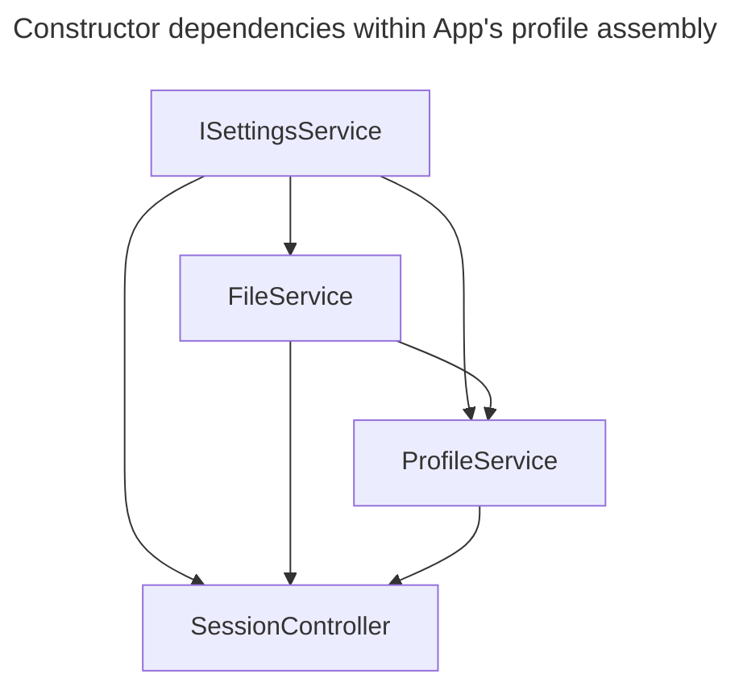
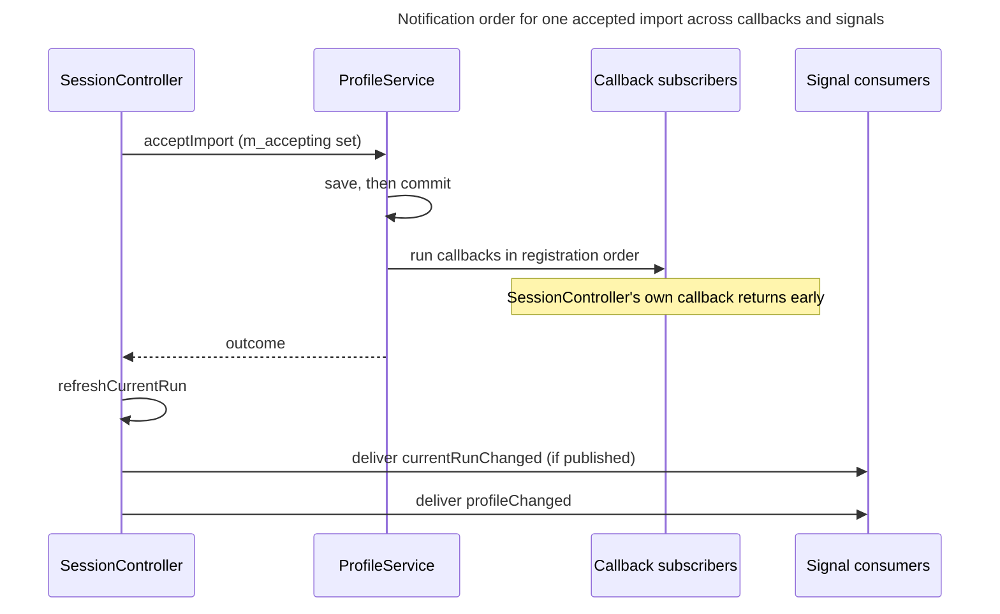

# Composition root

## Concern and reader outcome

`App::App()` is the only place where concrete services, use cases and view models meet. There is no dependency-injection framework, so construction order determines which dependencies are available and which subscribers receive the first profile notification. Before adding a service, use case or view model, a maintainer needs to know its injected dependencies, construction position, notification channel and lifetime. This view explains those constraints and which worker operations can delay exit.

## Scope and exclusions

This view covers object assembly in [`App`](../../../src/app/app.cpp), callback and signal registration, ownership, and shutdown. [Profile lifecycle][profile-lifecycle] describes the import protocol, and [QML boundary][qml-boundary] describes how QML receives the view models. Use-case algorithms and build-target dependencies are outside this view.

## Architectural account

### What `App` assembles

The injected `App` constructor accepts eight dependencies. The delegating constructors supply the production defaults below; the consumer column names where each injected dependency enters the assembly ([`App::App`](../../../src/app/app.cpp), [`app.h`](../../../src/app/app.h)).

| Injected interface | Production default | Constructor consumer |
|---|---|---|
| `ISettingsService` | `SettingsService` | `FileService`, `ProfileService`, `SessionController`, `RecentBenchmarks`, `SettingsViewModel`; also the default `GraphConfigurationPersistence` |
| `IProtoDecoder` | `ProtoDecoder` | `FileService` |
| `IGraphConfigurationPersistence` | `GraphConfigurationPersistence` over the same settings instance | `GraphConfigurationService`, which supplies `GraphConfigurationUseCase` |
| `IStatsCsvParser` | `StatsCsvParser` | `FileService` |
| `IBenchmarkStore` | `BenchmarkStore` rooted at `<AppDataLocation>/benchmarks` | `BenchmarksService` |
| `IDaySource` | `SystemDaySource` | `BenchmarkTrackingUseCase`, `PlaytimeGraphUseCase`, `CompletionHistoryUseCase` |
| `IClipboardImageWriter` | `QtClipboardImageWriter` | `ImageOutputUseCase` |
| `IPngImageWriter` | `QtPngImageWriter` | `ImageOutputUseCase` |

The remaining assembly is fixed inside `App::App()`. In particular, tests and tools steer the concrete `FileService`'s scans and watches through the paths reported by the injected `ISettingsService`; they cannot substitute `IFileService`.

**Type:** constructor dependency flowchart. **Scope:** constructor arguments among `ISettingsService`, `FileService`, `ProfileService` and `SessionController`; other arguments are outside this model. **Concern:** these dependencies constrain the order in which the profile assembly can be constructed. Arrows describe argument provision, not execution order or ownership.

**Key**

- Solid directed arrow: is passed as a constructor argument to, from provider to consumer

`FileService` must exist before `ProfileService`, and both must exist before `SessionController`. The construction-order table below adds the side effects that make the first profile load depend on this assembly ([`App::App`](../../../src/app/app.cpp)).

Most view models receive use-case contracts. Three have direct dependencies that need a separate account:

| View model | Direct dependencies and consequence |
|---|---|
| `SettingsViewModel` | `ISettingsService`, `IFileService`, `IProfileService` and `IGraphConfigurationUseCase`. The three service ports bypass the use cases, the debt recorded in [ADR 0004](../decisions/0004-route-view-model-interactions-through-use-cases.md). |
| `SessionViewModel` | `ISessionController`, a Qt-bearing application interface allowed by ADR 0004. |
| `CaptureViewModel` | `IImageOutputUseCase` and raw pointers to `GraphViewModel`, `PlaytimeGraphViewModel`, `CompletionHistoryViewModel` and `BenchmarkTrackingViewModel`. It constructs its own `CaptureCoordinator`; those live-model dependencies stay within presentation and constrain construction and teardown. |

Evidence: [`App::App`](../../../src/app/app.cpp), [`SettingsViewModel`](../../../src/ui/presentation/app/settings_vm.cpp), [`CaptureViewModel`](../../../src/ui/presentation/capture/capture_vm.cpp).

The constructor dependency graph is acyclic. `CaptureViewModel` depends on four graph-bearing view models through raw pointers; the remaining view models are terminal consumers. `App` is the one place that includes concrete types of `qt_data`, `data` and `ui`; the layering rule in `AGENTS.md` applies to every other file.

### Construction order and why it matters

The order inside `App::App()` is partly forced by constructor arguments and partly by what each constructor does as a side effect.

| Step | Constructed | Side effect that makes the position matter |
|---|---|---|
| 1 | `GraphConfigurationService`, then `GraphConfigurationUseCase` | The service loads the persisted configuration in its constructor (`m_persistence->load()`), so graph configuration is available synchronously before any use case asks for it. The use case is built immediately after its service, before any file or profile object. |
| 2 | `FileService`, `RunIngestor`, `ProfileImporter` | `FileService` starts watching in its constructor and registers its `onKovaaksDirsChanged` callback with the settings service. |
| 3 | `ProfileService` | Registers `onSourcesChanged` (file service), `onProfilePathChanged` and `onKovaaksDirsChanged` (settings service). Starts no import. |
| 4 | `SessionController` | Starts the profile import thread (`m_build_thread`), registers `onProfileChanged`, and installs the single-slot `onBuildRequested` and `onRefreshRequested` requesters on the profile service. |
| 5 | `loadProfile()` | Reads the stored profile on the calling thread. Success: install it and request a Refresh with reason `Startup` through the requester. No usable file: request a Rebuild through the requester. |
| 6 | `BenchmarksService`, `BenchmarkResolutionUseCase`, `BenchmarkManagerUseCase`, `BenchmarkTrackingUseCase` | `BenchmarksService` reads its store in its constructor. The resolution and tracking use cases subscribe in their constructors and then pull current state once. |
| 7 | Graph use case and `GraphViewModel`, then `onCurrentPerfChanged` and an explicit `fetchData()` | After constructing `GraphViewModel`, `App` registers its session callback through `onCurrentPerfChanged` and separately calls `fetchData()` to read the initial run, whose announcement has already fired. |
| 8 | Playtime, completion-history and scenario-browser use cases; `SessionViewModel`, `SettingsViewModel`, remaining view models | Session subscriptions are made at two kinds of site: the scenario-browser use case connects in its own constructor, while completion history's connections are installed by explicit `onCurrentScenarioChanged`, `onSelectedRunChanged` and `onRangeChanged` calls made after its view model exists. |
| 9 | `ImageOutputUseCase`, `CaptureViewModel` | Constructed last; the capture view model needs the four live graph view models. |

**The session controller's requesters must be installed before the first `loadProfile()`.** `ProfileService::loadProfile` calls `m_build_requester` when it exists and otherwise falls back to `generateProfileFromDirectory()`, which runs a full import synchronously on the calling thread; with a requester it only queues work on the profile import thread ([`ProfileService::loadProfile`](../../../src/data/profile_service.cpp)). Moving `loadProfile()` above the `SessionController` construction would turn a missing or rejected `profile.pb` into a blocking scan during startup. [Profile lifecycle][profile-lifecycle] explains the import modes and reasons.

**A consumer constructed after `loadProfile()` must read its initial state if it needs the stored profile.** `loadProfile()` runs at step 5, before the benchmark use cases and every view model exist. When a stored profile loads successfully, only `SessionController` receives that initial notification, because `setProfile` has notified only the callbacks registered so far. The consumers constructed later therefore read state in their own constructors: the resolution use case calls `reconcile()` after subscribing, the tracking use case calls `refresh()`, the playtime, history, browser and tracking view models call `refresh()`, `SessionViewModel` reads `isBuildInProgress()` and the import state, and `App` calls `m_graphVm->fetchData()` itself ([`BenchmarkResolutionUseCase`](../../../src/app/usecases/benchmark_resolution_use_case.cpp), [`BenchmarkTrackingUseCase`](../../../src/app/usecases/benchmark_tracking_use_case.cpp), [`SessionViewModel`](../../../src/ui/presentation/app/session_vm.cpp), [`App::App`](../../../src/app/app.cpp)). A new subscriber that only registers a callback will show an empty state until the next profile change. Neither channel replays past events.

### Two notification channels

| | Service callbacks | Session signals |
|---|---|---|
| Form | `std::function` registered through `on…` methods on `ISettingsService`, `IFileService`, `IProfileService`, `IBenchmarksService` and the use-case interfaces. The channel follows the interface, not the implementation: `FileService` and `SettingsService` are `QObject`s but publish through callbacks. | Qt signals on `ISessionController`: `currentRunChanged`, `profileChanged`, `profileImportStateChanged`, `buildStarted`, `buildProgress`, `buildFinished`. |
| Delivery | Synchronous, inside the notifier's call stack. The profile, settings and file-source callback lists are append-only vectors invoked in registration order. | Qt connections made by consumers; the order slots run in is connection order. Everything involved lives on the GUI thread, so delivery is by direct call (inferred from thread affinity, not observed). |
| Unsubscribe | Subscriptions are append-only: there is no unsubscribe on the interfaces read for this view. The two request hooks (`onBuildRequested`, `onRefreshRequested`) are a different kind of slot: each holds one requester, so a later registration replaces the earlier one, and `~SessionController` clears both hooks. | Use cases disconnect in their destructors (`ScenarioBrowserUseCase`, `CompletionHistoryUseCase`); `CompletionHistoryUseCase`'s `on…` methods disconnect and reconnect, so each registration method retains one callback. |
| Guard against a dead subscriber | `FileService`, `ProfileService` and `SessionController` capture a `weak_ptr` lifetime token; `SettingsViewModel` and `ScenarioBrowserViewModel` capture a `QPointer`. `BenchmarkResolutionUseCase`, `BenchmarkTrackingUseCase` and `PlaytimeGraphUseCase` capture a bare `this`. | Receiver lifetime is not assessed in this cell; the Unsubscribe row describes the consumers' explicit disconnection. |
| Subscribers to profile change | Direct registrations, in registration order: `SessionController`, `BenchmarkResolutionUseCase`, `BenchmarkTrackingUseCase`, `PlaytimeGraphUseCase`, `SettingsViewModel`. Delivery can nest. The resolution use case's `reconcile()` notifies the tracking use case before the tracking use case receives its own direct profile callback. | `profileChanged`: `CompletionHistoryUseCase`, then `SessionViewModel`, then `ScenarioBrowserUseCase`. `currentRunChanged`: the graph callback, `CompletionHistoryUseCase` (scenario change, then selection), then `ScenarioBrowserUseCase`. |

Evidence for the callback registrations: [`SessionController`](../../../src/app/session_controller.cpp) constructor, [`ProfileService`](../../../src/data/profile_service.cpp) constructor and [`profile_service.h`](../../../src/data/profile_service.h), [`FileService`](../../../src/qt_data/file_service.cpp) constructor, [`SettingsService`](../../../src/qt_data/settings_service.h), [`SettingsViewModel`](../../../src/ui/presentation/app/settings_vm.cpp) constructor, the use-case constructors named above. For the signals: [`ISessionController`](../../../src/app/usecases/i_session_controller.h), [`SessionViewModel`](../../../src/ui/presentation/app/session_vm.cpp), and the header-only [`CompletionHistoryUseCase`](../../../src/app/usecases/completion_history_use_case.h), [`GraphUseCase`](../../../src/app/usecases/graph_use_case.h) and [`ScenarioBrowserUseCase`](../../../src/app/usecases/scenario_browser_use_case.h).

**Type:** sequence. **Scope:** one accepted import that changed the profile, as seen by the two notification channels, with the save-then-commit gate collapsed into one step. **Concern:** the callback subscribers run before the session signals do.

**Key**

- Solid arrow, filled head: direct synchronous call, or signal delivery by direct connection (inferred from thread affinity)
- Dashed arrow, filled head: returned outcome
- Self-arrow: step inside one component

The callback-subscriber role represents the profile subscribers listed above, including `SessionController`, whose callback returns early on this path. The save-then-commit gate is shown only as a step, because [Profile lifecycle][profile-lifecycle] owns it.

- **On the accept path, callback subscribers see the new profile before the current run has been refreshed, and signal consumers see both.** `SessionController` sets `m_accepting` around `acceptImport`, so its own `onProfileChanged` callback returns early and the current-run update and both signals come afterwards. [Profile lifecycle][profile-lifecycle] owns that guard, the conditions under which `currentRunChanged` and `profileChanged` are emitted, and the selection rules; the point for a subscriber is only the order.
- **During a stored-profile load, `SessionController` emits session signals from its callback before the remaining profile callbacks run.** `loadProfile()` (including a runtime profile-path change through `applyProfilePath`) goes through `setProfile`, which notifies without `m_accepting` set, so the import acceptance guard does not apply to it. `SessionController` registered first, so its callback attempts `setCurrentRunToLatest` and emits `profileChanged` before the benchmark, playtime and settings subscribers run. That reselection still goes through the equality-guarded overload (the same-ID guard, which is a different guard from the import acceptance guard): when the latest run has the same id as the current one `SessionController` retains the previous `Run` payload even if the new store has different data for the same ID; `profileChanged` is emitted regardless.
- **A change to the configured KovaaK's source roots runs `FileService`'s watcher repoint before `ProfileService`'s invalidate-and-refresh**, purely because `FileService` is constructed, and so registers on `ISettingsService`, first (step 2 versus step 3). Reordering those two constructions would swap the callbacks. What each callback does is in [Profile lifecycle][profile-lifecycle]; the effects of reversing the callbacks were not traced through `acknowledgeImport` (see the limitations).
- **No dependence on relative order among the signal consumers was found in the code read.** The order is a by-product of the construction sequence, so a new consumer that reads state another consumer mutates would be order-sensitive by accident.

### Ownership and lifetime

The nine view models are created with `new …(…, this)`, so `App` is their `QObject` parent; `App` also stores them as raw pointers for `initialProperties()`. Use cases, services and the session controller are `shared_ptr`s: `App` keeps most of them in members, and each view model or use case keeps the ones it was constructed with. `SessionController`, `FileService`, `SettingsService` and the other service objects have no `QObject` parent. `main()` creates `App` after the `QGuiApplication`, so it is destroyed first: on a normal exit after `exec()` has returned, and on the early return when `App::start()` fails to load the QML, without `exec()` ever running ([`main.cpp`](../../../src/main.cpp)).

### Shutdown

Three worker resources exist outside the GUI thread, and one destructor per resource blocks the GUI thread. This view owns the teardown picture; [Profile lifecycle][profile-lifecycle] owns what an unaccepted import result means and [Image capture][image-capture] owns the runtime cancellation and pending-result semantics of a render or save.

| Worker resource and destructor | What it waits for | Why |
|---|---|---|
| The profile import thread: `SessionController` owns `m_build_thread` with a `ProfileBuildWorker` moved onto it; `SessionController::~SessionController` | `m_build_thread.quit()` then `wait()`. A build already running in the worker slot cannot be interrupted, so shutdown waits for the full import to return. It first stops the retry timer and clears both requester slots. | Source comment: `quit()` cannot interrupt a build, and the thread must not be torn down under it. |
| The PNG save pool: `ImageOutputUseCase` owns `m_savePool` (one thread); `ImageOutputUseCase::~ImageOutputUseCase` | `m_savePool.waitForDone()`. | A running save task uses the PNG writer and the completion context, which are members of the use case; `m_savePool` is declared last so it is destroyed first. |
| The capture render pool (one thread, covered by [Image capture][image-capture]): the capture render queue inside the capture view model's coordinator owns it; `CaptureRenderQueue::~CaptureRenderQueue` | Drops the pending render, sets the running render's cancellation flag, then `waitForDone()`. | Cancellation is cooperative: the wait lasts until the running render function returns. The production render passes the flag to `renderCapture` as a poll ([`capture_render.cpp`](../../../src/ui/capture/capture_render.cpp)), but an injected function need not poll and nothing imposes a timeout. |

Among background-import results, only an accepted one writes the profile (`ProfileService::acceptImport`, on the GUI thread); the separate GUI-thread version-3 migration write during load is independent of import acceptance ([`ProfileSerializer::load`](../../../src/data/formats/protobuf/profile_serializer.cpp)). A build that finishes during shutdown posts its result to a controller that is being destroyed, so that result is not accepted and `profile.pb` keeps its last accepted content (inferred from the save location and the destruction order; not observed at runtime).

**Destruction order is inferred from C++ and Qt rules rather than observed.** It is not asserted anywhere in the repository and was not exercised by a test or a debugger for this view.

The inference has two evidence bases. `App` holds `QQmlApplicationEngine m_engine` as its first data member. Under C++ member-destruction rules, data members are destroyed in reverse declaration order after `~App`'s body, which releases `App`'s shared ownership before destroying the engine; its raw pointer members do not delete the view models. Under Qt parent-child behaviour, `~QObject` then deletes the children front to back, which is creation order: graph, playtime, history, session, settings, scenario-browser, manager, tracking, capture view models ([`app.h`](../../../src/app/app.h), [`App::App`](../../../src/app/app.cpp)).

QML objects bound to the view models are destroyed with the engine before any view model is deleted. `CaptureViewModel`'s raw pointers to the four graph view models dangle during its own destruction because they were deleted first. Whether `~CaptureViewModel` or its coordinator dereferences them was not checked. A use case or service is destroyed when its last `shared_ptr` is released. Deleting the corresponding `App` member may therefore only release one owner; the last holder may be a view-model child.

## Consequences and invariants

- **Install the requesters before the first `loadProfile()`.** Moving the load above `SessionController` construction makes startup block on a directory scan when no usable profile exists.
- **A subscriber added after `loadProfile()` must pull.** A new consumer that only subscribes shows nothing until the next profile change.
- **Callbacks have no unsubscribe, so nothing may notify a subscriber after it is destroyed.** There is no unsubscribe on the interfaces read, and three use cases capture a bare `this` ([`BenchmarkResolutionUseCase`](../../../src/app/usecases/benchmark_resolution_use_case.cpp), [`BenchmarkTrackingUseCase`](../../../src/app/usecases/benchmark_tracking_use_case.cpp), [`PlaytimeGraphUseCase`](../../../src/app/usecases/playtime_graph_use_case.cpp)). Each holds a `shared_ptr` to the service it subscribed to, so the service cannot die first, but other holders can keep the service alive after the use case is gone; safety rests on no profile or benchmark notification being delivered during or after teardown, which holds as far as the code read shows (inferred; no destructor read invokes them). If the service invokes one of these callbacks after the use case is destroyed, the callback uses a dangling `this` pointer.
- **Cross-subscriber order is registration order, which `App::App()` sets by where constructors and explicit `on…` calls sit.** Dependent behaviour (directory change before refresh, `SessionController` first on the load path, the graph before history before browser on `currentRunChanged`) holds only because of that placement. Reordering constructions or registration calls is a behaviour change.
- **Adding a QML-facing view model changes both `App` and `Main.qml`.** It must be constructed in `App::App()`, stored for `initialProperties()`, and declared in `Main.qml`. A new `QML_ELEMENT` type is a separate registration concern: its header directory must be on the `ksv_ui` include path used by the generated registrar and, when nothing else in C++ references it, it must be referenced from `declare_metatypes()`; see [QML boundary][qml-boundary].
- **The GUI thread waits for outstanding worker operations during shutdown.** An import in flight, a PNG save in flight, and a capture render each hold it at exit.

## Evidence and limitations

Verified by reading: `src/main.cpp`; `src/app/app.{h,cpp}`; the constructor, destructor, `onBuildFinished`, `refreshCurrentRun` and `startImport` of `src/app/session_controller.cpp` and its header; `src/app/usecases/i_session_controller.h`; the constructor, `loadProfile`, `applyProfilePath`, `acceptImport` and callback members of `src/data/profile_service.{h,cpp}`; the constructor and callback registration of `src/qt_data/file_service.{h,cpp}` and `src/qt_data/settings_service.{h,cpp}`; the constructors of the resolution, tracking and playtime use cases and `BenchmarksService` and `GraphConfigurationService`; the header-only graph, completion-history and scenario-browser use cases; the constructors of the playtime, history, scenario-browser, tracking, session, settings and capture view models; and the destructors of `ImageOutputUseCase` and `CaptureRenderQueue`.

Observed documentation discrepancy: The source comment above the benchmark block says those objects are "built before the initial profile load", but the code constructs them after `loadProfile()`. This view describes the code; behaviour is still correct because of the pull-on-construct rule, not because of the ordering the comment claims.

Not established:

- Destruction order and the safety of callbacks that capture a bare `this` during teardown are inferred from C++ and Qt rules; no test or run exercised shutdown.
- That Qt signal delivery between these objects is always direct is inferred from the objects living on the GUI thread.
- What goes wrong if `FileService`'s repoint and `ProfileService`'s refresh run in the opposite order was not traced through `acknowledgeImport`.
- Whether a view model's destructor dereferences the raw pointers it holds to sibling view models (`CaptureViewModel`) was not read.
- The dev tools (`tools/gallery`, `tools/driver`) and test harnesses construct `App` through the injected constructor; their own wiring was not read.

Both diagrams were rendered and inspected at documentation width; this does not add runtime verification.

<!-- arch-doc:references:start -->
[image-capture]: image-capture.md
[profile-lifecycle]: profile-lifecycle.md
[qml-boundary]: qml-boundary.md
<!-- arch-doc:references:end -->
