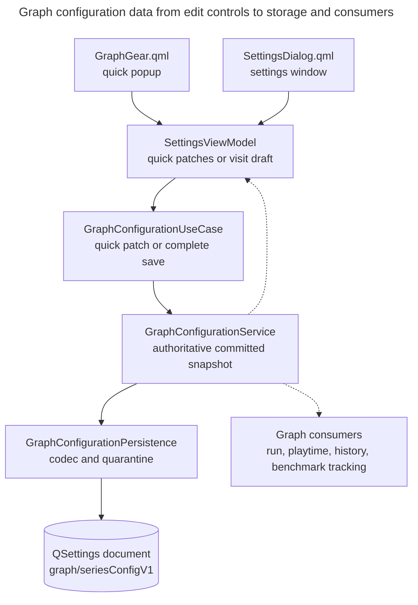

# Graph configuration

How do graph preferences, Graph Lines and the run graph's Y-axis label become committed configuration? This view follows edits from a control through validation and publication to every dependent graph, and shows how stored versions are loaded. Use this view when changing preferences, stored fields, settings controls or change subscriptions. It identifies the authoritative copy, the draft boundaries and the compatibility consequences of a stored-format change.

Consumer refresh behaviour belongs to [Graph presentation][graph-presentation] and [Benchmark tracking][benchmark-tracking]; this view only names the consumers of a published change. Whether a graph is shown at all is QML-owned state, described in the [QML boundary][qml-boundary] view, and is not part of this configuration.

## What the configuration is

`GraphConfiguration` ([graph_configuration.h](../../../src/app/contracts/graph_configuration.h)) contains a `GraphPreferences` entry for each `GraphKey`, the run graph's `RunSeriesDocument` (lines, axes and their two ID allocators), and an optional `runAxisLabel` that says which axis or unattached line labels the run graph's Y axis. The model and its validation rules live in the Qt-free `ksv_contracts` library, so each layer can use the same validation rules.

| Aspect | Rule | Evidence |
|---|---|---|
| Identity | A preference belongs to a graph type alone, never to a selected run, scenario or benchmark. There are six `GraphKey`s: `Run`, `DailyPlaytime`, `ScenarioHistory`, `BenchmarkRank`, `BenchmarkRecentRank`, `BenchmarkPlaytime`. | `GraphKey`, `kGraphKeys` |
| Shape per graph | One `GraphPreferences` shape serves every graph. A descriptor table says which fields a graph offers (date range, latest-runs range, averaging window, series keys with their axis keys, axes with default policies). Validation rejects unsupported fields as `NotApplicable`, `UnknownSeries` or `UnknownAxis`. The run graph's descriptor offers no range, series or axes, so its preferences are appearance only; its lines live in the `RunSeriesDocument`. | `graphDescriptor`, `makeDescriptors`, `validateGraphPreferences` in [graph_configuration.cpp](../../../src/app/contracts/graph_configuration.cpp) |
| Run series | Lines and axes are addressed by `SeriesId` and `AxisId` values. Within incremental edits an ID is never reused: each allocator only advances (`successor`). | `RunSeriesDocument`, `validateRunSeriesDocument`, `successor` in [run_series_editing.cpp](../../../src/app/contracts/run_series_editing.cpp) |
| Run axis label | A variant of axis ID or line ID. `reconciledRunAxisLabel` clears it when its target is gone and moves a line label to the axis the line has since joined; it runs after every Graph Lines edit and after every load. | `reconciledRunAxisLabel`, `runAxisLabelAfterDeletingAxis` |
| Equality | Defaulted member equality, except that expressions compare by canonical DSL text and not by node identity. | `operator==(RunSeriesDocument)`, `sameSeriesConfigs` |

An allocator becomes absent after issuing the largest possible ID (`successor` checks `std::numeric_limits<uint64_t>::max()` in [run_series_editing.cpp](../../../src/app/contracts/run_series_editing.cpp)).

Whole-document validation requires a present allocator to exceed every ID in use, and accepts an absent one only while the largest ID is still present in that collection, so deleting that last line or axis after exhaustion passes the per-edit check and fails Save.

Restore Default Graph Lines is the exception to non-reuse: it replaces the whole document and resets both allocators to the successors of the default IDs ([defaultRunSeriesDocument](../../../src/app/contracts/graph_configuration.cpp)), so custom IDs issued before it can be issued again.

Validation is one contract with three entry points: `validateGraphPreferences` for one graph, `validateRunSeriesDocument` for the document-level rules (ID uniqueness, axis references, allocator ordering) and `validateGraphConfiguration` for the whole value. Issues are keyed by `(graph, group, target, field)` with `group` one of `dataRange`, `axes`, `seriesStyle` or `graphLines`; the presentation layer reuses that key to place errors on controls. Axis-name uniqueness is deliberately not part of this contract: it is a presentation rule enforced by `SettingsViewModel::axisNameIssue`, so a persisted configuration can legitimately contain names that the editor would now refuse.

## Getting a change to the committed copy

Two paths write the committed copy and both end in `GraphConfigurationService::replace`. They differ in who holds the draft.

| | Quick patch | Settings visit |
|---|---|---|
| Entry | `GraphGear.qml` popup on each graph | `SettingsDialog.qml` window |
| Draft | None. Each control change submits one patch | One working copy of the whole configuration in `SettingsViewModel` (`m_working`), with a baseline, unparsed input and the issues of the last rejected Save |
| Scope | One graph: range, averaging window, connection, markers | Every graph and Graph Lines |
| Commit | `SettingsViewModel::applyQuickPatch` parses counts, then `GraphConfigurationUseCase::applyQuickPatch` copies the committed value, patches the one graph, validates that graph, then `replace` validates the whole | `SettingsViewModel::save` hands the complete working copy to `GraphConfigurationUseCase::save` |
| Failure | Issues returned to the gear, nothing changes | Issues returned; window stays open with the working copy |

The quick patch contract also allows series and axis-policy changes (`GraphQuickPatch`), but `SettingsViewModel::applyQuickPatch` only builds the four fields above. A count that is not a whole number is reported as an issue without reaching the use case.

## Authority and flow

The committed configuration is held by `GraphConfigurationService` ([graph_configuration_service.cpp](../../../src/data/graph_configuration_service.cpp)) as an immutable `shared_ptr<const GraphConfiguration>` plus an in-process revision. It is the only element that replaces the committed copy, and it keeps no editor working copy. At construction, the service loads its initial committed value from the stored document. It then serves reads from its in-memory committed copy; the document persists that copy and is not read again.

**Type:** data-flow. **Scope:** one configuration change from the quick-popup or settings-window path to the committed copy, its stored document and the graph consumers (run, playtime, history, benchmark tracking); the consumers' later pull of the committed value is omitted. **Concern:** committed authority, persistence data flow and change notifications.

**Key**

- Unlabelled solid arrow: hands configuration data to, from producer to recipient
- Dashed arrow: committed-change notification carrying `GraphConfigurationChange`
- Cylinder: persisted form

A dashed arrow carries only a `GraphConfigurationChange` (revision plus which sections changed), never the configuration itself; the notification reaches the use case's `onChanged` subscribers, which are the consumers and the view model. Consumers also pull the full committed value with `IGraphConfigurationUseCase::current()`; that read is not drawn.

Consumers see committed configuration only: no draft edit reaches a graph consumer before the service commits it, so a draft cannot affect a graph. The settings view model is both a writer and a subscriber. During a visit it receives notifications of its own commits while draft controls keep reading its working copy, so it must not let a committed notification overwrite a draft (see the visit protocol below).

### Committing a change

`GraphConfigurationService::replace` ([graph_configuration_service.cpp](../../../src/data/graph_configuration_service.cpp)) is the single commit step:

1. It validates the whole candidate with `validateGraphConfiguration`. If validation finds issues, the service returns them with the current revision and stops before writing or publishing.
2. It diffs the candidate against the committed copy with `diffGraphConfigurations`. An empty diff returns success without writing or publishing.
3. It calls `IGraphConfigurationPersistence::save` before swapping. `save` returns `void`, and `GraphConfigurationPersistence::save` submits the whole encoded document to `ISettingsService::setSeriesConfigDocument`. **Acceptance means "the write was submitted"**, as `IGraphConfigurationUseCase::save` documents. The persistence port cannot report a write failure to the service, so the service still advances the in-memory copy.
4. Under the mutex it swaps the pointer and increments the revision, then publishes the change.

The first publisher drains a first-in, first-out (FIFO) notification queue (`GraphConfigurationService::publish`): a callback that calls `replace` again appends its change and returns, and the outer loop delivers it after the current callback list finishes, so subscribers are notified in revision order.

A subscriber can receive an earlier revision's notification and read a later committed snapshot: a nested `replace` swaps the committed pointer before it enqueues its notification, so a subscriber handling an older notification can already see a newer revision from a fresh `current()`. `snapshot()` is safe from any thread; `replace` and `onChanged` belong to one thread, which in this application is the GUI thread (stated by the `IGraphConfigurationService` contract, not enforced by code).

The revision is an in-process counter that starts at 1 at each launch (`GraphConfigurationService` constructor) and is not persisted. The service loads in its constructor, called from `App::App()` ([app.cpp](../../../src/app/app.cpp)) before any consumer exists, so there is no initial notification: every consumer must pull `current()` when it needs state, and one constructed later cannot rely on having seen a change. The [Composition root][composition-root] view owns the construction-order rules in general.

### Change sections

A change identifies the affected graph and configuration sections: `GraphSectionChange` owns the per-graph `range` (including the anchor flag), `window` (averaging window) and `style` (appearance, series overrides, axis policies) flags. `GraphConfigurationChange` owns the document-wide `runSeries` and `runAxisLabel` flags ([graph_configuration.h](../../../src/app/contracts/graph_configuration.h)). Each consumer selects which state to refresh from the reported sections:

| Consumer | Reacts to | Evidence |
|---|---|---|
| `GraphUseCase` (run graph) | `runSeries`, `runAxisLabel`; style through `GraphPresentationSource` | [graph_use_case.h](../../../src/app/usecases/graph_use_case.h) |
| `PlaytimeGraphUseCase` | `DailyPlaytime` range or window; style through its source | [playtime_graph_use_case.cpp](../../../src/app/usecases/playtime_graph_use_case.cpp) |
| `CompletionHistoryUseCase` | `ScenarioHistory` range; style through its source | [completion_history_use_case.h](../../../src/app/usecases/completion_history_use_case.h) |
| `BenchmarkTrackingUseCase` | `BenchmarkRank` and `BenchmarkRecentRank` range (rank-only refresh of the personal-best and recent-rank graphs, which plot `averageRankHistory` and `recentAverageRankHistory`), `BenchmarkPlaytime` range or window (playtime-only refresh), one combined style announcement | [benchmark_tracking_use_case.cpp](../../../src/app/usecases/benchmark_tracking_use_case.cpp) |
| `SettingsViewModel` | any graph preference change (quick settings), run series and label when no visit is open | [settings_vm.cpp](../../../src/ui/presentation/app/settings_vm.cpp) |

`GraphPresentationSource` ([graph_presentation_source.h](../../../src/app/usecases/graph_presentation_source.h)) is the shared adapter that turns a graph's `style` section into a presentation announcement. What each consumer does on notification is the concern of [Graph presentation][graph-presentation] and [Benchmark tracking][benchmark-tracking].

## Stored form and its evolution

The document is a single JSON string in QSettings under the historical key `graph/seriesConfigV1` (`SettingsService`, [settings_service.cpp](../../../src/qt_data/settings_service.cpp)), written whole by `encodeGraphConfigurationDocument` at `kGraphConfigurationSchemaVersion` 6 ([graph_configuration_codec.h](../../../src/qt_data/graph_configuration_codec.h)). Writing always produces the current schema; there is no downgrade.

Older schema versions are supported on read. `decodeGraphConfigurationDocument` accepts integral versions 1 to 6 and migrates in memory:

| Version | Read as |
|---|---|
| 1, 2 | Series-only documents. Version 1 is migrated to the current lines and axes model with a fixed legacy axis set; version 2 keeps structured expression JSON. |
| 3 | Series-only with expressions stored as DSL text. |
| 4 | Series section of version 3 plus `runAxisLabelSeriesId` (a line ID) and optional `graphs`. |
| 5 | Series section with `hiddenLeadingPoints`, plus `runAxisLabelSeriesId` and optional `graphs`. |
| 6 | As 5, but `runAxisLabel` is an `{axis}` or `{series}` object or null. |

(`decodeRunSeries` in [series_config_codec.cpp](../../../src/qt_data/series_config_codec.cpp) holds the per-version series rules; the mapping of 4 to the version-3 series format and 5 or later to the version-4 format is in `decodeGraphConfigurationDocument`.)

Decoding is strict within each section, but sections are recovered independently. `exactKeys` demands exactly the expected keys, IDs are canonical decimal strings, and numbers must be finite and in range. Each graph's preferences, the run series and the run axis label decode independently, and a decoded graph is also run through `validateGraphPreferences`. A section that fails is replaced by its defaults and flagged; the others are kept. `GraphConfigurationPersistence::load` ([graph_configuration_persistence.cpp](../../../src/qt_data/graph_configuration_persistence.cpp)) then decides what to do with the whole document:

| Stored state | Result of `load()` | Quarantine | Written back |
|---|---|---|---|
| No document | Defaults; run lines seeded from legacy `graph/disabledColumns`; run axis label from legacy `graphAxis/seriesId` if present | none | yes |
| Not a JSON object, no integral `schemaVersion`, or version below 1 or above 6 | Same as no document | whole raw text | yes |
| Valid, current or older version, every section accepted | Decoded and, for older versions, migrated in memory | none | no; an older document stays as stored until the next accepted change rewrites it as version 6 |
| Recognised document with one or more rejected sections | Accepted sections kept, rejected ones defaulted; a rejected run series is legacy-seeded as above, and a rejected label (not stored) falls back to the legacy selection as above | whole raw text, even though sections survive in the live copy | yes, as version 6 |

Quarantine (`SettingsService::quarantineSeriesConfigDocument`) copies the unreadable raw text under `graph/seriesConfigQuarantine/<UTC timestamp>` with a numeric suffix on collision; nothing in `SettingsService` removes these entries.

A malformed run axis label is flagged but leaves `runAxisLabelStored` false, whereas a valid label, including an explicit null, sets it ([decodeGraphConfigurationDocument](../../../src/qt_data/graph_configuration_codec.cpp)). A valid stored run axis label (including an explicit "none") always wins over the legacy `graphAxis/seriesId` selection; an absent or rejected one does not, and the legacy selection is tried. Either way the label is reconciled with the loaded lines before use ([GraphConfigurationPersistence::load](../../../src/qt_data/graph_configuration_persistence.cpp)). A version-4 or later document that lacks `graphs` is accepted with default preferences rather than rejected; a missing `runAxisLabel` falls back to the legacy selection.

## Settings visit protocol

`SettingsViewModel` ([settings_vm.h](../../../src/ui/presentation/app/settings_vm.h)) owns the visit:

- `beginVisit` seeds `m_working` and `m_baseline` from `current()`, and does nothing if a visit is already open. While `m_working` exists, `shownConfiguration` makes every read model (graph drafts, lines, axes, the expression editor's source) serve the working copy; without a visit they serve the committed copy.
- Control edits change only `m_working`. Text a control cannot parse is stored as raw input keyed by the same `(graph, group, target, field)` as an issue and is never placed in the candidate; raw input blocks `save`.
- `save` converts unparsed input into validation issues. It calls the use case with the whole working copy only when no such issues remain. On acceptance the baseline becomes the working copy and the visit stays open; on rejection the issues are kept and the working copy is unchanged. `save` is not rebased against the committed copy, so it would overwrite anything committed since `beginVisit`.
- `revertChanges` returns to the baseline (the seed or the last accepted save); `endVisit` discards the working copy without applying it.
- `pendingChanges` is true when raw input exists or the working copy differs from the baseline, so unparsed text counts as unsaved.
While a visit is open, committed notifications do not emit draft or lines signals, so a commit cannot rewrite what the person is editing. The notification rules in [`SettingsViewModel`](../../../src/ui/presentation/app/settings_vm.cpp) are:

| Change or operation | Visit open | Visit closed |
|---|---|---|
| Any graph preference change | `quickSettingsChanged`; no draft or lines signals | `quickSettingsChanged` and `graphDraftsChanged`; lines/axis-overview signals only if run lines or the label also changed |
| Run lines or axis label only | No signals | Lines and axis-overview signals only |
| `replaceWorkingCopy` | Refreshes draft, lines and axis overview | Refreshes draft, lines and axis overview; on `endVisit`, read models fall back to the committed copy |

The use case also holds no working copy: both `GraphConfigurationUseCase` methods start from `snapshot()` or from the caller's value and finish in `replace`.

Nothing prevents a quick patch and a visit overlapping in code. `SettingsDialog.qml` is a window-modal `ApplicationWindow`, which keeps the gear popups in the main window unreachable while a visit is open; ADR 0006 states that this is why no conflict protocol exists. Window modality supplies the exclusion in the UI; the commit path has no overlap check.

### QML close and commit protocol

`SettingsDialog.qml` begins a visit when it is shown from a closed state (`_show` calls `beginVisit`) and ends it on every close path. A maintainer must preserve three rules:

- **Commit the focused field first.** Line and axis names use `CommitOnFinishField` ([CommitOnFinishField.qml](../../../src/ui/qml/common/CommitOnFinishField.qml)), which reaches the view model only on `editingFinished`, an event that closing the window does not fire. `commitActiveEdit` therefore fires it explicitly when the focused field's text differs from `committedText`, before Save and in `onClosing`. Save's enablement also counts `hasUncommittedEdit`. The cached `focusedField` property exists to avoid a binding loop when disabling the focused button changes the active focus item.
- **Veto while dirty.** `onClosing` commits, then if `pendingChanges` is set it refuses the close and opens the Save / Discard / Cancel prompt; only a clean close calls `endVisit`.
- **Save keeps the visit.** The window's regular Save button does not close the window; the visit continues with the saved copy as the baseline, so Cancel afterwards drops only later edits.

| Action | Effect on visit and window |
|---|---|
| Prompt: Save | Accepted Save closes the window and ends the visit through `onClosing`; rejected Save leaves both open so issues can be corrected. |
| Prompt: Discard | Calls `endVisit`, then closes. |
| Prompt: Cancel | Dismisses the prompt; visit and window remain open. |
| Window: Cancel | Calls `endVisit` and closes directly. |

Profile-page fields in the same window (the configured KovaaK's source roots, profile path) act immediately and are outside the visit; they are covered by [Profile lifecycle][profile-lifecycle]. The window's own size and last page are QML settings, not graph configuration.

## Graph Lines and expressions

Run-graph lines and axes are edited as transformations of a caller-owned `RunSeriesDocument` in `run_series_editing` ([run_series_editing.cpp](../../../src/app/contracts/run_series_editing.cpp)). Each incremental edit helper copies the document, edits the copy and installs it only if `validateSeriesConfigs` accepts it (`install`), so a failed edit leaves the working copy untouched. Restore Default Graph Lines is the exception: `SettingsViewModel::restoreDefaultGraphLines` assigns `defaultRunSeriesDocument()` and clears the label directly, relying on the defaults being valid. That per-edit check covers the series only; axis references and allocator rules are checked at `save` through `validateRunSeriesDocument`. `SettingsViewModel::applyRunSeriesEdit` reconciles the axis label after every successful edit.

The expression domain-specific language (DSL) has a canonical text form, defined in [expression_dsl.h](../../../src/app/contracts/expression_dsl.h): `encodeExpressionDsl` emits one canonical spelling and spacing, and `decodeExpressionDsl` accepts noncanonical case and whitespace between tokens, so decode then encode is byte-identical only for text already in canonical form. Only the empty string is a null expression; whitespace-only text is a parse failure ([expression_dsl.cpp](../../../src/app/contracts/expression_dsl.cpp)).

The same text is the stored form from schema 3, the transport between C++ and QML (`allSeriesConfigs`, `updateComputedSeries`), the clipboard form, and the basis of expression equality. A DSL grammar change is therefore a persisted-format change.

The expression editor is a second, nested draft. `SettingsViewModel::beginExpressionEdit` returns a new, parentless `SeriesExpressionEditorModel` loaded from the shown configuration; `ExpressionEditorDialog.qml` creates one each time it becomes visible (`onVisibleChanged`), replacing whatever `editorModel` it held. Its tree edits touch nothing else. Save sends the model's DSL text to `updateComputedSeries`, which edits the visit's working copy; Cancel leaves the working copy untouched; the dialog keeps its `editorModel` reference until the next open replaces it. The expression editor's Save therefore updates only the visit's working copy; only a successful settings commit publishes it to graph consumers.

An incomplete tree yields empty DSL text, which `decodeTransportExpression` turns into a null expression; a null top-level expression is valid (a deliberately blank series that plots nothing, see the comment in `validateSeriesConfigs`), so accepting an incomplete tree stores a blank line instead of being refused. The dialog itself does not disable Save for an incomplete tree.

## Consequences and invariants

- **One writer of the committed copy.** Only `GraphConfigurationService::replace` swaps it, and the only caller is `GraphConfigurationUseCase`; the persistence port supplies the initial value at construction and stores each committed document. Adding a second writer, or letting a consumer hold and mutate a configuration, would break the guarantee that graphs follow committed revisions; the published object is `const`.
- **Diff completeness.** `replace` writes and publishes only when `diffGraphConfigurations` finds a change. A new `GraphPreferences` field that is not folded into one of the diff's sections makes an edit to it look like no change, so it would be silently neither persisted nor published. A new field must also be added to the descriptor rules, `graphSectionKeys`, `encodeGraph` and `decodeGraph`.
- **Persist before swap, with no failure channel.** Reordering the swap ahead of `save` would let consumers see state that was never submitted; making `save` fallible needs a new result path through the service, use case and view model, because none exists today.
- **Whole-candidate validation and atomic acceptance.** Invalid input on any graph blocks the whole save, and no observer sees a partial set of graphs. Validating only the edited section in `replace` would break this.
- **Stored-format strictness has a whole-document cost.** `exactKeys` rejects unknown keys, so stored keys and decoder must change together. A decoder changed to require a new key under an existing version rejects older documents' affected section, and an older decoder rejects the section of a document that carries a newly written key. A rejected section quarantines the entire raw document (never pruned by code). Add read-time migrations that keep older documents loadable, and continue writing only the current version.
- **Drafts stay in presentation.** The working copy, raw input and expression model are never visible to a consumer. A feature that read `shownConfiguration` outside the view model, or committed per edit during a visit, would let uncommitted edits reach the graphs.
- **The visit is not rebased.** `save` overwrites the committed copy with the whole working copy. This is safe only while no other commit can happen during a visit; removing the window modality or adding a background writer of configuration breaks it.
- **Close protocol.** Skipping `commitActiveEdit` before the dirty check loses the focused field's text and can let a dirty window close silently.
- **Duplicate graph registry in QML.** `GraphCatalog.js` ([GraphCatalog.js](../../../src/ui/qml/graph/GraphCatalog.js)) lists the six graph keys, display names and workspaces and is not generated from `GraphKey`; `SettingsDialog.qml` and the gear rely on it (`isKnown`, `nameOf`). A new `GraphKey` must be added there by hand or the graph is unreachable in the settings window.

## Evidence and limitations

ADR [0006](../decisions/0006-unified-graph-configuration-and-presentation-drafts.md) lists five graph types and schema version 4; the implementation has six and version 6. Its ownership split (service, persistence, use case, view-model draft) agrees with the code.

Verified against source: the contracts model, validation and diff (`graph_configuration.{h,cpp}`), `run_series_editing`, the DSL header and `validateSeriesConfigs` null-expression rule, `GraphConfigurationService`, `GraphConfigurationUseCase`, `GraphConfigurationPersistence::load`, the document codec (`decodeGraphConfigurationDocument`, `encodeGraphConfigurationDocument`), the series codec's version dispatch and legacy seeding, `SettingsService` document and quarantine methods, the visit, quick-patch and Graph Lines parts of `SettingsViewModel`, the close and commit logic of `SettingsDialog.qml`, `GraphGear.qml`, `CommitOnFinishField.qml`, `ExpressionEditorDialog.qml`, `GraphCatalog.js`, and the construction in `App::App()`.

Not established: the exact per-field details of the version 1 to 3 series migrations beyond their dispatch, the expression-node limit value, the internals of `EditableExpressionNode` and the expression tree editor, and how `GraphViewModelBase` consumers refresh after a notification. The earlier review left ownership transfer of the model returned by `beginExpressionEdit` unresolved; it read the code but ran no ownership test. Durability of the QSettings write is not verified anywhere (the persistence port states the same). The earlier implementation review did not render the diagram. The revised diagram was rendered and inspected at documentation width. The claim that the gear is unreachable during a visit rests on `Qt.WindowModal` in `SettingsDialog.qml` and ADR 0006, not on a test.

<!-- arch-doc:references:start -->
[benchmark-tracking]: benchmark-tracking.md
[composition-root]: composition-root.md
[graph-presentation]: graph-presentation.md
[profile-lifecycle]: profile-lifecycle.md
[qml-boundary]: qml-boundary.md
<!-- arch-doc:references:end -->
