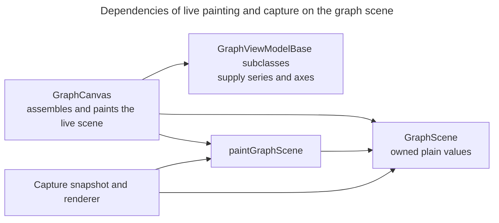

# Graph presentation

## Concern and reader outcome

How do graph view models, the canvas and the painter divide responsibility for presenting run, playtime, completion-history and benchmark data? Use this view when adding a graph, changing axis scaling or changing the painter. It explains the common view-model contract, series addressing, shared Y axes and the value-only scene used by live painting and capture.

This view refines the presentation layer's graph element (the graph view models, the `GraphCanvas` item and the QML panels around it). It covers structure and responsibility. The refresh triggered by a run change is in [Run selection and rendering][run-selection-and-rendering]. [Graph configuration][graph-configuration] explains the origin, validation and persistence of series definitions, ranges and styles. Snapshotting a scene for export, the render queue and output are in [Image capture][image-capture]. How view models reach QML is in [QML boundary][qml-boundary].

## Architectural account

### The view-model family

Every graph view model derives from `GraphViewModelBase` ([graph_vm_base.h](../../../src/ui/presentation/graphs/common/graph_vm_base.h)). The base defines what `GraphCanvas` may ask of any graph:

- `series(columns)` returns the `SeriesModel` objects for the requested columns, in the graph's line-list order, omitting columns the graph does not plot.
- `xAxis()` is the default X axis that series are plotted against. A `SeriesModel` may carry its own `xAxis`, which `GraphCanvas` prefers over the view model's both when assembling the scene and when mapping points ([xAxisFor](../../../src/ui/components/graph_canvas.cpp)).
- `yAxisColumn()` names the default labelled Y column.
- `dataUpdated`, `boundsChanged` and `styleChanged` distinguish changes to points, axis geometry and appearance (connection mode, markers, colours or widths) respectively.
- `connectionMode` and `pointMarkers` expose the committed appearance.

A returned series need not contain drawable data. Filtering uses the requested columns, not drawability: the run graph (`GraphViewModel::series`) and completion history return a requested model even when its points are empty, and playtime does the same whether or not `hasData()` holds. Only the benchmark model returns nothing while it has no data (`BenchmarkHistoryViewModel::series`, gated on `m_hasData`). The pointers belong to the view model; [pointer lifetime](#consequences-and-invariants) says how long they stay valid.

| View model | Backed by | Graph | X axis |
|---|---|---|---|
| `GraphViewModel` ([graph_vm.cpp](../../../src/ui/presentation/graphs/graph_vm.cpp)) | `IGraphUseCase` (`GraphUseCase`) | The selected run's configured series over time | `ValueAxis` in seconds, zero baseline |
| `PlaytimeGraphViewModel` ([playtime_graph_vm.cpp](../../../src/ui/presentation/graphs/playtime_graph_vm.cpp)) | `IPlaytimeGraphUseCase` (`PlaytimeGraphUseCase`) | Daily or rolling-average playtime | `DateTimeAxis`, whole days |
| `CompletionHistoryViewModel` ([completion_history_vm.cpp](../../../src/ui/presentation/graphs/completion_history_vm.cpp)) | `ICompletionHistoryUseCase` (`CompletionHistoryUseCase`) | The scenario's runs in order, six metrics | `ValueAxis` over run numbers |
| `BenchmarkHistoryViewModel` ([benchmark_history_vm.cpp](../../../src/ui/presentation/benchmarks/tracking/benchmark_history_vm.cpp)) | No use case of its own: `BenchmarkTrackingViewModel` pushes `update()` and `setPresentation()` | One benchmark metric: the `benchmarkRank` graph (`averageRankHistory`, the mean normalised personal best), the `benchmarkRecentRank` graph (`recentAverageRankHistory`) or `benchmarkPlaytime` (rolling playtime) | A date axis owned by the parent and passed by reference |

`GraphUseCase` depends on `ISessionController`, `IGraphConfigurationUseCase` and `IAverageLineUseCase` ([graph_use_case.h](../../../src/app/usecases/graph_use_case.h)). `PlaytimeGraphUseCase` depends on `IProfileService`, `IGraphConfigurationUseCase` and `IDaySource`; `CompletionHistoryUseCase` adds `ISessionController` to that set ([completion_history_use_case.h](../../../src/app/usecases/completion_history_use_case.h)). All three are wired in `App::App()` ([app.cpp](../../../src/app/app.cpp)).

The benchmark pipeline that feeds the fourth family is owned by [Benchmark tracking][benchmark-tracking]; here it matters only as a `GraphViewModelBase` subclass whose X axis is shared and externally owned (`BenchmarkHistoryViewModel` documents that the axis "must outlive this object").

The run, playtime and completion-history view models each read their committed style from their use case's `presentation()` and re-apply it when `onPresentationChanged` fires (`applyPresentation` in each), emitting `styleChanged`. The benchmark history models do not subscribe: `BenchmarkTrackingViewModel` subscribes once and pushes each graph's presentation to its child through `setPresentation` ([benchmark_tracking_vm.cpp](../../../src/ui/presentation/benchmarks/tracking/benchmark_tracking_vm.cpp) `applyPresentation`). The configuration that produces those values is the [Graph configuration][graph-configuration] concern.

### Column addressing

`GraphCanvas` and the QML panels address a series by an `int` column, but each graph defines it differently:

| Graph | Column meaning | Evidence |
|---|---|---|
| Run | A series' own `SeriesId::value`, never a position; `seriesIdForColumn`/`columnForSeriesId` translate to and from the string ids QML holds. | `GraphViewModel::fetchMetadata`, `fetchData` |
| Completion history | Fixed `Column` enum: `RunIndex` (0, the axis only), `Score`, `Accuracy`, `Shots`, `Hits`, `Misses`, `ScoreAverage`; series ids are the same numbers as strings | `CompletionHistoryViewModel` constructor |
| Playtime | `Column { Date = 0, Playtime = 1 }`; only `Playtime` yields a series | `PlaytimeGraphViewModel::series` |
| Benchmark metric | `Column { Date = 0, Value = 1 }`; only `Value` yields a series, and none while the metric has no data | `BenchmarkHistoryViewModel::series` |

The run-graph mapping is exact only for ids that fit a positive `int`: `fetchMetadata` uses `QString::toInt()` and `fetchData` a `static_cast<int>`, and configuration validation does not bound ids ([`graph_vm.cpp`](../../../src/ui/presentation/graphs/graph_vm.cpp), [`series_config.cpp`](../../../src/app/contracts/series_config.cpp)).

### Axes and series

`SeriesModel` ([series_model.h](../../../src/ui/presentation/graphs/common/series/series_model.h)) is a `QObject` carrying identity (`id`, `column`), display name and colour (an invalid colour means neutral), line width, a `ValueTransform` (raw to display value and its formatter), raw `points`, optional `leadingCarry`/`trailingCarry` boundary geometry, optional reference lines, an optional resolved `yAxis`, and `yAxisId`/`yAxisName`.

Only `points` are actual observations: tooltips, hit tests and selection address them; carries extend the drawn line at its boundaries and are excluded from sampling.

Axes derive from `Axis` ([axis.h](../../../src/ui/presentation/graphs/common/axes/axis.h)), a read-only surface (bounds, ticks, formatter) whose resolved state is replaced as one unit. `ValueAxis` computes nice bounds and ticks from a data range under `Options` (baseline, integral ticks, target ticks, `niceBounds`); `DateTimeAxis` is the calendar variant. `axis_policy` ([axis_policy.h](../../../src/ui/presentation/graphs/common/axes/axis_policy.h)) maps a committed `AxisPolicy` (fit visible data, start at zero, fixed bounds) to `ValueAxis` options, falling back to fitting the data when fixed bounds are unusable.

Completion history uses the first and last visible run as X bounds when two or more runs are visible. With none visible it uses `1..runCount`; with one visible run, `ValueAxis::recompute` widens the span (`CompletionHistoryViewModel` in [completion_history_vm.cpp](../../../src/ui/presentation/graphs/completion_history_vm.cpp)).

**Shared Y axis.** A Y axis belongs to a group of series, and for data-derived bounds its range is the union of the display ranges of the members currently requested (`axisForSeries`; `axisForPolicy` falls back to it unless fixed bounds are usable). It is computed inside `series(columns)` and written onto each member, so it depends on which columns are visible:

| Graph | Grouping | How the axis is set |
|---|---|---|
| Run | Series with the same `yAxisId` (series config's axis); a series with no axis id keeps its own derived axis | `GraphViewModel::series`: options and transform from the configured `AxisConfig` |
| Completion history | Fixed three groups: score (Score, ScoreAverage), accuracy, counts (Shots, Hits, Misses) | `CompletionHistoryViewModel::series`: `axisForPolicy` with the committed per-group `AxisPolicy` |
| Playtime, benchmark playtime | One series | `applyAxisPolicy` on refresh and on policy change |
| Benchmark ranks | One series | `rankYAxis`: zero to the shown tier count, one tick per tier, tier names as labels, tier reference lines |

`GraphCanvas` chooses the labelled Y column in this order: its requested `yAxisColumn` if visible, the first visible column, then the view model's default (`GraphCanvas::labelledYAxisColumn`). The group always includes the selected series; it includes other visible series only when the selected series has a `yAxisId` and they share it, so a line with no axis id is a group of one (`labelledAxisGroup`). The axis title comes from the axis name or the member names (`labelledYAxisTitle`).

### Content states

Each panel chooses what to show from its view model's content state, counts or flags. The run graph has an explicit `ContentState` (`NoRunSelected`, `NoPerformanceData`, `HasData`) derived in `GraphViewModel::fetchData`. The other three expose counts and flags instead: completion history `runCount`/`visibleRunCount`, playtime `hasData`/`historyAvailable`/`noObservationsInRange`, benchmark metrics those plus `noPointsInRange` (a points-only mode over a range holding only carried state). In every panel the canvas is created by a `Loader` only while the panel's content gate is true (`DashboardGraphCanvas.qml`: `HasData`; `PlaytimeGraphPanel.qml`: `hasData`; `ScenarioHistoryPanel.qml`: `visibleRunCount >= 1`; [BenchmarkHistoryCard.qml](../../../src/ui/qml/benchmark/BenchmarkHistoryCard.qml): `hasData`). An active loader does not guarantee visible points: the benchmark card keeps it active under `hasData` while a separate label reports `noPointsInRange`. Empty-state labels occupy the same area so the panel does not resize.

### The painting boundary

**Type:** dependency view. **Scope:** the elements that build, hold or paint a `GraphScene` (the canvas, the graph view-model base, the scene, the painter function and capture's snapshot and renderer), and nothing else in the graph element. **Concern:** live painting and capture share a painter whose graph input consists only of owned scene values.

**Key**

- Unlabelled solid arrow: depends on, from the dependent to its dependency

The painter can replay a scene without accessing the live canvas or view model. `GraphCanvas` is a `QQuickPaintedItem`; its `scene()` ([graph_canvas.cpp](../../../src/ui/components/graph_canvas.cpp)) resolves everything painting needs into a `GraphScene` ([graph_scene.h](../../../src/ui/components/graph_scene.h)): resolved axes with ticks and formatted labels; per-series display-space observations, carries, axis bounds, reference lines and styling (colour resolved against the foreground and line width); and scene-wide appearance (connection mode, markers and background) and labelled-axis selection, columns and title. Every member is an owned value (no pointer, `QObject` or callable), which the header states is what lets a scene outlive the canvas and view model that built it and be replayed off the GUI thread. `GraphCanvas::paint` calls `paintGraphScene(painter, scene(), bounds)`; the capture renderer calls the same `paintGraphScene` overload with an explicit style and cancellation check ([capture_renderer.cpp](../../../src/ui/capture/capture_renderer.cpp)). How a scene is copied for export, and what is removed from the copy, belongs to [Image capture][image-capture].

`graphPlotRect` computes the plot rectangle from the labelled Y axis and the X axis. The painter uses it, and so does `GraphCanvas::plotRect` for hover geometry. This keeps hover geometry aligned with the painted plot. `GraphCanvas::plotRect` passes an empty X axis while the painter passes the real one; the two agree because the horizontal label extent is always the font height (`AxisPainter::measureLabelExtent`), so omitting the labels preserves the bottom margin for the same style.

### QML composition and overlay

The dashboard panels (`DashboardGraphCanvas`, `ScenarioHistoryPanel`, `PlaytimeGraphPanel`, and the benchmark history card) are `Frame`s composed of a title, capture actions, a settings gear, a legend (`ControlPanel`) where the graph has toggleable lines, and a `Loader` for the plot. The plot is `GraphCanvasWithTooltip` ([GraphCanvasWithTooltip.qml](../../../src/ui/qml/graph/GraphCanvasWithTooltip.qml)): a `GraphCanvas` with a `MouseArea` and QML-drawn overlay (vertical rule, per-series hover dots, tooltip box) positioned from `canvas.valuesAtX`, which samples the live `SeriesModel`s.

The panel supplies `visibleColumns`, `yAxisColumn`, `pointMarkers` and `connectionMode` from the view model and visual settings.

The history panel also supplies `markedX` (the selected run) and enables click selection through `pointClicked`.

`YAxisTitle` is laid out from `canvas.plotArea` and `labelledYAxisTitle`. `GraphCanvas` reaches only `GraphViewModelBase`, so any family member can be bound to it.

## Consequences and invariants

- **Y axis depends on visibility.** The shared axis is computed from the columns passed to `series()`. Hiding a line rescales its group whenever the axis bounds are data-derived and the hidden line changes the extent; a fixed completion-history policy with usable bounds overrides the data-derived range (`axisForPolicy`, `usableBounds`), so there hiding a line leaves the axis alone. Computing the axis outside `series()` (or caching it across a visibility change) would leave the painted range inconsistent with the visible lines.
- **Pointer lifetime and freshness.** Models are deleted only by the run graph's `fetchMetadata` (`qDeleteAll(m_seriesById)`); `fetchData` reuses existing models and the other graphs mutate theirs in place. A held `SeriesModel *` can dangle after a metadata refresh. While the model remains alive, its points and `yAxis` can still change. Consumers re-ask `series()` for each use, as `GraphCanvas` does, which is what yields current geometry.
- **Column semantics are per graph.** A column number means nothing without its view model. In particular the run graph's columns are series ids, so inserting or reordering lines must not renumber them (the mapping holds while ids stay within `int` range, which nothing enforces); using a position would break the id mapping the QML legend and visibility settings use.
- **Painter purity.** `paintGraphScene` and `graphPlotRect` must depend only on `GraphScene` and styles. Giving the scene a pointer to a model or a callable (the `ValueTransform` formatter is one, which is why labels are resolved into strings in `resolveAxis`) would break off-thread replay and let capture diverge from the live item.
- **Selection is live-only.** The live canvas sets the selected-run band in the scene; [Image capture][image-capture] owns removing it from exported copies.
- **Shared date axes (benchmark).** The benchmark metrics draw against an axis the parent owns; a child must not outlive or replace it. The rebuild protocol is owned by [Benchmark tracking][benchmark-tracking].

## Evidence and limitations

Verified by reading the view-model headers and sources, `series_model.h`, `axis.h`, `value_axis.h`, `axis_policy.{h,cpp}`, `graph_canvas.{h,cpp}`, `graph_scene.h`, `graph_scene_painter.{h,cpp}`, the four QML files named above, and the call sites of `paintGraphScene` found by search.

Not read: `ValueAxis::resolve`/tick algorithm, `DateTimeAxis` internals, `AxisPainter`/`SeriesPainter`, the capture layout builders, `PlaytimeGraphUseCase` source, and `BenchmarkTrackingViewModel` and the benchmark history card QML beyond the presentation-forwarding and loader-gate lines cited above.

The review established how the canvas uses `SeriesModel::xAxis`, but did not verify which producers supply it. The earlier implementation review did not render the Mermaid diagram or check graph behaviour in a running application. The revised diagram was rendered and inspected.

<!-- arch-doc:references:start -->
[benchmark-tracking]: benchmark-tracking.md
[graph-configuration]: graph-configuration.md
[image-capture]: image-capture.md
[qml-boundary]: qml-boundary.md
[run-selection-and-rendering]: run-selection-and-rendering.md
<!-- arch-doc:references:end -->
