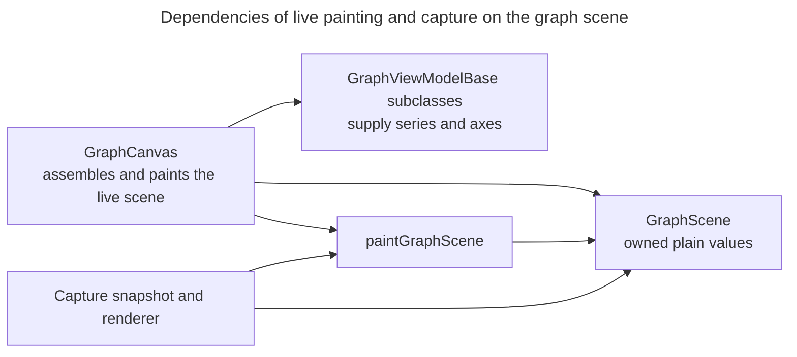

# Graph presentation

## Concern and reader outcome

How do graph view models, the canvas and the painter divide responsibility for presenting run, playtime, completion-history and benchmark data? Use this view when adding a graph, changing axis scaling or changing the painter. It explains the common view-model contract, series addressing, shared Y axes and the value-only scene used by live painting and capture.

This view refines the presentation layer's graph element (the graph view models, the `GraphCanvas` item and the QML panels around it). It covers structure and responsibility, and the local presentation protocols inside the graph element: style-change callbacks, the order in which a view model installs delegates and the shared Y axis, series-pointer invalidation on refresh, and the loader and content-state gates. End-to-end flows stay with the owning views. The refresh triggered by a run change is in [Run selection and rendering][run-selection-and-rendering]. [Graph configuration][graph-configuration] explains the origin, validation and persistence of series definitions, ranges and styles. Snapshotting a scene for export, the render queue and output are in [Image capture][image-capture]. How view models reach QML is in [QML boundary][qml-boundary].

## Architectural account

### The view-model family

Every graph view model derives from `GraphViewModelBase` ([graph_vm_base.h](../../../src/ui/presentation/graphs/common/graph_vm_base.h)). The base defines what `GraphCanvas` may ask of any graph:

- `series(columns)` returns the `SeriesModel` objects for the requested columns, in the graph's line-list order, omitting columns the graph does not plot.
- `xAxis()` returns the X axis used to plot series. Consumers must query it again when they need the current axis and must not assume its values are epoch milliseconds: `BenchmarkHistoryViewModel::xAxis()` can switch between calendar and run axes. `GraphCanvas` gives an optional `SeriesModel::xAxis` precedence over the view model's axis ([xAxisFor](../../../src/ui/components/graph_canvas.cpp)). No production code assigns this series-level override, so production graphs use the view model's axis.
- `yAxisColumn()` names the default labelled Y column.
- `dataUpdated`, `boundsChanged` and `styleChanged` distinguish changes to points, axis geometry and appearance (connection mode, markers, colours or widths) respectively.
- `connectionMode` and `pointMarkers` expose the committed appearance.

A returned series need not contain drawable data. Filtering uses the requested columns, not drawability: the run graph (`GraphViewModel::series`) and completion history return a requested model even when its points are empty, and playtime does the same whether or not `hasData()` holds. Only the benchmark model returns nothing while it has no data (`BenchmarkHistoryViewModel::series`, gated on `m_hasData`). The pointers belong to the view model; [pointer lifetime](#consequences-and-invariants) says how long they stay valid.

| View model | Backed by | Graph | X axis |
|---|---|---|---|
| `GraphViewModel` ([graph_vm.cpp](../../../src/ui/presentation/graphs/graph_vm.cpp)) | `IGraphUseCase` (`GraphUseCase`) | The selected run's configured series over time | `ValueAxis` in seconds, zero baseline |
| `PlaytimeGraphViewModel` ([playtime_graph_vm.cpp](../../../src/ui/presentation/graphs/playtime_graph_vm.cpp)) | `IPlaytimeGraphUseCase` (`PlaytimeGraphUseCase`) | Daily or rolling-average playtime | `DateTimeAxis`, whole days |
| `CompletionHistoryViewModel` ([completion_history_vm.cpp](../../../src/ui/presentation/graphs/completion_history_vm.cpp)) | `ICompletionHistoryUseCase` (`CompletionHistoryUseCase`) | The scenario's runs in order, six metrics | `ValueAxis` over run numbers, labelled with run dates |
| `BenchmarkHistoryViewModel` ([benchmark_history_vm.cpp](../../../src/ui/presentation/benchmarks/tracking/benchmark_history_vm.cpp)) | No use case of its own: `BenchmarkTrackingViewModel` pushes `update()` and `setPresentation()` | One benchmark metric: the `benchmarkRank` graph (`averageRankHistory`, the mean normalised personal best), the `benchmarkRecentRank` graph (`recentAverageRankHistory`) or `benchmarkPlaytime` (rolling playtime) | Its own `DateTimeAxis` and `RunDateAxis`; `xAxis()` is whichever the last `update()` was laid out for |

`GraphUseCase` depends on `ISessionController`, `IGraphConfigurationUseCase` and `IAverageLineUseCase` ([graph_use_case.h](../../../src/app/usecases/graph_use_case.h)). `PlaytimeGraphUseCase` depends on `IProfileService`, `IGraphConfigurationUseCase` and `IDaySource`; `CompletionHistoryUseCase` adds `ISessionController` to that set ([completion_history_use_case.h](../../../src/app/usecases/completion_history_use_case.h)). All three are wired in `App::App()` ([app.cpp](../../../src/app/app.cpp)).

[Benchmark tracking][benchmark-tracking] owns the pipeline that feeds `BenchmarkHistoryViewModel`. This view covers the model as a `GraphViewModelBase` subclass that owns both X axes and chooses which one `xAxis()` returns. Its parent, `BenchmarkTrackingViewModel`, sets the range of the axis used for the content and then calls `update()`. The benchmark-tracking view owns that rebuild protocol.

The run, playtime and completion-history view models each read their committed style from their use case's `presentation()` and re-apply it when `onPresentationChanged` fires (`applyPresentation` in each), emitting `styleChanged`. The benchmark history models do not subscribe: `BenchmarkTrackingViewModel` subscribes once and pushes each graph's presentation to its child through `setPresentation` ([benchmark_tracking_vm.cpp](../../../src/ui/presentation/benchmarks/tracking/benchmark_tracking_vm.cpp) `applyPresentation`). The configuration that produces those values, including the rank graphs' `xAxis` and `tierRounding`, is the [Graph configuration][graph-configuration] concern; what the parent rebuilds when either changes is described in [Benchmark tracking][benchmark-tracking].

### Column addressing

`GraphCanvas` and the QML panels address a series by an `int` column, but each graph defines it differently:

| Graph | Column meaning | Evidence |
|---|---|---|
| Run | A series' own `SeriesId::value`, never a position; `seriesIdForColumn`/`columnForSeriesId` translate to and from the string ids QML holds. | `GraphViewModel::fetchMetadata`, `fetchData` |
| Completion history | Fixed `Column` enum: `RunIndex` (0, the axis only), `Score`, `Accuracy`, `Shots`, `Hits`, `Misses`, `ScoreAverage`; series ids are the same numbers as strings | `CompletionHistoryViewModel` constructor |
| Playtime | `Column { Date = 0, Playtime = 1 }`; only `Playtime` yields a series | `PlaytimeGraphViewModel::series` |
| Benchmark metric | `Column { Date = 0, Value = 1 }`; only `Value` yields a series, and none while the metric has no data | `BenchmarkHistoryViewModel::series` |

The run-graph mapping is exact only for ids that fit a positive `int`: `fetchMetadata` uses `QString::toInt()` and `fetchData` a `static_cast<int>`, and configuration validation does not bound ids ([`graph_vm.cpp`](../../../src/ui/presentation/graphs/graph_vm.cpp), [`series_config.cpp`](../../../src/app/contracts/series_config.cpp)).

### Axes and series

`SeriesModel` ([series_model.h](../../../src/ui/presentation/graphs/common/series/series_model.h)) is a `QObject` carrying identity (`id`, `column`), display name and colour (an invalid colour means neutral), line width, a `ValueDelegate` (raw to display value and its axis label), raw `points`, optional `leadingCarry`/`trailingCarry` boundary geometry, optional reference lines, an optional resolved `yAxis`, and `yAxisId`/`yAxisName`.

Only `points` are actual observations: tooltips, hit tests and selection address them; carries extend the drawn line at its boundaries and are excluded from sampling.

Axes derive from `Axis` ([axis.h](../../../src/ui/presentation/graphs/common/axes/axis.h)), a read-only interface exposing bounds, ticks and a delegate. Its resolved state is replaced as one unit. `ValueAxis` computes nice bounds and ticks from a data range using `Options`: baseline, integral ticks, target ticks, `niceBounds`, and an explicit `step`. An explicit `step` bypasses `targetTicks`, `integral` and `distinctLabels`.

`DateTimeAxis` is the calendar variant. `RunDateAxis` ([run_date_axis.h](../../../src/ui/presentation/graphs/common/axes/run_date_axis.h)) uses run numbers, one unit per run, labelled with UTC dates. Its ticks mark the first visible run of each calendar period. It chooses periods from the interval ladder shared with `DateTimeAxis` ([calendar_interval.h](../../../src/ui/presentation/graphs/common/axes/calendar_interval.h)). Both axis types report the day range used to select their data through `Axis::calendarRangeMs()`.

`axis_policy` ([axis_policy.h](../../../src/ui/presentation/graphs/common/axes/axis_policy.h)) maps a committed `AxisPolicy` (fit visible data, start at zero or fixed bounds) to `ValueAxis` options. It falls back to fitting the data when fixed bounds are unusable or the axis descriptor has no default policy (`axisPolicyFor`).

An axis formats through a `ValueDelegate` ([value_delegate.h](../../../src/ui/presentation/graphs/common/axes/value_delegate.h)): `scale` and `offset` convert a raw value for display, `axisFormatter` labels ticks, and an optional `hoverFormatter` labels hovered values. `Axis::formatTick` and `formatHover` expose the two, and `GraphCanvas::valuesAtX` takes the hover text for both X and Y values from `formatHover` and `ValueDelegate::hoverLabel`, so a hover label can carry more than the tick does (a run's date and time against a date alone).

Completion history keeps run numbers as its X values and labels them with dates: each `refresh()` installs a delegate built from the visible runs' start times (`runDateDelegate`), which labels any value with the date of the nearest visible run, and only then sets the range. It uses the first and last visible run as X bounds when two or more runs are visible. With none visible it uses `1..runCount`; with one visible run, `ValueAxis::recompute` widens the span (`CompletionHistoryViewModel` in [completion_history_vm.cpp](../../../src/ui/presentation/graphs/completion_history_vm.cpp)). Selection and `valueAtX` still address run numbers. This delegate formats dates in the local time zone, whereas `RunDateAxis` uses UTC.

**Shared Y axis.** A Y axis belongs to a group of series, and for data-derived bounds its range is the union of the display ranges of the members currently requested (`axisForSeries`; `axisForPolicy` falls back to it unless fixed bounds are usable). It is computed inside `series(columns)` and written onto each member, so it depends on which columns are visible:

| Graph | Grouping | How the axis is set |
|---|---|---|
| Run | Series with the same `yAxisId` (series config's axis); a series with no axis id keeps its own derived axis | `GraphViewModel::series`: options and delegate from the configured `AxisConfig` |
| Completion history | Fixed three groups: score (Score, ScoreAverage), accuracy, counts (Shots, Hits, Misses) | `CompletionHistoryViewModel::series`: `axisForPolicy` with the committed per-group `AxisPolicy` |
| Playtime, benchmark playtime | One series | `applyAxisPolicy` on refresh and on policy change |
| Benchmark ranks | One series | `rankYAxis`, driven by the committed `rank` policy and the graph's `tierRounding`; see below |

**Rank Y axis.** `BenchmarkHistoryViewModel::rankYAxis` builds the benchmark rank graphs' axis from the committed policy. The `rank` axis supports start-at-zero and fit-visible-data; fixed bounds are unavailable. Start-at-zero spans zero (Unranked) to the shown tier count, with a tick per tier.

Fit-visible-data is the default. It rounds the visible line's range outward according to `tierRounding`: `Both` snaps both edges to whole tiers; `Above` and `Below` snap one edge and pad the other to the next tick of a 10, 20 or 50 % step (`paddedRankStep`); `Off` pads both. Ticks use `ValueAxis::Options::step`, which honours fractional steps. `rankAxisDelegate` labels whole values with tier names and intermediate ticks with percentages toward the next tier.

The shown tiers extend to one above the full-history peak, which determines which tier reference lines exist. The canvas skips reference lines outside the axis. The view model retains the tiers and peak between updates, so changing the policy or rounding only recalculates this Y axis's bounds (`refreshRankAxis`); it does not change the content.

`GraphCanvas` chooses the labelled Y column in this order: its requested `yAxisColumn` if visible, the first visible column, then the view model's default (`GraphCanvas::labelledYAxisColumn`). The group always includes the selected series; it includes other visible series only when the selected series has a `yAxisId` and they share it, so a line with no axis id is a group of one (`labelledAxisGroup`). The axis title comes from the axis name or the member names (`labelledYAxisTitle`).

### Content states

Each panel chooses what to show from its view model's content state, counts or flags. The run graph has an explicit `ContentState` (`NoRunSelected`, `NoPerformanceData`, `HasData`) derived in `GraphViewModel::fetchData`. The other three expose counts and flags instead: completion history `runCount`/`visibleRunCount`, playtime `hasData`/`historyAvailable`/`noObservationsInRange`, benchmark metrics those plus `noPointsInRange` (a points-only mode over a range holding only carried state). In every panel the canvas is created by a `Loader` only while the panel's content gate is true (`DashboardGraphCanvas.qml`: `HasData`; `PlaytimeGraphPanel.qml`: `hasData`; `ScenarioHistoryPanel.qml`: `visibleRunCount >= 1`; [BenchmarkHistoryCard.qml](../../../src/ui/qml/benchmark/BenchmarkHistoryCard.qml): `hasData`). An active loader does not guarantee visible points: the benchmark card keeps it active under `hasData` while a separate label reports `noPointsInRange`. Empty-state labels occupy the same area so the panel does not resize.

### The painting boundary

**Type:** dependency view. **Scope:** the elements that build, hold or paint a `GraphScene` (the canvas, the graph view-model base, the scene, the painter function and capture's snapshot and renderer), and nothing else in the graph element. **Concern:** live painting and capture share a painter whose graph input consists only of owned scene values.

**Key**

- Unlabelled solid arrow: depends on, from the dependent to its dependency

The painter can replay a scene without accessing the live canvas or view model. `GraphCanvas` is a `QQuickPaintedItem`; its `scene()` ([graph_canvas.cpp](../../../src/ui/components/graph_canvas.cpp)) resolves everything painting needs into a `GraphScene` ([graph_scene.h](../../../src/ui/components/graph_scene.h)). The scene contains resolved axes with ticks and formatted labels; per-series display-space observations, carries, axis bounds, reference lines and styling; scene-wide connection mode, markers and background; and the labelled-axis selection, columns and title. Series colours are resolved against the foreground, and widths come from the models. The run graph does not copy configured widths into its models; see the width invariant below.

Every scene member is an owned value, with no pointer, `QObject` or callable. As the header states, this lets a scene outlive the canvas and view model that built it and be replayed off the GUI thread. `GraphCanvas::paint` calls `paintGraphScene(painter, scene(), bounds)`. The capture renderer calls the same overload with an explicit style and cancellation check ([capture_renderer.cpp](../../../src/ui/capture/capture_renderer.cpp)). [Image capture][image-capture] owns how a scene is copied for export and what is removed from the copy.

`graphPlotRect` computes the plot rectangle from the labelled Y axis and the X axis. The painter uses it, and so does `GraphCanvas::plotRect` for hover geometry. This keeps hover geometry aligned with the painted plot. `GraphCanvas::plotRect` passes an empty X axis while the painter passes the real one; the two agree because the horizontal label extent is always the font height (`AxisPainter::measureLabelExtent`), so omitting the labels preserves the bottom margin for the same style.

### QML composition and overlay

The dashboard panels (`DashboardGraphCanvas`, `ScenarioHistoryPanel`, `PlaytimeGraphPanel`, and the benchmark history card) are `Frame`s composed of a title, capture actions, a settings gear, a legend (`ControlPanel`) where the graph has toggleable lines, and a `Loader` for the plot. The plot is `GraphCanvasWithTooltip` ([GraphCanvasWithTooltip.qml](../../../src/ui/qml/graph/GraphCanvasWithTooltip.qml)): a `GraphCanvas` with a `MouseArea` and QML-drawn overlay (vertical rule, per-series hover dots, tooltip box) positioned from `canvas.valuesAtX`, which samples the live `SeriesModel`s.

The panel supplies `visibleColumns`, `yAxisColumn`, `pointMarkers` and `connectionMode` from the view model and visual settings.

The history panel also supplies `markedX` (the selected run) and enables click selection through `pointClicked`.

`GraphCanvasWithTooltip` also takes an optional `hoverDetail` function from its panel, which maps the hovered raw X value to one extra line shown under the tooltip header. Two panels supply one (`Run: #N`), so the callback assumes X values that are run numbers. `ScenarioHistoryPanel` always supplies it, and titles its X axis `Date`. [BenchmarkHistoryCard.qml](../../../src/ui/qml/benchmark/BenchmarkHistoryCard.qml) binds it only while `historyModel.runAxisShown` is true and binds null on the calendar axis, so the callback is removed whenever the X values are epoch milliseconds. A panel that binds the canvas to a view model whose X values are not run numbers must not reuse that callback unconditionally; the card's conditional binding is the pattern.

`YAxisTitle` is laid out from `canvas.plotArea` and `labelledYAxisTitle`. `GraphCanvas` reaches only `GraphViewModelBase`, so any family member can be bound to it.

## Consequences and invariants

- **Y axis depends on visibility.** The shared axis is computed from the columns passed to `series()`. Hiding a line rescales its group whenever the axis bounds are data-derived and the hidden line changes the extent; a fixed completion-history policy with usable bounds overrides the data-derived range (`axisForPolicy`, `usableBounds`), so there hiding a line leaves the axis alone. Computing the axis outside `series()` (or caching it across a visibility change) would leave the painted range inconsistent with the visible lines.
- **Pointer lifetime and freshness.** Models are deleted only by the run graph's `fetchMetadata` (`qDeleteAll(m_seriesById)`); `fetchData` reuses existing models and the other graphs mutate theirs in place. A held `SeriesModel *` can dangle after a metadata refresh. While the model remains alive, its points and `yAxis` can still change. Consumers re-ask `series()` for each use, as `GraphCanvas` does, which is what yields current geometry.
- **Column semantics are per graph.** A column number means nothing without its view model. In particular the run graph's columns are series ids, so inserting or reordering lines must not renumber them (the mapping holds while ids stay within `int` range, which nothing enforces); using a position would break the id mapping the QML legend and visibility settings use.
- **Painter purity.** `paintGraphScene` and `graphPlotRect` must depend only on `GraphScene` and styles. A model pointer or callable in the scene would break off-thread replay and let capture diverge from the live item. `ValueDelegate` formatters are callables, so `resolveAxis` resolves labels into strings; retaining run-date delegates would also retain their table of run dates.
- **Selection is live-only.** The live canvas sets the selected-run band in the scene; [Image capture][image-capture] owns removing it from exported copies.
- **`xAxis()` is the axis the last `update()` laid out.** `BenchmarkHistoryViewModel::update` installs the content and switches `xAxis()` together (`Content::onRunAxis`), because the X units differ: epoch milliseconds on the calendar axis, the benchmark run number on the run axis. The ordering of range and `update()` is owned by [Benchmark tracking][benchmark-tracking].
- **Hover text goes through the hover formatters.** Tooltip and hover text must use `formatHover` and `ValueDelegate::hoverLabel`, not `formatTick`; otherwise the tooltip loses the detail (the time of day for a run) that the tick label omits. Completion history installs its run-date delegate before it sets the range, so the final ticks are never labelled from the previous run set.

- **Configured run-line width does not reach the painter.** The scene owns a width per series, copied from `SeriesModel` by `GraphCanvas::scene()`. `GraphViewModel::fetchMetadata` builds each run `SeriesModel` from the configuration's name, colour, transform, axis and column, but does not transfer `config.presentation.lineStyle.width`, and `fetchData` does not assign it either; a `TODO(2026-08-18)` in `graph_vm.cpp` marks the outstanding transfer. A width edited in the settings window is stored, committed and triggers the metadata rebuild, but every run model keeps its default width (`kDefaultSeriesWidth` in `series_model.h`), so live painting and capture both draw the default. Colour is transferred; width is the gap. Fixing it means assigning the width in `fetchMetadata`.

## Evidence and limitations

Verified by reading at v1.1.0: `benchmark_history_vm.{h,cpp}`, `run_date_axis.{h,cpp}`, `calendar_interval.h`, `value_delegate.h`, `axis.h`, `value_axis.h`, the `step` branch of `value_axis.cpp`, `axis_policy.{h,cpp}`, the run-date delegate and refresh of `completion_history_vm.cpp`, the hover calls in `graph_canvas.cpp`, `GraphCanvasWithTooltip.qml` and `ScenarioHistoryPanel.qml` (the `hoverDetail` lines), and the presentation-forwarding code of `BenchmarkTrackingViewModel::applyPresentation`. A search over `src/ui` found no assignment to `SeriesModel::xAxis`; tests were not searched. Read at v1.0.0 and not re-read: `graph_scene.h`, `graph_scene_painter.{h,cpp}` (unchanged since v1.0.0 by the discovery diff), `series_model.h`, the other view-model sources and the loader-gate lines of the QML panels.

Not read: `ValueAxis::resolve` and its tick algorithm, `DateTimeAxis` internals, `periodOpeners` in `RunDateAxis`, `AxisPainter` and `SeriesPainter`, the capture layout builders, `PlaytimeGraphUseCase` source, and `BenchmarkTrackingViewModel` beyond `applyPresentation` and the lines that call `update()`.

The earlier implementation review did not render the Mermaid diagram or check graph behaviour in a running application. The diagram, which this pass did not change, was rendered and inspected in the earlier revision.

<!-- arch-doc:references:start -->
[benchmark-tracking]: benchmark-tracking.md
[graph-configuration]: graph-configuration.md
[image-capture]: image-capture.md
[qml-boundary]: qml-boundary.md
[run-selection-and-rendering]: run-selection-and-rendering.md
<!-- arch-doc:references:end -->
