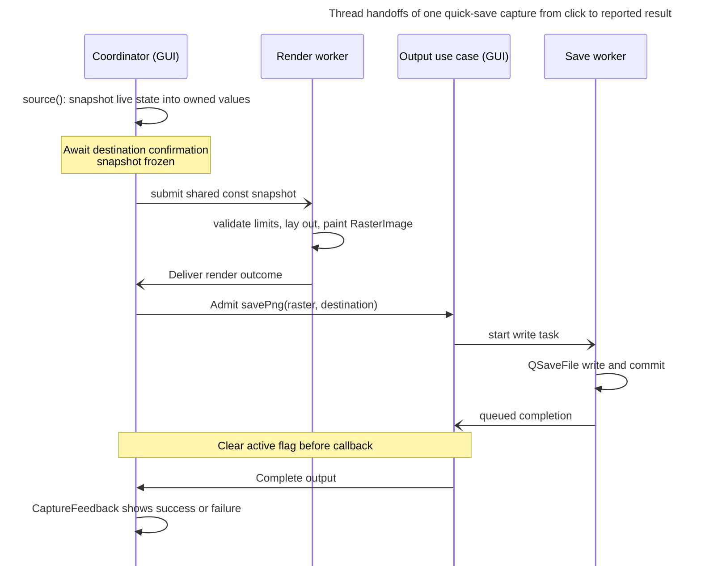

# Image capture

Image capture lets users copy or save a freshly rendered image of any of the six graphs or of the benchmark tracking table. How does capture turn live presentation state into a PNG or clipboard image while keeping worker threads away from live objects? This view explains request admission, stale-result rejection and destination-file protection. A maintainer changing what a capture contains, how it is sized, or how its result is reported needs the ownership and ordering rules below.

The view begins when a QML action calls `CaptureViewModel`. An admitted output ends with one result from `ImageOutputUseCase`, displayed by `CaptureFeedback`; refusals, empty captures and rejected or failed previews end earlier with a message. It does not cover detailed process teardown (see [Composition root][composition-root]), how graphs are modelled or painted live (see [Graph presentation][graph-presentation]), where the table's content comes from (see [Benchmark tracking][benchmark-tracking]), the layout algorithms inside `graph_capture_layout.cpp` and `table_capture_layout.cpp`, or the detailed composition in `App`. The accepted intent is [ADR 0007](../decisions/0007-presentation-owned-capture-snapshots-and-application-owned-output.md); the code agrees with it on every point examined here.

## Parts and where they live

| Part | Layer and location | Responsibility |
|---|---|---|
| `CaptureViewModel` | presentation, [`capture_vm.cpp`](../../../src/ui/presentation/capture/capture_vm.cpp) | Exposes capture commands to QML, maps target keys to capture source closures, holds the theme-derived `CaptureAppearance`, and forwards every command to the coordinator. |
| Capture sources | ui, [`capture_sources.cpp`](../../../src/ui/capture/capture_sources.cpp) | `captureGraph` and `captureTable` read live objects once, on the GUI thread, into owned snapshots. |
| `CaptureCoordinator` | ui, [`capture_coordinator.cpp`](../../../src/ui/capture/capture_coordinator.cpp) | GUI-thread state machine: admission, the preview session and its generation, the pending quick save, and matching output results to the operation it admitted. |
| `CaptureRenderQueue` | ui, [`capture_render_queue.cpp`](../../../src/ui/capture/capture_render_queue.cpp) | One thread (the capture render pool) with one running job and one replaceable pending slot; cancellation; delivery back to the GUI thread. |
| Render-function wrapper and renderer | ui, `makeCaptureRenderFunction` ([`capture_render.cpp`](../../../src/ui/capture/capture_render.cpp)) and `renderCapture` ([`capture_renderer.cpp`](../../../src/ui/capture/capture_renderer.cpp)) | Computes layout, validates limits, paints a `RasterBuffer` and creates a thumbnail from snapshot values on the worker. Runs on the worker. |
| `RasterImage` and `RasterBuffer` | contracts, [`raster_image.h`](../../../src/app/contracts/raster_image.h) | The Qt-free image handed to the output port; it is the image that is copied or exported. A render outcome also carries a separate `QImage` thumbnail across the render-to-GUI boundary for the preview ([`capture_render.h`](../../../src/ui/capture/capture_render.h) `CaptureRendered`). |
| `IImageOutputUseCase` and `ImageOutputUseCase` | contracts and app, [`image_output_use_case.cpp`](../../../src/app/usecases/image_output_use_case.cpp) | Single-flight output admission, the save worker, and exactly one result per admitted operation. |
| `IClipboardImageWriter`, `IPngImageWriter` and their Qt implementations | data ports in `src/data/interfaces/`, implementations in [`qt_clipboard_image_writer.cpp`](../../../src/qt_data/qt_clipboard_image_writer.cpp) and [`qt_png_image_writer.cpp`](../../../src/qt_data/qt_png_image_writer.cpp) | Publish clipboard images and write PNG files through Qt. |
| `CaptureFeedback` | ui, [`capture_feedback.cpp`](../../../src/ui/capture/capture_feedback.cpp) | The single status message the QML status strips show. |

Ownership follows the construction in [`app.cpp`](../../../src/app/app.cpp): `App` owns the `ImageOutputUseCase` and creates `CaptureViewModel` with the use case, the four live view models (run graph, playtime, completion history, benchmark tracking), and `makeCaptureRenderFunction(standardCaptureLimits(), standardCaptureComposition())`. The view model owns `CaptureFeedback` and `CaptureCoordinator`, and the coordinator owns the render queue. `App` receives both writer implementations through its constructor.

## One capture across three threads

**Type:** sequence. **Scope:** one quick save whose render succeeds and whose output is admitted, from the click to the reported result; refusal and failure branches are described below, and quick copy is omitted. **Concern:** how the snapshot crosses threads without exposing live GUI objects to the workers, with the acceptance point shown where the output is admitted.

**Key**

- Solid arrow, filled head, between participants: direct call
- Solid arrow, open head: queued handoff to another thread
- Solid self-arrow: local work on that participant's thread

For quick copy, `copyImage` publishes synchronously to the clipboard on the GUI thread and posts completion back to that thread, replacing the destination and save-worker steps.

Quick save freezes the target before opening the destination dialog, so it exports the state at the moment of the click, not at confirmation. `quickSave` stores the snapshot in `m_pendingSave` and emits `saveDestinationRequested`; confirmation (`confirmQuickSave` in [`capture_coordinator.cpp`](../../../src/ui/capture/capture_coordinator.cpp)) starts rendering the snapshot already held. After snapshot creation, the render and output stages do not read a live item or view model: `CaptureCoordinator::CaptureSource` is invoked only after admission, and the worker sees a `std::shared_ptr<const CaptureContent>`.

## Snapshots are owned values

`captureGraph` copies `GraphCanvas::scene()` into a `GraphCaptureSnapshot`, clears `selectedBand` (a live-only overlay, so exports never show the selection), and refuses a scene with no drawable observation or carried point. `captureTable` requires a tracking state of `trackable` or `incomplete` and a progress grid with at least one row; it then copies the grid's `content()` and, when the view model reports a summary, the summary values ([`captureTable`](../../../src/ui/capture/capture_sources.cpp)). Both return `std::nullopt` for nothing to capture, and the coordinator reports that as a failure message (`showNoContent`) instead of rendering an empty image. [`GraphScene`](../../../src/ui/components/graph_scene.h) states the invariant that makes this safe: every member is an owned value, so a scene outlives the canvas and view model that built it and can be replayed off the GUI thread. `CaptureAppearance` carries colours and a font description rather than a `QFont` or theme object, and the renderer builds fonts on the worker from that description (`captureFont` in `paintText`).

Copying the target's data lets a preview stay unchanged while imports and live updates keep changing the app, at the cost of one copy per capture. The appearance is read once, when `Main.qml` completes and calls `captureVm.useTheme(Theme, root.font)`; until then every source returns `std::nullopt`.

### The painter is shared with the live graph

The capture renderer replays the copied scene with the live canvas's `paintGraphScene`, using capture styling and a `CancellationCheck` ([`cancellation_check.h`](../../../src/ui/components/cancellation_check.h)). The live path supplies an empty cancellation check. A graph capture therefore replays the live drawing at a chosen size rather than grabbing the item. The scene and painter contract belong to [Graph presentation][graph-presentation]; the table is not drawn through `paintGraphScene`: it has its own layout path, `table_capture_layout.cpp`, over a `ProgressGridContent` value of the table's content ([Benchmark tracking][benchmark-tracking] owns that content).

## Render queue, sessions and generations

### Queue capacity and delivery

`CaptureRenderQueue` has a one-thread pool, one running job, and a single pending slot. `submit` starts the job if idle and otherwise overwrites the pending slot; a replaced pending job is dropped and never reports. The worker runs the render function, and if the job was not cancelled it posts the outcome through the queue's own `m_deliveryContext` to the GUI thread, where `done` runs only if the submitting object still exists, as checked through a `QPointer`.

Two mechanisms discard unwanted results, at different times. Session cancellation drops pending work or flags running work; generation checks reject obsolete outcomes at delivery.

### Cancellation

Cancellation is session-wide. `closePreview` calls `cancel(session)`, which drops that session's pending job and sets the running job's atomic flag. Layout is not polled; the flag is checked in `renderCapture` (on entry, before each painted item, inside the scene painter, and before the raster is frozen), so a render stops at the next of those checkpoints, not instantly. The worker posts its outcome only if the flag is still clear, but the posted GUI callback checks only that the submitting object exists ([`capture_render_queue.cpp`](../../../src/ui/capture/capture_render_queue.cpp) `runFrom`). A close after the post can therefore leave a delivery queued, and the coordinator discards it because its session is gone or changed (`installPreviewOutcome`). The queue destructor cancels the running job, drops the pending one and waits; the process-teardown picture is in [Composition root][composition-root].

### Preview generations

Generation identifies the current preview request or invalid input state. Each `PreviewSession` has an `id` and a `generation`. `setPercent`, `setIncludeSummary`, a committed dimension and `retryRender` go through `renderCurrentChoices`: when the options are renderable they start a new generation and submit a new request, and they do not cancel the running render.

While either dimension field holds malformed text nothing is submitted, even when another option changes or a retry is requested, until the text is corrected; entering the malformed text itself advances the generation, so an in-flight render is discarded and the preview shows `Invalid`.

When its outcome arrives, `installPreviewOutcome` ignores it unless both `session` and `generation` match the current session. A superseded running render is therefore still computed and, if it reaches delivery, discarded on the GUI thread; a replaced pending job never runs.

The preview state is `Rendering`, `Ready`, `Invalid` (a rejection or a malformed dimension), or `Failed`. Output is allowed only in `Ready` (`canOutput`). A preview's thumbnail is a separate, smoothly downscaled copy bounded by `CaptureLimits::thumbnailBytes` and shares no storage with the raster; the image that is copied or exported is the raster, never the thumbnail. `Export…` calls `beginExport`, which pins the displayed raster in the session and locks the options (`optionsLocked`) while the file dialog is open, so the file contains what was previewed. Cancelling the dialog unpins the raster. If the use case accepts the confirmed export, the coordinator starts the save and closes the session. If admission fails, it shows the busy notice and unpins the raster (see Admission).

## Admission

Coordinator admission protects UI preparation and session state by checking preparation, preview and destination state. Output admission in the use case protects the single platform operation. The GUI-thread admission checks need no lock because their entry points run on that thread.

| Entry | Refusal conditions | Notes |
|---|---|---|
| `quickCopy` | preparing, a preview session, a pending save, or an active output | A repeat for the same target while it is preparing is dropped silently (`m_preparing == target`). |
| `quickSave` | the same four conditions | Takes the snapshot, then waits for a destination. |
| `openPreview` | preparing or a pending save | It does not consult the active output. A quick save keeps `m_preparing` set until its output completes, so it blocks opening; a save admitted from a preview export closes its session without setting `m_preparing`, so a new preview can open while that save finishes. Copy and Export inside it are then refused by output admission. |
| `copyPreview` | not `Ready`, or the use case rejects the call | Refusal by the use case produces the busy notice. |
| `beginExport` | not `Ready`, or an output is active | Checked before the raster is pinned and the file picker opens; an active output produces the busy notice. |
| `confirmExport` | the use case rejects the call | Produces the busy notice and unpins. |

The preview window is `Qt.WindowModal` ([`CapturePreviewDialog.qml`](../../../src/ui/qml/shell/CapturePreviewDialog.qml)), which is what keeps a second `openPreview` from replacing a live session; the coordinator itself does not forbid it.

## Output: one operation at a time, one result each

`ImageOutputUseCase` accepts `copyImage` and `savePng` only while `m_active` is empty; a rejected call returns `accepted == false` and produces no result. An accepted call produces exactly one `ImageOutputResult`, posted to the use case's GUI-thread context and delivered by `deliverCompletion`, which clears the active flag before invoking handlers. The flag therefore stays set across the worker's finish and the queued delivery: admission reopens when the result is delivered, not when the write ends.

- **Copy** runs `IClipboardImageWriter::publish` synchronously on the GUI thread, because the clipboard must be used there. `QtClipboardImageWriter` reports `Succeeded` only if the backend then `ownsClipboard()`, else `ClipboardNotConfirmed`. The result is still posted, not returned, so the coordinator sees one completion path for both kinds.
- **Save** moves the `RasterImage` onto a one-thread save pool and calls `IPngImageWriter::write` there. `QtPngImageWriter` writes through a `QSaveFile` with `setDirectWriteFallback(false)`, cancels the write if encoding fails, and commits otherwise, so a failure leaves any existing destination file intact. Outcomes are `DestinationUnavailable`, `EncodeFailed`, `CommitFailed`, or `Succeeded`.
- An exception from either writer becomes `Unexpected`; no error propagates as an exception to the caller.

`m_active` is set after `m_savePool.start` in `savePng`, and the comment states why: delivery happens on the GUI thread, so it cannot clear the flag before it is set.

The coordinator registers one completion handler in its constructor. The use case can outlive the coordinator and offers no unregister operation, so the handler uses a `QPointer` to guard calls after the coordinator is destroyed. The coordinator keeps the admitted operation ID in its own `m_admittedOperation`, rather than in a preview session, because a save outlives the preview that started it; `handleOutputCompleted` ignores any result whose id is not that one.

Success and busy notices are temporary (`kFeedbackExpiryMs`, 4000 ms); a failure persists until dismissed or replaced, and is re-shown after a temporary message expires (`CaptureFeedback`). QML shows the message in `ProfileStatusBar` through `CaptureStatusStrip`, and a second strip inside the preview window, where only one announces to assistive technology.

## Limits

The render function lays the capture out first and then validates the output size against the limits before the raster is allocated (`renderRequest`, `validateCaptureOutput`); a violation is a typed `CaptureRejected` outcome, not an exception. `standardCaptureLimits()` sets a maximum edge of 16,384 px, a maximum area of 100,000,000 px, a maximum of 2,000,000 source points, a 16 MiB thumbnail, and a maximum estimated memory of 1.5 GiB. `estimateCaptureBytes` budgets for three rasters—the current image, an in-flight replacement and clipboard-retained pixels—plus 72 bytes per source point and the thumbnail. It uses checked arithmetic and rejects overflow. The code comments attribute the constants to Release measurements; this view did not repeat the measurement. ADR 0007 also records 4.5 ms to copy 800,000 graph points, an author measurement this view did not reproduce. Resolution marks run from 50 % to 500 % with a default of 200 %.

A rejection carries a correction the user can act on, paired with its cause. When a graph's layout has too little room, the rejection suggests larger dimensions or, when the user set the size, a lower resolution that would fit (`graph_capture_layout.cpp`, `capture_render.cpp`). For a graph that breaks an edge, area or memory limit, the rejection suggests reducing dimensions or resolution. For one over the source-point limit, it suggests narrowing the range or showing fewer series. For the table, the correction is the highest lower resolution mark that passes, or "unsupported at minimum" (`validateCaptureOutput`). Allocation failure, a cancellation noticed by `renderCapture`, and an exception all collapse to the generic `CaptureRenderFailed`, which the preview shows as "The image could not be rendered" with a retry.

## Consequences and invariants

- **No live reads off the GUI thread.** The worker's only inputs are `shared_ptr<const CaptureContent>` and options. A change that adds a `QObject*` or a callable closing over a view model or live item to a snapshot type would put live state on the worker without a compiler error, because the snapshot types are plain structs; the comments on `GraphScene` and `capture_snapshot.h` are the only guard.
- **Result authority belongs to the GUI thread.** A render outcome is installed only if its session and generation still match, and an output result is reported only if its id is the admitted one. Reporting from the worker, or comparing only the session, would show stale previews and report operations the user no longer expects.
- **Success means the platform work finished.** The result is posted after `publish` confirms ownership or after the `QSaveFile` commit. Moving the notification to admission would report a file that was never written.
- **Output outlives the preview.** The operation id lives on the coordinator and the raster is held by the save task, so closing the preview mid-save neither cancels it nor loses its result.
- **Single-flight spans the thread boundary.** The flag clears on GUI delivery; clearing it on the worker would reopen admission before the result and let two operations race for the same status line.
- **The queue is destroyed in order.** `CaptureRenderQueue` and `ImageOutputUseCase` each declare their `QThreadPool` last and drain it in the destructor body, because running tasks use the earlier members. The use case's destructor waits for a running save, so shutdown can block on a slow disk, and a completion still queued then is dropped unreported ([Composition root][composition-root] owns the teardown order).

## Evidence and limitations

Verified against source: `CaptureCoordinator` (header and implementation), `CaptureRenderQueue`, `capture_render.cpp`, `capture_renderer.cpp`, `capture_limits.*`, `capture_sources.cpp`, `capture_snapshot.h`, `capture_feedback.*`, `CaptureViewModel`, `GraphScene`, `CancellationCheck`, `CapturePreviewItem`, `RasterImage`, the output contract types, `ImageOutputUseCase`, both Qt writers, `raster_qimage.cpp`, the `App` wiring, the capture wiring in `Main.qml`, `CaptureActions.qml`, `CaptureFileDialog.qml`, `CaptureStatusStrip.qml` and the export flow of `CapturePreviewDialog.qml`.

Not established here: the layout algorithms (`graph_capture_layout.cpp`, `table_capture_layout.cpp`, `capture_sizing.cpp`, `capture_text.cpp`, `capture_fonts.cpp`, `capture_appearance.cpp`) were read only through their headers and call sites, so the review did not verify the layout algorithms that determine reference sizes, wrapping or suggested resolutions. The ADR and snapshot comments describe `ProgressGridContent` as value-only; this review did not inspect its members. The review inspected corrective messages only at the rejection sites in `graph_capture_layout.cpp`. Thread safety of constructing fonts and painting on the worker is asserted by the design, not checked against Qt documentation. No measurement of timing, memory or the limit constants was repeated, and the earlier implementation review inspected no Mermaid rendering. The revised sequence diagram was rendered and inspected.

<!-- arch-doc:references:start -->
[benchmark-tracking]: benchmark-tracking.md
[composition-root]: composition-root.md
[graph-presentation]: graph-presentation.md
<!-- arch-doc:references:end -->
