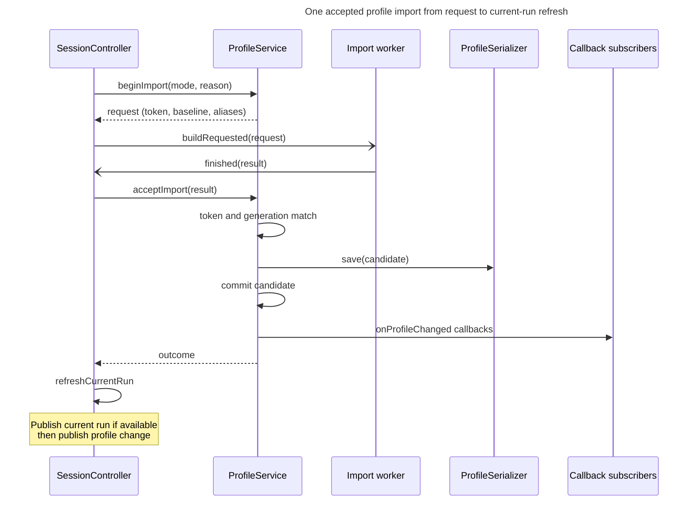

# Profile lifecycle

## Concern and reader outcome

How does the application bring its run history up to date with the KovaaK's folders, and what must hold for a background import to replace the accepted history safely? A maintainer who changes how imports are requested, queued, retried or committed should leave this view knowing which component may publish a result, which events invalidate an import in flight, what is saved before what is announced, and when an accepted import changes the selected run.

## Scope and exclusions

This view follows startup and profile-path loads, and background imports from request through publication. It covers request coalescing and retries in `SessionController`, worker handoff, acceptance in `ProfileService`, file watching, and shutdown during an import.

[Run history data][run-history-data] defines runs and profiles and explains identity, merging, file versions and quarantine. [Composition root][composition-root] describes application wiring and subscriber registration order. This view stops at current-run publication; [Run selection and rendering][run-selection-and-rendering] explains how the graphs and browser respond.

## Participants

| Element | Where it runs | Responsibility in this concern |
|---|---|---|
| `SessionController` (`ksv_app`) | GUI thread | Owns the one import slot, the follow-up flags and the retry timer. Starts imports, hands them to the worker, calls the acceptance gate, then refreshes the current run. |
| `ProfileBuildWorker` | Profile import thread (`m_build_thread`, a `QThread` owned by `SessionController`) | Runs `IProfileImporter::run` for one request. Returns a `ProfileImportResult` and converts exceptions to failed results. A result carries a candidate only when a save is needed. |
| `ProfileImporter` (`ksv_data`) | Profile import thread (and the GUI thread in the synchronous fallback) | Computes a *candidate* profile from a baseline and a scan. Never writes the stored profile and never touches the live profile. |
| `ProfileService` (`ksv_data`) | GUI thread | Holds the accepted profile, issues request tokens, and is the only component that saves and commits a result. Has no locking. |
| `FileService` (`ksv_qt_data`) | GUI thread for watching; its stateless read methods are also called from the profile import thread | Watches the folders under the configured KovaaK's source roots and reports that something arrived; updates its pending-file set when an import is acknowledged. |
| `ProfileSerializer` | GUI thread, called by `ProfileService` | Persists the accepted candidate. Its file format is [Run history data][run-history-data]'s concern. |

`SessionController` constructs a `ProfileBuildWorker` around the same `ProfileImporter` instance that `ProfileService` holds, and moves it to that profile import thread, which is distinct from the capture render pool and the PNG save pool ([`SessionController` constructor](../../../src/app/session_controller.cpp), [`App::App()`](../../../src/app/app.cpp)). The worker reads files only through `FileService::scanSources`, `getPerfFromFile` and `getStatsFromFile`. These methods leave watcher state untouched ([`FileService`](../../../src/qt_data/file_service.cpp)). The worker and GUI thread share the `FileService`, decoder, and parser instances.

## The import protocol

An import has a **mode** and a **reason** ([`profile_import.h`](../../../src/app/contracts/profile_import.h)).

- **Refresh** merges newly eligible input into a copy of the accepted profile: it reads only files the profile does not already account for. A missing source file never removes a run.
- **Rebuild** discards the baseline's content: the candidate starts empty, every file is read again, and the result always counts as changed ([`ProfileImporter::run`](../../../src/data/profile_importer.cpp)).
- The reasons are `Startup`, `Manual`, `Live`, `SourceSettingsChanged` and `Retry`.

| Decision affected by reason | Where explained |
|---|---|
| Whether unchanged failed files are skipped | Skip policy below |
| Whether to select the latest run | Refreshing the current run after acceptance |
| Whether a timer retry may follow | Request queue, coalescing and retry |

For Refresh with reason `Startup`, `Live` or `SourceSettingsChanged`, `ProfileService::beginImport` sets `skip_unchanged_failures`; other mode/reason combinations re-read eligible failed files ([`ProfileService::beginImport`](../../../src/data/profile_service.cpp)).

A Rebuild is requested by the user's explicit Rebuild action (the confirmation in [`SettingsDialog.qml`](../../../src/ui/qml/shell/SettingsDialog.qml) calls the invokable [`SessionViewModel::generateProfile`](../../../src/ui/presentation/app/session_vm.h)) and when loading the stored profile fails. Other triggers request a Refresh. A change to the profile-store path reloads the file and can request a Rebuild if that load fails.

**Type:** sequence. **Scope:** one import that is accepted and changes the profile, from request to current-run refresh; progress signals, alias updates, watcher acknowledgement and `SessionController`'s own bookkeeping are omitted. **Concern:** Only `ProfileService` may save and commit the worker's candidate; notification follows commit.

**Key**

- Solid arrow, filled head: direct call on the GUI thread
- Solid arrow, open head: queued handoff between the GUI thread and the profile import thread
- Dashed arrow, filled head: returned value
- Self-arrow: step inside the named participant

The worker computes the result in the interval between `buildRequested` and `finished`. `SessionController` registers its own `onProfileChanged` callback, which is suppressed by `m_accepting` during `acceptImport`. Alias updates and watcher acknowledgement remain inside acceptance, as shown in the gate table below.

`ProfileService::acceptImport` checks the result before saving, committing, acknowledging source files, and notifying subscribers ([`ProfileService::acceptImport`](../../../src/data/profile_service.cpp)). The worker's `finished` signal means "an import result is ready", not "the history changed" and not "a candidate exists": a no-op result has no candidate yet can still update aliases and the watcher's pending set, and a result that is stale, failed, or cannot be saved leaves the accepted profile exactly as it was.

## Triggers

**Startup.** `App::App()` constructs `SessionController` before the first `ProfileService::loadProfile`, because the controller installs the build requester there ([`App::App()`](../../../src/app/app.cpp); details in [Composition root][composition-root]). `loadProfile` invalidates imports and loads the stored profile. On success it commits it through `setProfile` (notifying subscribers) and requests a Refresh with reason `Startup` to reconcile the loaded history with the disk. On failure (no file, unreadable, or rejected version) it asks the build requester for a Rebuild with reason `Manual`; with no requester installed it builds synchronously on the calling thread. The application therefore starts showing the stored profile at once and imports in the background, but with no stored profile it starts with no profile until the first Rebuild is accepted ([`ProfileService::loadProfile`](../../../src/data/profile_service.cpp)).

**Live watching.** `FileService` watches each source root (or its nearest existing ancestor, so a folder that does not yet exist can appear), `FPSAimTrainer`, `performances` and `stats`, plus every *pending* file individually. Any watched directory or file change restarts a 250 ms single-shot timer; when it fires, `refreshWatches` re-lists both subfolders on the GUI thread, adds files that were not in the previous listing to the pending set, compares the size and modification time of pending files, and calls its source callbacks if the listing or a pending fingerprint changed. `ProfileService` turns that callback into a Refresh with reason `Live`. 

A file stays pending until an accepted import names it as successful, a later relisting no longer contains it, or a change to the configured source roots repoints the watcher and clears the set. Files the import reported as retryable are (re)added to the pending set and watched individually when they still exist as files, so a file that is still growing triggers another Refresh with reason `Live` when it changes. The listing at construction is recorded without marking anything pending, so pre-existing files are left to the Refresh with reason `Startup` ([`FileService::refreshWatches`](../../../src/qt_data/file_service.cpp), [`FileService::acknowledgeImport`](../../../src/qt_data/file_service.cpp)). Removing a file also changes the listing and triggers a Refresh; the removal supplies no new file to import ([`FileService::refreshWatches`](../../../src/qt_data/file_service.cpp)).

**Settings changes.** When the configured KovaaK's source roots change, `FileService` first repoints its watcher and clears its listing and pending state, then `ProfileService` invalidates imports and requests a Refresh with reason `SourceSettingsChanged`. The order is a consequence of construction order, not an enforced contract; [Composition root][composition-root] owns it ([`FileService`](../../../src/qt_data/file_service.cpp), [`ProfileService`](../../../src/data/profile_service.cpp)).

When the profile-store path changes, `ProfileService` reloads from the new path through the same `loadProfile` entry point, so the startup rules above apply again: a successful load is followed by a Refresh with reason `Startup`, a missing file by a Rebuild. A path change immediately changes the save destination. If loading the new path returns a `ProfileLoadError`, the previous snapshot stays visible until a Rebuild is accepted. If saving the Rebuild result fails, the previous snapshot stays visible under the new path setting. The previous file is left where it was ([`ProfileService::applyProfilePath`](../../../src/data/profile_service.cpp), [`SettingsService`](../../../src/qt_data/settings_service.cpp)).

This recovery covers returned load errors only: `applyProfilePath` assigns the new path and then calls the throwing `std::filesystem::create_directories`, and `ProfileSerializer::load` uses the throwing `exists`, so a filesystem exception escapes the settings callback with the destination already changed and without requesting a Rebuild ([`ProfileService::applyProfilePath`](../../../src/data/profile_service.cpp), [`ProfileSerializer::load`](../../../src/data/formats/protobuf/profile_serializer.cpp)).

**Manual.** The refresh actions in the menu and settings dialog call `SessionController::refreshProfile` with reason `Manual`; the rebuild action is described above.

## Request queue, coalescing and retry

`SessionController` runs at most one import at a time. While one is in flight, further requests are folded into two flags instead of queued individually ([`SessionController::startImport`](../../../src/app/session_controller.cpp), [`SessionController::refreshProfile`](../../../src/app/session_controller.cpp), [`SessionController::onBuildFinished`](../../../src/app/session_controller.cpp)).

| Event | Effect |
|---|---|
| Rebuild requested (`startBuild`) | Stops the retry timer and resets its attempt counter. Idle: starts at once. Busy: sets `m_rebuild_requested` and clears any queued Refresh. |
| Refresh requested, idle | Starts at once. |
| Refresh requested, busy | Sets `m_refresh_requested`. The stored reason is overwritten by the newest request unless the queued one is `Manual`, which is kept. |
| `Live` Refresh arrives inside a retry window (timer active, a `Live` or `Retry` import in flight, or a `Retry` queued) | Promoted to `Retry`, keeping the attempt counter. Any other reason resets the counter. Either way the retry timer is stopped. |
| An import finishes (accepted or not, including `Stale`) | If a Rebuild is queued, start it with reason `Manual`; retain any Refresh requested after that Rebuild request. Otherwise, if a Refresh is queued, start it with the stored reason. If neither is queued, report completion. Intermediate results' summaries are not reported. |
| Completion with nothing queued | Sets `Idle`, the outcome and the summary, emits `buildFinished`, and arms a retry only if the outcome was accepted, the summary has a retryable issue, the completed reason was `Live` or `Retry`, and fewer than three attempts have been used. The delay is 250 ms doubled per attempt, so 250, 500 and 1000 ms. |
| Retry timer fires | Starts a Refresh with reason `Retry`. `Retry` does not skip unchanged failures, so the failed files are read again. |

A second Rebuild requested during a Rebuild queues another full Rebuild. A change to the configured source roots during a Rebuild turns that Rebuild into `Stale` and queues a `SourceSettingsChanged` Refresh; unless another Rebuild is already queued, only that Refresh runs afterwards, so the user's Rebuild is replaced rather than repeated. Promotion to `Retry` preserves the attempt count. After the retry window closes, a later unrelated arrival can reset the count. At most three timer retries follow one retry sequence ([`SessionController::refreshProfile`, `onBuildFinished`](../../../src/app/session_controller.cpp)).

Retryable issues include decode and parse failures, incomplete metadata, a missing or unreadable configured source root, and an existing but unreadable `performances` or `stats` directory. A root that exists without those child directories produces no issue. Source conflicts and deliberately skipped previously-failed files are not retryable ([`RunIngestor::ingestSibling`](../../../src/data/run_ingestor.cpp), [`ProfileImporter::run`](../../../src/data/profile_importer.cpp), [`FileService::scanSources`](../../../src/qt_data/file_service.cpp)).

## The acceptance gate

| Outcome | When | Saved | Candidate installed | Watcher acknowledged | Callbacks notified |
|---|---|---|---|---|---|
| `Stale` | The result's token is not the active import's token, or its generation differs from the service's current generation | no | no | no | no |
| `Failed` (importer) | `result.failed`: the importer or worker caught an exception | no | no | no | no |
| `Failed` (save) | When a save is required (`changed` or `failures_changed`), the candidate is missing, `save` returns false, or `save` throws; `summary.save_failed` is set | attempted unless the candidate is missing | no | no | no |
| `Succeeded` / `Partial` | Otherwise; `Partial` when the summary still lists issues | only if `changed` or `failures_changed` | only if saved | yes, after the aliases are updated | only if `changed` |

Two details matter to a maintainer. First, a result that changes only the failed-source ledger is saved and committed without notifying profile subscribers. It does not trigger `SessionController`'s current-run refresh. Second, the token is cleared before the failure branches are evaluated, so a failed save cannot be retried by re-presenting the same result.

**Generation** is what makes in-flight results disposable. `ProfileService::invalidateImports` increments the generation, clears the active token and clears the in-memory aliases; it is called directly from `loadProfile` and from `setProfile` (so a successful load bumps the generation twice) and whenever the configured KovaaK's source roots change. A request carries the generation it was issued under, so any such event turns the build already running into a `Stale` result without any message reaching the worker.

## Refreshing the current run after acceptance

After `acceptImport` returns, `SessionController::onBuildFinished` runs the current-run refresh only when the outcome is `Succeeded` or `Partial` **and** `result.changed`. The refresh chooses between two policies ([`SessionController::refreshCurrentRun`](../../../src/app/session_controller.cpp)):

| Policy | Conditions and action |
|---|---|
| Select latest | The request was a Rebuild the reason was `Live` or `Retry` the reason was `Startup` **and** selection has not changed since import started or nothing is selected. |
| Preserve selection | All remaining cases: follow any `rekeyed_runs` entry for the selected run, then look it up in the new profile. |

It then emits `currentRunChanged` when it has a run to publish and `profileChanged` ([`SessionController::refreshCurrentRun`](../../../src/app/session_controller.cpp), [`SessionController::onBuildFinished`](../../../src/app/session_controller.cpp)). The latest-run branch publishes a default empty `Run` after an empty Rebuild. The preserve-selection branch emits `currentRunChanged` only if it can resolve the selected run in the new profile; otherwise the selection is untouched. `profileChanged` follows either way, for every accepted result that changed the profile.

The selection-revision counter is what makes the `Startup` rule work: `SessionController::setCurrentRun` increments it when the `Run` overload is called, including a same-ID re-selection, so an import that started before the user clicked does not move them afterwards.

The `m_accepting` flag exists because `ProfileService` notifies its callbacks *inside* `acceptImport`, and `SessionController` is itself a subscriber. While `m_accepting` is set, the controller ignores its own profile callback. Without the flag, that callback would run before the reason-aware refresh: it would attempt to select the latest run, bump the selection revision and emit an extra `profileChanged`. The early revision bump would defeat the `Startup` rule; the equality guard could still retain the old payload when the latest run has the same id. Other callback subscribers run inside `acceptImport`, before `SessionController` updates the current run; they must not assume the current run has already moved. The fan-out of `currentRunChanged` and `profileChanged` is [Run selection and rendering][run-selection-and-rendering]'s account.

The same callback is free of this guard for `setProfile` (a stored profile loaded at startup or after a profile-path change), where it attempts to select the latest run. That reselection goes through the equality-guarded `setCurrentRun`, a different guard, so a latest run with the same id as the current one leaves the old payload in place. [Composition root][composition-root] owns the load-path notification order.

## Shutdown during a build

The consequence for this protocol is that the result of an import still running at exit is never accepted, so nothing is saved by it and `profile.pb` keeps its last accepted content. The destructor's blocking wait on the profile import thread and teardown ordering are the [Composition root][composition-root]'s concern.

## Consequences and invariants

- **Only `ProfileService::acceptImport` changes the accepted profile or the stored file from an import.** The importer returns a candidate built on a copy of an immutable baseline snapshot; `ProfileService` swaps the pointer after a successful save. A change that lets the worker, or `SessionController`, commit or save directly would reintroduce torn or unsaved history.
- **Save before commit before notify.** A failed save leaves the accepted in-memory profile unchanged. Moving commit or notification before the save would let subscribers observe history that the next start cannot reload.
- **Anything that changes what an in-flight result means must invalidate it.** Changes to the configured source roots and (re)loading a profile bump the generation; a profile-path change that throws before `loadProfile` is reached bumps nothing. A new trigger that alters roots, baseline or store path without going through `invalidateImports` would let a result computed for the old state be saved over the new one.
- **Requests carry their inputs.** `beginImport` snapshots the roots, the baseline and the aliases on the GUI thread, so the worker never reads the live profile, settings or watcher state. The snapshot guarantee is bounded: the worker shares the importer and the `FileService` scan and read methods (`scanSources`, `getPerfFromFile`, `getStatsFromFile`), including the decoder and CSV parser instances that GUI-thread paths such as Open .perf also use, so those adapters must stay safe to call concurrently.
- **Acknowledgement of an accepted import is the normal way a file leaves the watcher's pending set.** The others are a relisting that no longer contains the file ([`FileService::refreshWatches`](../../../src/qt_data/file_service.cpp)) and a watcher repoint; acknowledgement adds only retryable paths that still exist as files. A `Stale` or `Failed` result leaves pending files pending, so they are picked up again by the next trigger. Only an accepted `Partial` result can qualify for a timer retry; the request reason, retryable issues, and attempt limit still apply.
- **`m_accepting` must bracket `acceptImport`.** Preserve the suppression described under current-run refresh; removing it, or moving callback notification outside the bracket, allows a premature revision bump and an extra `profileChanged` before reason-aware selection.
- **A Rebuild reads from the configured source roots only.** A Rebuild started while a source root is unavailable still counts as changed: the unavailable root is reported as a retryable issue, and the accepted candidate omits that root's runs (it is empty if no other root contributes) and is saved. See [Run history data][run-history-data] for why that loses runs.

## Evidence and limitations

Verified by reading `src/data/profile_service.{h,cpp}`, `src/data/profile_importer.cpp`, `src/data/run_ingestor.cpp`, `src/app/session_controller.{h,cpp}`, `src/app/profile_build_worker.{h,cpp}`, `src/app/contracts/profile_import.h`, `src/qt_data/file_service.{h,cpp}`, `src/qt_data/settings_service.cpp`, and the wiring in `App::App()`. The sequence diagram and the tables were written from that code; the diagram was rendered and inspected at documentation width.

Not established: the Qt connection types for the signals `SessionController` emits (this view treats their delivery as GUI-thread and does not rely on queuing); the behaviour of the QML consumers of `profileImportStateChanged`; and whether `FileService`'s GUI-thread directory scan in `refreshWatches` is a practical stall for very large folders. `IProfileService::abandonImport` exists and clears an active token but has no caller in `src/` outside `ProfileService` itself (found by search, not by call-graph analysis), so it is not part of the protocol described here. Tests under `tests/data` and `tests/integration` were not read or run for this view. No ADR in `docs/architecture/decisions/` addresses the import protocol, so none is linked.

<!-- arch-doc:references:start -->
[composition-root]: composition-root.md
[run-history-data]: run-history-data.md
[run-selection-and-rendering]: run-selection-and-rendering.md
<!-- arch-doc:references:end -->
