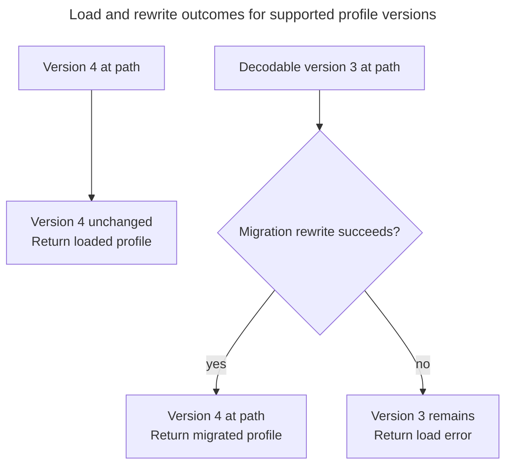
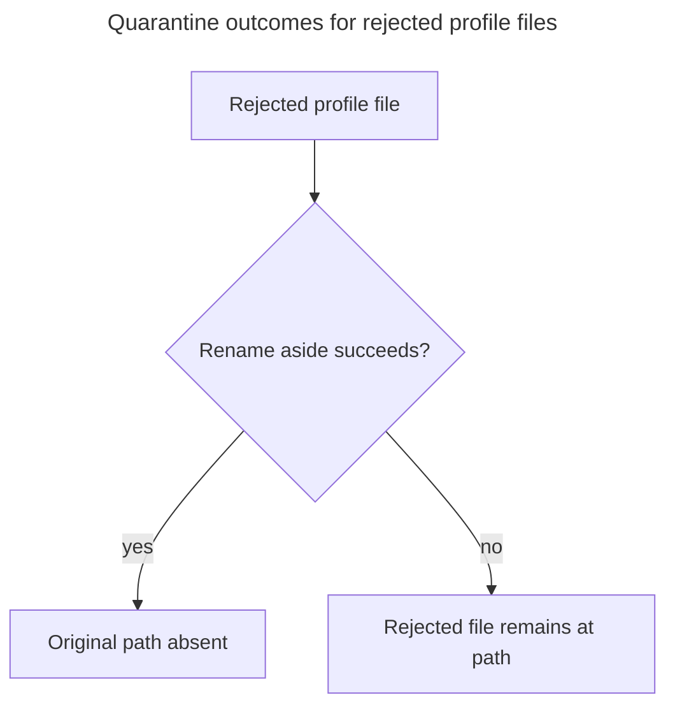

# Run history data

## Concern and reader outcome

What is the application's run history, what makes two runs the same, which copy of the data is authoritative, and how does KSV handle profile-format upgrades and assumptions about KovaaK's export formats? A maintainer who changes run identity, the profile file, a migration, or the readers of KovaaK's files should leave this view knowing which equality rules the rest of the system depends on, what can and cannot be recovered after a bad load or a rebuild, and which external format assumptions are hard-coded.

## Scope and exclusions

The view covers the accepted history (`UserProfile` and its source registry and failed-source ledger), the identities used to merge imported files into it, the persisted `profile.pb`, and the external `.perf` and stats CSV formats as inputs. It starts with the conversion of a scanned file into a candidate run and follows the accepted history through storage and later loads.

How imports are requested, queued, retried, accepted and published is [Profile lifecycle][profile-lifecycle]'s concern and is not repeated here. What the interface does with the current run is [Run selection and rendering][run-selection-and-rendering]. Other persisted data (graph configuration, benchmark definitions, UI settings) is outside this view.

## Identity and authority

| Data | Identity or contents | Authority and persistence |
|---|---|---|
| Scenario (`ScenarioId`) | The `hash` alone. `operator==`, `operator<` and `std::hash` ignore `name`. | Names are display labels and do not affect scenario identity. |
| Run (`ScenarioRunId`) | Scenario hash plus `start_time` (milliseconds since the epoch). | The run record inside `UserProfile`, persisted in `profile.pb`. Its `toString()` is the label shown in the UI. |
| Run source files | A normalised path key (`sourcePathKey`): separators unified, lexically normalised, lower-cased on Windows, trailing slash removed. | Input only. A run keeps references to its files (directory id plus filename), and a normal Refresh never re-reads accepted files. |
| Run halves | The perf half supplies `start_time`, `scenario_length` and sample series; the CSV half supplies totals and settings (`Stats`). | A run may hold either or both. CSV totals win when both exist; a perf-only run's totals are the sum of its samples. |
| Profile (`UserProfile`) | Runs are held in an append-only vector. The run index is keyed by `ScenarioRunId`, the scenario index and aggregate map by `ScenarioId`; the positions they store point into that vector. | `ProfileService` holds one immutable snapshot, replaced whole on acceptance. The stored profile is the authoritative record. |
| Source registry (`SourceRegistry`) | A `DirectoryId` (non-zero `uint32`); an entry is a root path (no parent) or a subdirectory under a root. | Persisted in `profile.pb`; runs and failed sources refer to directories by id. |
| Failed-source ledger (`FailedSource`) | A source file reference plus its size and modification time when it failed, and the message. | Persisted in `profile.pb`. When an import changes the ledger, it replaces the ledger with the failures it currently observes. |
| Alias (`ProfileSourceAlias`) | A source path key mapped to a run id. | In memory only; owned by `ProfileService` and cleared whenever imports are invalidated (profile load, a change to the configured source roots). |
| Derived aggregates | Per-scenario index sorted by `start_time`, per-scenario run count and total time, total play time, most recent run. | Derived. Maintained incrementally on `addRun` and merge, and rebuilt by loading, never persisted. |

A run carries its own `name` as a display label. The scenario list returns the map's keys, which keep the name of whichever run first created the scenario in this process. This name-retention rule is inferred from the map's key semantics and `UserProfile::getScenarioList`, rather than tested ([`UserProfile`](../../../src/domain/user_profile.cpp)).

Evidence: [`ScenarioId`, `ScenarioRunId`, `RunTotals`, `Run`](../../../src/domain/run.h), [`UserProfile`](../../../src/domain/user_profile.cpp), [`SourceRegistry`](../../../src/domain/source_directory.cpp), [`sourcePathKey`](../../../src/data/source_path_key.h), [`pairingStem`](../../../src/data/formats/csv/run_filename.cpp), [`ProfileService::acceptAliases`](../../../src/data/profile_service.cpp).

### How a run gets its identity

A *pairing group* is the root key plus the filename stem with ` Performance.perf` or ` Stats.csv` removed; any other name falls back to its extension-stripped stem. Evidence: [`pairingStem`](../../../src/data/formats/csv/run_filename.cpp).

A run's id depends on which file produced it. A `.perf` file supplies `start_time` directly from its metadata timestamp ([`ProtoDecoder::decode`](../../../src/data/formats/protobuf/proto_decoder.cpp)). A stats CSV has no start timestamp of its own: the importer derives one from the local-time end stamp in the filename and the CSV's challenge-start clock time, treating the start as the previous day when the clock wraps past midnight (with a one-second allowance for filename truncation) ([`deriveCsvTiming`](../../../src/data/formats/csv/run_filename.cpp)). Pauses do not enter the id: `RunIngestor::ingestSibling` subtracts them only afterwards, from the stored scenario length ([`RunIngestor::ingestSibling`](../../../src/data/run_ingestor.cpp)). A CSV that arrives before its perf file therefore creates a run under a derived id. If a later `.perf` file matches the pairing group and scenario hash of a CSV-only run, the merge moves that run to the `.perf` file's run id (a *re-key*). Equal ids need no re-key. An id already held by another run is a conflict. A re-key is reported in `rekeyed_runs` as an old/new id pair, allowing the current selection and aliases to follow the new id ([`UserProfile::mergeImportedRun`](../../../src/domain/user_profile.cpp), [`ProfileService::acceptAliases`](../../../src/data/profile_service.cpp)).

Merging is deliberately narrow. `UserProfile::mergeImportedRun` compares the incoming run with the run found by the supplied previous id, when present, or by the incoming id otherwise ([`UserProfile::mergeImportedRun`](../../../src/domain/user_profile.cpp)):

- An incoming run whose id is new is **Added**. One whose id exists is compared with the stored run.
- A stored run that lacks its perf half or its CSV half can be **Enriched** with the missing half; a half that is already present is never replaced. An in-place change to an already-imported file is therefore not picked up by a Refresh, and the importer also skips known paths ([`ProfileImporter::run`](../../../src/data/profile_importer.cpp)).
- A scenario mismatch or a re-key onto an existing id is a **Conflict**: the candidate is not changed and both source files are reported as non-retryable issues. The importer additionally treats a new group whose id already exists with different content (totals or stats for CSV, length or samples for perf) as a conflict; damage is compared only when both sides have it, because an absent value on either side is not a difference ([`sameTotalsForImport`](../../../src/data/profile_importer.cpp)).
- Runs are never removed, and the index of a run never changes within a snapshot lineage (candidates are copies of the accepted profile), which is why the index maps can store positions into the run vector. Total and per-scenario time are adjusted by the length delta when a merge changes `scenario_length`; a re-key re-sorts the scenario index and recomputes the most recent run.

Because identity is hash plus start time rather than a path, the same game run found under a different source root does not duplicate. It has one of three outcomes against the stored run: **unchanged** when the halves that overlap agree, **enriched** when it supplies a half the stored run lacks, or a **conflict** when the overlapping content differs. The path-keyed aliases exist so paths already matched to an accepted run but absent from its stored source references are not re-ingested during the same session; an alias is recorded only when the resolved reference matches a path the import was asked to read. Aliases are not persisted; after a restart, re-ingestion rebuilds them.

## The stored profile

`profile.pb` is a protobuf `File` with a `Header` (version, creation time, name) and a `Store` of runs, source directories and failed sources ([`profile.proto`](../../../src/data/formats/protobuf/schema/profile.proto)). A run record stores identity, length, totals (with optional damage), perf and CSV source references, the full performance sample series, and the settings. The default location is `<AppDataLocation>/profile.pb`, overridable through the `file/profilePath` setting ([`SettingsService::getProfilePath`](../../../src/qt_data/settings_service.cpp)). Aliases, the derived aggregates and the import state are not stored.

`ProfileSerializer::save` writes the whole store to `<path>.tmp`, flushes and closes it, and renames it over the destination, discarding the temporary file on failure (a best-effort delete whose errors are ignored). The header's creation time and name are carried over from the existing file when it has a non-zero creation time and a non-empty name; otherwise the current time and `default` are used ([`ProfileSerializer::save`](../../../src/data/formats/protobuf/profile_serializer.cpp)). The code does not call an explicit sync, so durability across power loss is not claimed.

On a version-3 migration, [`ProfileV3Migrator`](../../../src/data/formats/protobuf/migration/profile_v3_migrator.cpp) converts each run's samples into a perf-only run, sets totals to the sum of the samples (damage stays unknown), and then tries to enrich it from the CSV next to the perf file through [`RunIngestor::enrichStoredRun`](../../../src/data/run_ingestor.cpp). That derivation assumes the perf file lives at `<root>/FPSAimTrainer/performances/<file>`; if the CSV is missing or does not agree on the scenario hash, the run is kept without it. A v3 store has no failed-source ledger, so a migrated profile starts with an empty one.

**Type:** load-outcome flowchart. **Scope:** the file at the configured profile path for decodable versions 3 and 4; rejected files are covered separately below. **Concern:** whether a supported load leaves the stored version unchanged or rewrites it.

**Key**

- Rectangle: input version or resulting file condition and load result
- Diamond: migration rewrite outcome test
- Unlabelled solid arrow: load or migration step
- Labelled solid arrow: outcome of the rewrite test

A failed version-3 rewrite leaves the legacy file intact, returns `ProfileLoadError` and requests Rebuild. An undecodable legacy file instead follows the rejection account below ([`ProfileSerializer::load`](../../../src/data/formats/protobuf/profile_serializer.cpp), [`ProfileService::loadProfile`](../../../src/data/profile_service.cpp)).

**Type:** decision flowchart. **Scope:** load rejection for unsupported versions, unparseable headers or bodies, and undecodable version-3 migrations; terminal boxes describe the original profile path, not the aside file. **Concern:** a best-effort quarantine may leave the original path free or occupied by the rejected file.

**Key**

- Rectangle: rejected input or resulting condition of the original path
- Diamond: outcome test
- Unlabelled solid arrow: proceeds to the outcome test
- Labelled solid arrow: outcome of the test

Both outcomes return a load error and request Rebuild. Only a later successful accepted save creates or replaces version 4 at the original path ([`ProfileSerializer::load`, `save`](../../../src/data/formats/protobuf/profile_serializer.cpp), [`ProfileService::loadProfile`](../../../src/data/profile_service.cpp)):

| Condition at original path | Effect of a later successful accepted save |
|---|---|
| Path absent, initially or after quarantine | Creates version 4 |
| Rejected file remains | Replaces it with version 4 |
| Version 3 remains after a failed rewrite | Replaces it with version 4 |

The application requests a Rebuild whenever a load fails to return a usable profile; the file left at the path depends on whether the rewrite or quarantine succeeded ([`ProfileSerializer::load`](../../../src/data/formats/protobuf/profile_serializer.cpp)):

- The version is read from the first 4096 bytes. An unparseable header or body, or an unsupported version, causes a best-effort rename aside and an unparseable or version-mismatch error. Versions 3 and 4 are supported.
- The aside name is `<stem>_<reason>_<UTC yyyymmddThhmmssZ>[_<16 hex digits of a content hash>]<extension>`, in the same directory; the hash suffix is omitted when the file cannot be read to compute it. The rename is best effort and its error is ignored; if it fails the rejected file stays at the path and the next accepted save overwrites it.
- A migrated profile is returned only after it is rewritten as v4. If the rewrite fails the legacy file is left intact and not renamed, but the caller still sees a load failure and requests a Rebuild, whose accepted save then replaces that legacy file.

## Inputs versus authority

The accepted profile is authoritative for existing runs, and the `.perf` and CSV files are inputs. Refresh preserves those runs when exports are missing; Rebuild constructs a replacement from the exports that are available. Files are also read during Rebuild, version-3 migration and Open .perf. Rebuild uses exports as its only input; version-3 migration reads the CSV next to each stored perf. Open .perf decodes the chosen file outside the import protocol and does not add it to the profile ([`SessionController::setCurrentPerf`](../../../src/app/session_controller.cpp); see [Run selection and rendering][run-selection-and-rendering]). The two consequences a maintainer must preserve:

- A **Refresh** only ever adds or enriches; a missing source file does not remove a run.
- A **Rebuild** starts from an empty profile and re-reads every file, so any run whose files are gone is dropped when the result is accepted. `SettingsDialog.qml` warns the user of exactly this before it requests a Rebuild ([`SettingsDialog.qml`](../../../src/ui/qml/shell/SettingsDialog.qml)). The same replacement happens when a Rebuild is triggered by a failed load, and also when a configured source root is unavailable at the time: an unavailable root produces a retryable issue, and if the Rebuild is accepted, the saved profile omits runs that only that root supplied (it is empty only if no other root contributes) ([`ProfileImporter::run`](../../../src/data/profile_importer.cpp)).

After a quarantine, the file set aside is the only copy of runs whose sources no longer exist. Recovering those runs requires the quarantined profile; rebuilding cannot recover them from missing exports. Putting it back at the same path under the same binary would be rejected again; recovery needs compatible software, a migration or a repair, as the rejection reason requires.

The failed-source ledger records, per file, the size and modification time at failure and the message. A later Refresh can skip a failed file when its size and modification time still match the recorded fingerprint (see [Profile lifecycle][profile-lifecycle] for which reasons skip). The ledger is rebuilt from the issues each import observes, so a file that now imports, or that has been deleted, drops out of it. An import whose ledger differs from the baseline's is saved even if no run changed, but only when a baseline exists, because a failures-only candidate saved without one would overwrite a profile that was never loaded.

## Export-format assumptions

| Input | What the code reads | What it assumes or ignores |
|---|---|---|
| `.perf` (protobuf) | Scenario name, hash, timestamp and length from the metadata, and seven per-sample series ([`ProtoDecoder::decode`](../../../src/data/formats/protobuf/proto_decoder.cpp)). | The schema is inferred: `perf.proto` marks several metadata fields as "Unknown so far", and none of them (version, actor, targets, map name, the `unk*` fields) is read. A file that fails to parse raises an error, which the importer records as a retryable issue; an empty scenario hash, or a non-finite or negative length, is also rejected. |
| Stats CSV | Footer `Key:,value` rows for scenario, hash, game version, challenge start, score, hits, misses, kills, pauses and settings. | The parsed values scenario, hash, challenge start, score, hits, misses and kills must all be present, otherwise the file is invalid, but not all of them must come from the footer: the game version gates their source. Before 2.0.3 and for 3.0.x the challenge start is replaced by the filename's end time; before 3.1.0 hits and misses come from the weapon-summary table (which must be valid and consistent) and pause values are zeroed. If the version string cannot be parsed, none of these version-specific rules is applied. The gates cite the KovaaK's patch history in the parser's own comments ([`StatsCsvParser::parseFile`](../../../src/data/formats/csv/stats_csv_parser.cpp)). |
| Folder layout | Roots from settings, each with `FPSAimTrainer/performances` and `FPSAimTrainer/stats`. | `FileService` and migration enrichment (`statsSibling`/`enrichStoredRun`) assume this directory layout. Pairing recognises the filename suffixes ` Performance.perf` and ` Stats.csv`, and the filename timestamp format `... - YYYY.MM.DD-HH.MM.SS` used to derive CSV timing ([`FileService`](../../../src/qt_data/file_service.cpp), [`run_filename.cpp`](../../../src/data/formats/csv/run_filename.cpp)). |

A file-format change can produce a decode, parse, or validation issue when the importer reads the file. The issue is attached to that scanned file and recorded in the failed-source ledger when a saved candidate carries it, rather than failing the import; the runs from files that still parse are unaffected. A layout change is different. Discovery depends on the folders and the `.perf` and `.csv` extensions, so files elsewhere or under another extension are silently omitted, whereas a changed filename suffix affects only pairing, which falls back to the extension-stripped stem. Directory-level issues are not recorded in the failed-source ledger, because only issues whose path is a scanned file qualify ([`ProfileImporter::run`](../../../src/data/profile_importer.cpp)). The ledger persists only when an accepted result is saved.

## Consequences and invariants

- **Identity is hash plus start time; names and paths are not identity.** Adding `name` to `ScenarioId` equality would split one scenario in two and break every hash-keyed lookup. Keying runs by path would turn a moved install into duplicate runs.
- **A run's index is permanent and runs are never removed from a `UserProfile`.** All derived structures store that index. A "delete run" feature, or a merge that reorders `m_runs`, must rebuild them.
- **Merging fills gaps; it never overwrites a present half.** Making a Refresh overwrite would change history in place whenever a source file is touched.
- **A profile is a snapshot.** Candidates are built on a copy and published by pointer swap; nothing mutates the accepted profile.
- **Any incompatible `profile.proto` change must bump the store version and supply a migrator**, and the two omissions fail differently. Without a bump, the loader sees the same version and the old file parses under the new schema, possibly with different semantics or defaults and no rejection. With a bump but no migrator, the version check rejects existing profiles, which are renamed aside (best effort) and rebuilt from whatever source files still exist, silently losing the rest.
- **The Rebuild and quarantine paths replace the active history without a merge.** Rebuild replaces active history with the runs it can read from source exports. A quarantined profile may still contain runs whose exports are gone, but recovering them requires compatible software, migration, or repair.
- **CSV-derived ids depend on the local time zone and the filename.** They are provisional until the perf half arrives and re-keys the run.

## Evidence and limitations

Verified by reading `src/domain/run.h`, `user_profile.{h,cpp}`, `source_directory.{h,cpp}`; `src/data/profile_importer.cpp`, `run_ingestor.cpp`, `source_path_key.h`, `profile_service.cpp`; `src/data/formats/csv/run_filename.cpp` and `stats_csv_parser.cpp`; `src/data/formats/protobuf/profile_serializer.cpp`, `proto_decoder.cpp`, `schema/profile.proto`, `schema/perf.proto`, `migration/*`; and the profile-path handling in `src/qt_data/settings_service.cpp`. Both diagrams were rendered and inspected at documentation width.

Not established: durability and concurrent access to `profile.pb` (the code takes no lock and issues no explicit sync); behaviour when two processes share a profile path; the scenario-name rule in the identity table is inferred from `std::unordered_map` key semantics and `UserProfile::getScenarioList`, not from a test; and deduplication across source roots was inferred from `ProfileImporter::run` and `UserProfile::mergeImportedRun`, not by running a scenario. Migration cases other than v3 to v4 do not exist in the code and were not assessed beyond that. Tests under `tests/data` were not read or run. No ADR in `docs/architecture/decisions/` addresses run identity or the store format, so none is linked.

<!-- arch-doc:references:start -->
[profile-lifecycle]: profile-lifecycle.md
[run-selection-and-rendering]: run-selection-and-rendering.md
<!-- arch-doc:references:end -->
