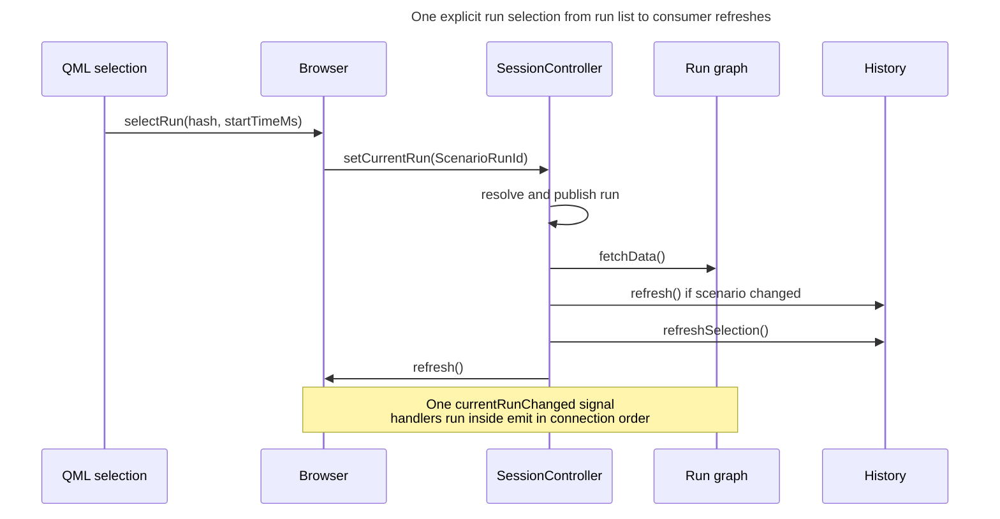

# Run selection and rendering

## Concern and reader outcome

How do explicit selections reach `SessionController`, and how do explicit selections and accepted imports refresh the run graph, completion history and scenario browser? A maintainer who adds a selection source, a consumer of the current run, or a new graph needs to know where the one authoritative "current run" lives, who is told about a change and in what form, and which refreshes are driven by the run change versus by a profile change.

## Scope and exclusions

The account starts when a selection request leaves the QML layer (or when an import commit changes the current run) and ends at the consumers' refresh decisions. [Profile lifecycle][profile-lifecycle] owns import selection policy. [Graph presentation][graph-presentation] describes the refreshed models, and [Graph configuration][graph-configuration] owns series, range and style configuration. [QML boundary][qml-boundary] explains how QML receives view models and passes properties.

## Architectural account

### The publication point

`SessionController` holds a single `domain::Run` (`m_current_run`) and is the only object that changes it. Every explicit selection path ends in an overload of `SessionController::setCurrentRun` ([session_controller.cpp](../../../src/app/session_controller.cpp)):

- `setCurrentRun(const domain::Run &)` is the guarded publication point for explicit selection. It increments `m_selection_revision`, returns without signalling when the new run has the same `ScenarioRunId` as the current one, and otherwise stores the run and emits `currentRunChanged`.
- `setCurrentRun(const domain::ScenarioRunId &)` looks the run up in the profile through `IProfileService::getCurrentRun` and forwards to the first overload; an id the profile does not hold is silently ignored.

The following helpers forward into those overloads:

- `setCurrentPerf(filename)` decodes the file via `IProfileService::getPerf` (which goes to `FileService::getPerfFromFile`) and forwards the decoded run; it is not added to the profile.
- `setCurrentRunToLatest()` forwards `getLatestRun()`.

For accepted imports, `SessionController::refreshCurrentRun` can publish directly by assigning `m_current_run` without the equality test. It may emit `currentRunChanged` even when the run id is unchanged, or emit only `profileChanged` when it cannot resolve the selection it was asked to preserve. Subscribers must therefore not assume that `currentRunChanged` implies a changed id, or that every profile change moves the current run. [Profile lifecycle][profile-lifecycle] owns which run an import selects, the branch conditions and the revision test. The code does not state why this path skips the equality guard.

### Entry points

| Entry point | Route to the publication point |
|---|---|
| Run list or Recent list (`SelectionPanel` / `RunListView`) | `SelectionPanel.runSelected` → `ScenarioWorkspace.qml` handler → `ScenarioBrowserViewModel::selectRun(hash, startTimeMs)` → `ScenarioBrowserUseCase::selectRun` → `SessionController::setCurrentRun(ScenarioRunId)` |
| Click on the history graph | `GraphCanvasWithTooltip.pointClicked` → `ScenarioHistoryPanel` → `CompletionHistoryViewModel::selectRun(index)` → `CompletionHistoryUseCase::select_run` → `SessionController::setCurrentRun(ScenarioRunId)` |
| Open .perf dialog | `Main.qml` `FileDialog.onAccepted` → `GraphViewModel::fetchData(url)` → `GraphUseCase::load_perf` → `SessionController::setCurrentPerf` |

Evidence: [ScenarioWorkspace.qml](../../../src/ui/qml/scenario/ScenarioWorkspace.qml) (the `onRunSelected` binding on `SelectionPanel`, which holds no view-model reference), [scenario_browser_vm.cpp](../../../src/ui/presentation/scenarios/scenario_browser_vm.cpp) (`ScenarioBrowserViewModel::selectRun` builds the `ScenarioRunId` from the hash, the start time and the active scenario's name), [ScenarioHistoryPanel.qml](../../../src/ui/qml/graph/ScenarioHistoryPanel.qml), [completion_history_vm.cpp](../../../src/ui/presentation/graphs/completion_history_vm.cpp), [completion_history_use_case.h](../../../src/app/usecases/completion_history_use_case.h), [Main.qml](../../../src/ui/qml/Main.qml) (`perfFileDialog`), [graph_vm.cpp](../../../src/ui/presentation/graphs/graph_vm.cpp), [graph_use_case.h](../../../src/app/usecases/graph_use_case.h).

Scenario activation uses the browser route above. `ScenarioBrowserViewModel::activateScenario` calls `ScenarioBrowserUseCase::selectScenario`, which makes the scenario's most recent run current unless the current run already belongs to that scenario. If the scenario differs and has a run, the use case forwards its most recent run id to `setCurrentRun(ScenarioRunId)`.

The history route also rejects hidden run indices. `CompletionHistoryViewModel::selectRun` binary-searches its visible run numbers and ignores an index the committed range hides before calling the use case.

All three routes converge on `setCurrentRun(const domain::Run &)`, so explicit selections share its equality guard.

Open .perf decodes synchronously on the selection path. `GraphViewModel::fetchData(url)` ignores an empty argument, but otherwise `ProtoDecoder::decode_file` can throw (missing or unparseable file), and nothing on the route (`GraphUseCase::load_perf`, `SessionController::setCurrentPerf`) catches it; the route also skips the import path's metadata validation and issue conversion ([`ProtoDecoder::decode_file`](../../../src/data/formats/protobuf/proto_decoder.cpp), [`graph_vm.cpp`](../../../src/ui/presentation/graphs/graph_vm.cpp)).

### Explicit selection from the run list

The Browser role combines `ScenarioBrowserViewModel` and `ScenarioBrowserUseCase`; Run graph combines `GraphViewModel` and `GraphUseCase`; History combines `CompletionHistoryViewModel` and `CompletionHistoryUseCase`. QML selection represents `SelectionPanel` and its `ScenarioWorkspace.qml` handler. Direct delivery is inferred from GUI-thread affinity, rather than observed at runtime.

**Type:** sequence. **Scope:** one valid explicit selection in the run list whose run id differs from the current one, from the QML signal to the consumers' refresh; the four signal deliveries are drawn as one arrow per handler. **Concern:** one explicit selection synchronously refreshes consumers through a single controller publication. The import branch, which can publish through `refreshCurrentRun`, is described above.

**Key**

- Solid arrow, filled head: direct synchronous call
- Self-arrow: step inside one participant

The four controller-to-consumer arrows represent delivery of one signal to four direct connections (history has two); their delivery order is set by registration in `App::App()` ([Composition root][composition-root] owns it). No dependency on that delivery order was found in the reviewed code.

Before `selectRun` returns, the graph and browser refresh, completion history updates selection, and its rows rebuild if the scenario changed.

### Fan-out

`currentRunChanged` is a Qt signal declared on `ISessionController` ([i_session_controller.h](../../../src/app/usecases/i_session_controller.h)). Use cases subscribe to `currentRunChanged` and invoke the view-model refresh methods below. `GraphUseCase` and `CompletionHistoryUseCase` connect with the controller as context object; `ScenarioBrowserUseCase` connects contextless lambdas and disconnects them explicitly in its destructor. For the connections described here, direct delivery is inferred from the objects' GUI-thread affinity; each connection runs synchronously inside the `emit`, in registration order, so `currentRunChanged` reaches four connections ([app.cpp](../../../src/app/app.cpp)). A second signal, `profileChanged`, is emitted after an accepted import that changed the profile (and by the `onProfileChanged` handler `SessionController` installs); [Composition root][composition-root] owns the complete signal and callback registrations and their order.

| Consumer | Hears | Does |
|---|---|---|
| `GraphUseCase::onCurrentPerfChanged`, registered in `App::App()` with `GraphViewModel::fetchData` | `currentRunChanged` | Re-pulls the run graph |
| `CompletionHistoryUseCase::onCurrentScenarioChanged` → `CompletionHistoryViewModel::refresh` | `currentRunChanged` only when the scenario hash differs from the last seen one; **and** every `profileChanged` | Rebuilds the history rows |
| `CompletionHistoryUseCase::onSelectedRunChanged` → `CompletionHistoryViewModel::refreshSelection` | every `currentRunChanged` | Refreshes the selection marker only |
| `SessionViewModel::updateScenarioHashMap` | `profileChanged` only (it does not hear `currentRunChanged`) | Updates the scenario hash map |
| `ScenarioBrowserUseCase` → `ScenarioBrowserViewModel::refresh` | `currentRunChanged` and `profileChanged` | Refreshes current-run properties, scenario list, run list and recent list |

- `currentRunChanged` is the graph's only session signal; it does not subscribe to `profileChanged`. After an accepted changed import it re-pulls only when `refreshCurrentRun` emitted `currentRunChanged`. When an import cannot resolve the selection it was asked to preserve in the updated profile, only `profileChanged` is emitted, the graph is not re-pulled, and it keeps showing the old run.
- Completion history has two refresh granularities. A run change within the same scenario does not rebuild rows (`CompletionHistoryViewModel::refresh`) but does re-read the selected run (`refreshSelection`), so the marker moves while the point set stays. A scenario change or any `profileChanged` rebuilds rows, and `refresh()` itself ends by calling `refreshSelection()`. `CompletionHistoryUseCase::onCurrentScenarioChanged` also resets its remembered hash on `profileChanged`.

The import path emits any `currentRunChanged` before `profileChanged`, so an import that moves the current run to another scenario rebuilds the rows twice (once for the scenario change, once for the profile change), and both signals refresh the scenario browser too.

- `selectedRunIndex` is the run's 1-based number in the scenario's whole history; `selectedRunVisible` says whether the committed range shows it. `ScenarioHistoryPanel.qml` marks the canvas only when `selectedRunIndex` is defined and positive and `selectedRunVisible` is true, so a selection the range hides stays selected but unmarked.
- `ScenarioBrowserViewModel::refreshCurrentRun` moves the active scenario to the current run's scenario only when the current run changed and its scenario hash is non-empty, so a refresh for another reason does not override what the user picked. One refresh can still clear the choice: `refreshScenarioModel` drops the active scenario when its hash no longer occurs in the profile (after a rebuild, for example). `activateScenario` sets the active scenario first and then asks for the most recent run, relying on that refresh finding the scenario already active (see the comment on `activateScenario`).

### The graph refresh it triggers

`GraphViewModel::fetchData()` reads the run label and enabled series configurations, then obtains each series through `GraphUseCase::getSeriesValues`, which evaluates the series expression against the current run, aligns values to the run's one-second buckets and drops the configured leading points. A single-entry cache keyed by run id avoids re-bucketing for x-values and duration; see the constraint below ([`GraphUseCase`](../../../src/app/usecases/graph_use_case.h)).

It then derives `ContentState` (`NoRunSelected`, `NoPerformanceData`, `HasData`) from `hasCurrentRun()` and `currentRunHasPerformance()`, emits `seriesConfigurationChanged` and `dataUpdated`, and calls `recomputeBounds()`, which emits `boundsChanged` when the time axis range changes. 

`GraphCanvas` listens to `dataUpdated`/`boundsChanged` and schedules a repaint. The model being refreshed is described in [Graph presentation][graph-presentation].

The same `fetchData()` also runs when the series configuration changes (via `fetchMetadata`; [`graph_vm.cpp`](../../../src/ui/presentation/graphs/graph_vm.cpp)); the run change is one of several triggers. [Composition root][composition-root] explains the initial state reads at startup, including `App::App()`'s explicit graph refresh.

Completion history also refreshes through `CompletionHistoryUseCase::onRangeChanged` when its configured range changes or day rollover affects a range that follows today ([`CompletionHistoryUseCase`](../../../src/app/usecases/completion_history_use_case.h)).

The bucket cache is keyed by run id only. If a refresh replaces the `Run` payload under an id it already holds, the cached x-values and duration are not recomputed even though series evaluation reads the current payload, so any change that alters a run's sampling under the same id must also invalidate that cache ([`GraphUseCase::referenceBuckets`](../../../src/app/usecases/graph_use_case.h)).

## Consequences and invariants

- **One writer.** Only `SessionController` stores the current run; explicit selections pass through the equality-guarded `setCurrentRun(const domain::Run &)` overload, and the import refresh is the one unguarded assignment site. A new selection source must go through the guarded overload, not edit `m_current_run`. A second writer would let consumers disagree about the current run, because every consumer re-reads `getCurrentRun()` rather than receiving the run in the signal.
- **The run and profile change signals carry no payload.** Consumers pull the current run after `currentRunChanged`. Adding a consumer means connecting to the signal and reading `ISessionController`; it also means deciding whether it needs `profileChanged` as well, since the import path (see [Profile lifecycle][profile-lifecycle]) can emit `currentRunChanged` for an unchanged id, which the guarded publication point would not, or emit only `profileChanged`.
- **Equality guard versus revision.** `setCurrentRun` bumps `m_selection_revision` before the equality test, so re-selecting the already current run still counts as a user choice for the import logic ([Profile lifecycle][profile-lifecycle] owns the revision test) without signalling consumers.
- **Synchronous fan-out.** Handlers run inside `emit` on the GUI thread. `ScenarioBrowserViewModel::activateScenario` initiates a selection and is synchronously re-entered through its own view model's refresh path, which finds the scenario already active and selects nothing; that is re-entry into the view model, not recursive publication. No consumer is known to call `setCurrentRun` from inside the fan-out, and one that did would re-enter publication mid-emit. A consumer that did blocking work would block selection.
- **Two refresh granularities for history.** Moving the selection marker must not rebuild rows. Replacing the `refreshSelection` connection with `refresh` would rebuild rows on every selection within a scenario.
- **Open .perf is not profile-backed.** A run opened from a file is current but is not in `UserProfile`; the history's `selected_run_index` finds no matching row unless the file's run id coincides with a stored run, so no marker is drawn for it. When the selection is published, the run graph reads the file-backed run from `SessionController`.

## Evidence and limitations

Verified against source: the `SessionController` overloads and `refreshCurrentRun`/`onBuildFinished` in [session_controller.cpp](../../../src/app/session_controller.cpp); the connection and callback registrations in [app.cpp](../../../src/app/app.cpp), [scenario_browser_use_case.h](../../../src/app/usecases/scenario_browser_use_case.h), [completion_history_use_case.h](../../../src/app/usecases/completion_history_use_case.h) and [graph_use_case.h](../../../src/app/usecases/graph_use_case.h); the view-model methods in [scenario_browser_vm.cpp](../../../src/ui/presentation/scenarios/scenario_browser_vm.cpp), [completion_history_vm.cpp](../../../src/ui/presentation/graphs/completion_history_vm.cpp) and [graph_vm.cpp](../../../src/ui/presentation/graphs/graph_vm.cpp); the QML routes in the files cited above. A grep over `src` shows `currentRunChanged` connected only from the three use cases listed (plus the browser view model's own property signal of the same name, which is a different signal).

Not established: that every consumer runs on the GUI thread (inferred from the single-threaded presentation layer and the queued `finished` handoff, not asserted in code); the effect of the order of connections on any handler, beyond not finding one that depends on another's result; what `SessionViewModel` does beyond its `profileChanged` connection; the internals of `AverageLineUseCase::evaluate`. The sequence diagram was rendered and inspected at documentation width. Signal delivery and refresh behavior were inferred from source without runtime verification.

<!-- arch-doc:references:start -->
[composition-root]: composition-root.md
[graph-configuration]: graph-configuration.md
[graph-presentation]: graph-presentation.md
[profile-lifecycle]: profile-lifecycle.md
[qml-boundary]: qml-boundary.md
<!-- arch-doc:references:end -->
